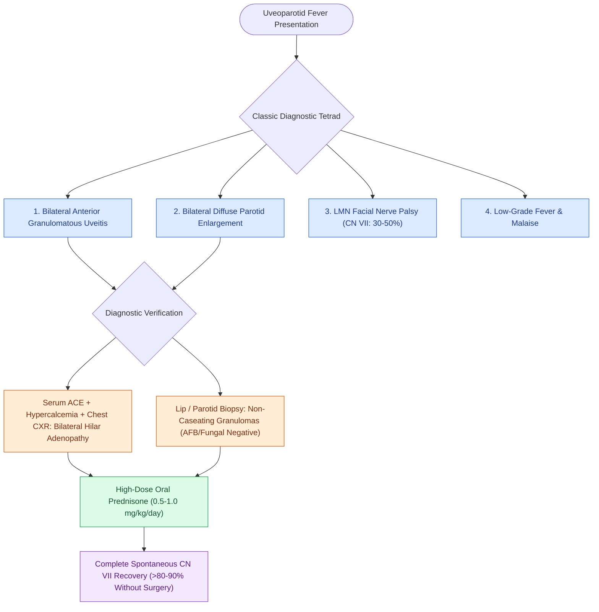

# Heerfordt syndrome uveoparotid fever manifests as a distinct acute presentation of systemic sarcoidosis

## Active Recall

> [!question]- What is the classic diagnostic tetrad of Heerfordt syndrome (uveoparotid fever)?
> *Answer / Clinical Rationale*: Heerfordt syndrome is a distinct, acute presentation of **systemic sarcoidosis** defined by the tetrad of: 1. **Uveitis** (typically bilateral anterior granulomatous uveitis with mutton-fat keratic precipitates, or panuveitis), 2. **Bilateral parotid gland enlargement** (firm, non-tender or mildly tender, diffuse parotitis), 3. **Cranial nerve palsy** (predominantly **unilateral or bilateral lower motor neuron facial nerve palsy [CN VII]**, seen in $30\text{–}50\%$ of cases), 4. **Low-grade fever** $\pm$ night sweats and malaise.

> [!question]- What diagnostic laboratory markers, imaging modalities, and biopsy sites establish the diagnosis of sarcoidosis in Heerfordt syndrome?
> *Answer / Clinical Rationale*: - *Laboratory*: Elevated serum **Angiotensin-Converting Enzyme (ACE)** level, hypercalcemia, and hypercalciuria (due to 1-alpha-hydroxylase production of active vitamin D by epithelioid macrophages). - *Imaging*: Chest radiograph or high-resolution CT demonstrating **bilateral hilar lymphadenopathy (BHL)** and pulmonary reticulonodular infiltrates. - *Biopsy*: Core needle or fine-needle aspiration/minor salivary gland labial biopsy revealing pathognomonic **non-caseating granulomas with negative fungal/AFB stains**.

> [!question]- What is the first-line medical therapy, and what is the typical prognosis for the facial nerve paralysis?
> *Answer / Clinical Rationale*: **Systemic corticosteroids (oral Prednisone $0.5\text{–}1.0\text{ mg/kg/day}$ tapered over 4–8 weeks)** represent the first-line therapy, prompting rapid resolution of uveitis, parotid swelling, and fever. The prognosis for facial nerve paralysis is generally excellent, with $>80\text{–}90\%$ of patients achieving full or near-full spontaneous recovery without requiring surgical nerve decompression.

## Core Clinical & Mechanistic Principles
Heerfordt syndrome (Heerfordt-Waldenström syndrome / uveoparotid fever) occurs in approximately $5\%$ of patients with systemic sarcoidosis, exhibiting a predilection for women in their third to fourth decades:

### Parotid & Neurological Management Nuances
- **Facial Nerve Infiltration vs Compression**:
  - Facial nerve paralysis in Heerfordt syndrome is caused by perineural granulomatous infiltration or direct inflammatory compression within the parotid gland and temporal bone.
  - Unlike traumatic or bacterial mastoiditis palsies, surgical exploration and decompression are **contraindicated**; medical immunosuppression with steroids provides high recovery rates.
- **Xerostomia & Ocular Protection**:
  - Parotid granulomatous replacement reduces salivary output; artificial saliva and aggressive corneal lubrication (ointment, moisture chambers) are required during active facial palsy (see [[Melkersson-Rosenthal syndrome is characterized by the classic triad of recurrent facial palsy, plicated tongue, and orofacial edema|Melkersson-Rosenthal vs Sarcoidosis]]).

## Connected Concepts & Graph Traversal
- **Granulomatous Cheilitis Differential**: [[Melkersson-Rosenthal syndrome is characterized by the classic triad of recurrent facial palsy, plicated tongue, and orofacial edema|Melkersson-Rosenthal vs Sarcoidosis]]
- **Sinonasal Sarcoidosis**: [[Granulomatosis with polyangiitis presents with necrotizing sinonasal granulomas and saddle nose|Sinonasal Granulomatous Disease Differential]]
- **Parotid Surgical Anatomy**: [[The facial nerve main trunk is localized using the tragal pointer, tympanomastoid suture, and digastric ridge|Parotid & Facial Nerve Topography]]
- **Bell's Palsy Differential**: [[Acute Bell's palsy presents with unilateral lower motor neuron facial paralysis treated with early oral steroids|Idiopathic vs Sarcoid Facial Palsy]]
- **Salivary Gland Neoplasms**: [[Adenoid cystic carcinoma exhibits prominent perineural invasion and late distant hematogenous metastasis|Salivary Gland Pathology Overview]]
