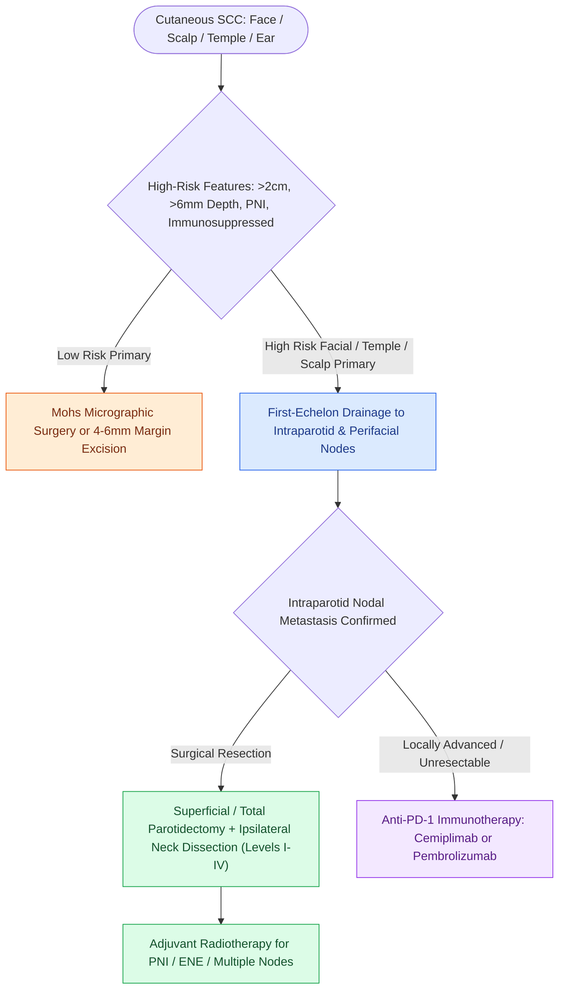

# High-risk cutaneous squamous cell carcinoma drains first to parotid and perifacial nodal basins

## Active Recall

> [!question]- Why does a 'new parotid tumor' history-taking always include a skin exam and cancer history?
> *Answer / Clinical Rationale*: Because the parotid is the sentinel basin for lateral face/scalp cSCC and melanoma — the gland's most common malignancy in high-UV populations is metastasis, not primary salivary cancer.

> [!question]- Which patient factor most transforms cSCC behavior and follow-up intensity?
> *Answer / Clinical Rationale*: Immunosuppression — transplant recipients develop numerous, aggressive, metastasis-prone tumors requiring intensified surveillance and immunosuppression modulation.

## Core Clinical & Mechanistic Principles
- High-risk features: diameter over 2 cm, **depth beyond subcutaneous fat or over 6 mm**, poor differentiation, **perineural invasion of named or large-caliber nerves**, ear/lip/temple location, recurrence, and — the great multiplier — **immunosuppression** (transplant recipients).
- Drainage doctrine: temple, forehead, anterior scalp, ear, and lateral face drain **first to intraparotid and perifacial nodes** — a new parotid mass with a skin cancer history is metastasis until proven otherwise, and 'parotidectomy as lymphadenectomy' plus neck dissection is the operation.
- Perineural disease announces itself as formication, numbness, or progressive VII/V deficits; MRI neurography traces named-nerve spread toward skull base foramina.
- Systemic era: **cemiplimab/[[Cetuximab targets EGFR overexpression while pembrolizumab and nivolumab inhibit PD-1 in head and neck SCC|pembrolizumab]]** for advanced disease reshaped unresectable and transplant-adjacent decision-making (with rejection-risk negotiation in the immunosuppressed).

### Management & Critical Safety Checks
- Primary management: excision with margin control (Mohs for high-risk facial sites); radiation adjuvant for perineural, multiply node-positive, or extranodal disease.
- Surveillance is skin-plus-basin examination at short intervals; educate transplant patients that their cSCC is a different, more dangerous disease.

## Connected Concepts & Graph Traversal
- **Cutaneous Melanoma Parallel**: [[Cutaneous head and neck melanoma is staged by Breslow depth and sentinel lymph node biopsy|Melanoma Staging & Sentinel Nodes]]
- **Parotid Lymphadenectomy**: [[Pleomorphic adenoma requires superficial parotidectomy with a cuff of normal tissue to prevent pseudopod recurrence|Superficial Parotidectomy Craft]]
- **Perineural Neurotropism**: [[Adenoid cystic carcinoma exhibits prominent perineural invasion and late distant hematogenous metastasis|Adenoid Cystic Perineural Invasion]]
- **Cervical Nodal Drainage**: [[Cervical lymph node levels I through VII define regional metastatic drainage basins|Cervical Lymph Node Basin Mapping]]
- **Immune Checkpoint Blockade**: [[Cetuximab targets EGFR overexpression while pembrolizumab and nivolumab inhibit PD-1 in head and neck SCC|Anti-PD-1 Cemiplimab and Pembrolizumab]]
