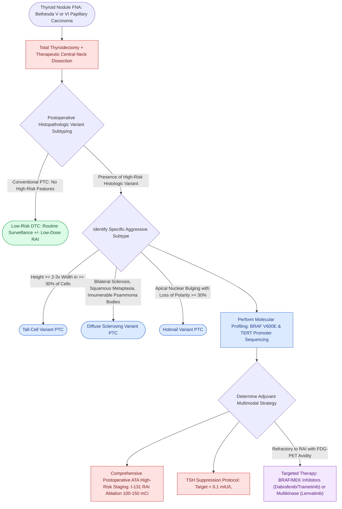

# High-risk papillary thyroid carcinoma histologic variants portend aggressive extrathyroidal invasion, radioiodine refractoriness, and adverse prognosis

## Active Recall

> [!question]- What histopathologic diagnostic threshold defines the tall-cell variant of papillary thyroid carcinoma (TCV-PTC), and what molecular mutation occurs in >80% of cases?
> *Answer / Clinical Rationale*: TCV-PTC is defined by the presence of **$\ge 30\text{–}50\%$ tall cells** whose height is at least **2 to 3 times their width**, exhibiting dense, oncocytoid eosinophilic cytoplasm and basally oriented nuclei with classic PTC features. Genetically, $>80\%$ harbor the **BRAF V600E** point mutation, frequently accompanied by co-existing **TERT promoter mutations** (C228T/C250T). This synergistic molecular signature correlates with marked clinical aggression, extensive gross extrathyroidal extension (ETE), high rates of nodal recurrence, and resistance to radioactive iodine (RAI).

> [!question]- What are the distinctive histopathologic hallmarks, imaging signs, and patient demographics of the diffuse sclerosing variant of PTC (DSV-PTC)?
> *Answer / Clinical Rationale*: DSV-PTC typically affects **children and young women (second to third decades)**. Rather than a solitary distinct nodule, it presents as painless, diffuse bilateral thyroid enlargement with widespread microcalcifications producing a classic **"snowstorm" appearance on neck ultrasound**. Histologically, it displays: (1) diffuse pan-thyroid infiltration; (2) extensive dense stromal **fibrosis and sclerosis**; (3) florid **squamous metaplasia**; (4) marked lymphocytic thyroiditis; and (5) **countless psammoma bodies** permeating thyroid parenchyma and lymphatic channels. Central and lateral cervical nodal metastases occur in $>80\%$ of patients.

> [!question]- Why do aggressive histologic variants of PTC (tall-cell, columnar, hobnail) frequently display refractoriness to radioactive iodine (RAI) therapy?
> *Answer / Clinical Rationale*: Hyperactivation of the **MAPK (mitogen-activated protein kinase) signaling cascade** driven by BRAF V600E mutations results in profound transcriptional repression of thyroid-specific differentiation genes, most notably the **sodium-iodide symporter (NIS, SLC5A5)** and **thyroid peroxidase (TPO)**. Loss of functional NIS at the basolateral follicular membrane prevents therapeutic intracellular trapping of iodine-131 ($^{131}\text{I}$), rendering the tumor radioiodine-refractory (RAI-R) and necessitating complete initial surgical resection and consideration of redifferentiation or multikinase inhibitor therapy.

## Core Clinical & Mechanistic Principles

While conventional papillary thyroid carcinoma (PTC) is an indolent differentiated malignancy with >98% 10-year overall survival, specific histologic variants exhibit aggressive biological behavior rivaling poorly differentiated thyroid carcinoma *(Cummings p.241–246)*. Recognizing these high-risk subtypes on preoperative biopsy or final surgical pathology fundamentally alters surgical extent, nodal dissection boundaries, and postoperative surveillance *(Cummings p.242–245)*.

### World Health Organization (WHO) High-Risk PTC Variants

#### 1. Tall-Cell Variant (TCV)
- **Diagnostic Criteria**: $\ge 30\text{–}50\%$ of neoplastic cells exhibit height-to-width ratio $\ge 2\text{–}3:1$. Cells feature intense, dense eosinophilic cytoplasm with basally displaced nuclei showing prominent pseudoinclusions and longitudinal grooves ("tramp steamer" appearance).
- **Clinical Behavior**: Accounts for 5–10% of PTCs, predominantly in older adults ($\ge 50$ years). Demonstrates high rates of gross extrathyroidal extension (ETE) into the recurrent laryngeal nerve, trachea, and strap muscles, lymphovascular invasion, and 3-fold higher disease-specific mortality compared to conventional PTC.
- **Molecular Profile**: Highest rate of **BRAF V600E (>80%)** and frequent **TERT promoter mutations**; strong association with radioiodine refractoriness.

#### 2. Diffuse Sclerosing Variant (DSV)
- **Diagnostic Criteria**: Diffuse, bilateral infiltration of both thyroid lobes without a discrete encapsulated nodule. Florid squamous metaplasia, marked interfollicular sclerosis, dense lymphocytic infiltrates with germinal centers, and innumerable psammoma bodies ("sea of calcifications").
- **Clinical Behavior**: Presents in adolescents and young women (15–30 years), frequently masquerading clinically and radiographically as Hashimoto thyroiditis. Regional lymph node metastases are present at diagnosis in 80–90% of cases; distant pulmonary metastases occur in 10–15%.
- **Molecular Profile**: Frequently driven by **RET/PTC rearrangements** (RET/PTC1, RET/PTC3) rather than BRAF point mutations.

#### 3. Hobnail Variant
- **Diagnostic Criteria**: $\ge 30\%$ of tumor cells exhibit loss of cellular polarity with **apical nuclear bulging** into gland lumens, giving a "hobnail" or matchstick appearance. Displays marked cytologic atypia, high nuclear-to-cytoplasmic ratio, and frequent mitoses.
- **Clinical Behavior**: Extreme clinical aggression with $>50\%$ mortality, widespread early distant metastases (bone, lung, brain), and early loss of radioiodine avidity.
- **Molecular Profile**: High frequency of **BRAF V600E (80%)**, **TP53 mutations**, and *TERT* promoter mutations.

#### 4. Columnar Cell Variant (CCV)
- **Diagnostic Criteria**: Tall, slender columnar cells with prominent nuclear pseudostratification and hyperchromasia, closely mimicking colonic adenocarcinoma or endometrial carcinoma. Often exhibits supranuclear and subnuclear cytoplasmic clearing.
- **Clinical Behavior**: Unencapsulated forms are relentlessly aggressive with rapid visceral and skeletal dissemination. Encapsulated forms behave indolently.

### Comparative Clinicopathologic Matrix of Aggressive PTC Variants

| Variant | Diagnostic Microscopic Features | Demographics | Primary Molecular Driver | Distant Metastasis Rate | 10-Year Mortality |
| :--- | :--- | :--- | :--- | :--- | :--- |
| **Conventional PTC** | Papillae, Orphan Annie nuclei, nuclear grooves, psammoma bodies | All ages; F > M | BRAF (50-60%), RET/PTC | 3-5% | <2% |
| **Tall-Cell Variant** | Height $\ge 2-3\times$ width, dense pink cytoplasm, tramp-steamer nuclei | Older adults ($\ge 50$ yr) | **BRAF V600E (>80%) + TERT** | 15-20% | 10-15% |
| **Diffuse Sclerosing** | Bilateral sclerosis, squamous nests, massive psammoma bodies | Children & young females | **RET/PTC rearrangements** | 10-15% | 5-10% |
| **Hobnail Variant** | Apical nuclear bulging, loss of polarity, dyscohesive micropapillae | Elderly; equal gender | **BRAF V600E + TP53** | 30-40% | 30-50% |
| **Columnar Cell** | Pseudostratified tall columnar cells, colonic adenocarcinoma mimic | Middle-aged to elderly | BRAF V600E or TERT | 25-35% | 20-30% |

### Surgical & Endocrine Management Implications

1. **Surgical Aggressiveness**: Because high-risk variants harbor high rates of occult central and lateral cervical nodal metastasis, conservative active surveillance or hemithyroidectomy is contraindicated. While low-risk lesions are managed per guidelines with conservative options, high-risk aggressive variants require definitive resection as outlined in the [[The 2025 ATA guidelines establish active surveillance criteria and lobectomy preference for low-risk differentiated thyroid cancer|2025 ATA guidelines]], mandating upfront total thyroidectomy with bilateral central compartment (Level VI) neck dissection and comprehensive lateral compartment clearance (Levels II–IV) if clinically or radiographically involved.
2. **Radioactive Iodine (RAI) Refractoriness**: Aggressive variants exhibit progressive dedifferentiation with loss of sodium-iodide symporter (NIS) function. When distant metastases fail to concentrate $^{131}\text{I}$ while demonstrating high fluorodeoxyglucose ($^{18}\text{F}$-FDG) uptake on PET/CT, patients are classified as RAI-refractory. First-line systemic management relies on multikinase inhibitors (lenvatinib, sorafenib) or mutation-directed therapy with BRAF/MEK inhibitors (dabrafenib plus trametinib).

## Connected Concepts & Graph Traversal
- **Molecular Driver Synergy**: [[BRAF V600E and TERT promoter mutations drive aggressive papillary thyroid carcinoma behavior|BRAF and TERT Synergistic Oncogenesis]]
- **Cervical Nodal Metastatic Pathways**: [[Papillary thyroid carcinoma spreads via cervical lymphatics to central and lateral neck compartments|PTC Lymphatic Dissemination]]
- **Lethal Undifferentiated Transformation**: [[Anaplastic thyroid carcinoma is an airway and molecular emergency requiring immediate BRAF testing|Anaplastic Thyroid Transformation]]
- **Preoperative Cytopathology Staging**: [[The Bethesda system for reporting thyroid cytopathology stratifies malignancy risk and guides surgical decision-making|Bethesda Cytopathology Staging]]
- **Prognostic Risk Stratification**: [[Differentiated thyroid carcinoma prognostic scoring systems AMES, AGES, and MACIS stratify low and high risk disease to guide the extent of thyroidectomy|AMES, AGES, and MACIS Risk Scoring]]
- **Capsular & Vascular Invasion Paradigm**: [[Follicular thyroid carcinoma is distinguished from follicular adenoma by capsular and vascular invasion|Follicular Thyroid Carcinoma]]
