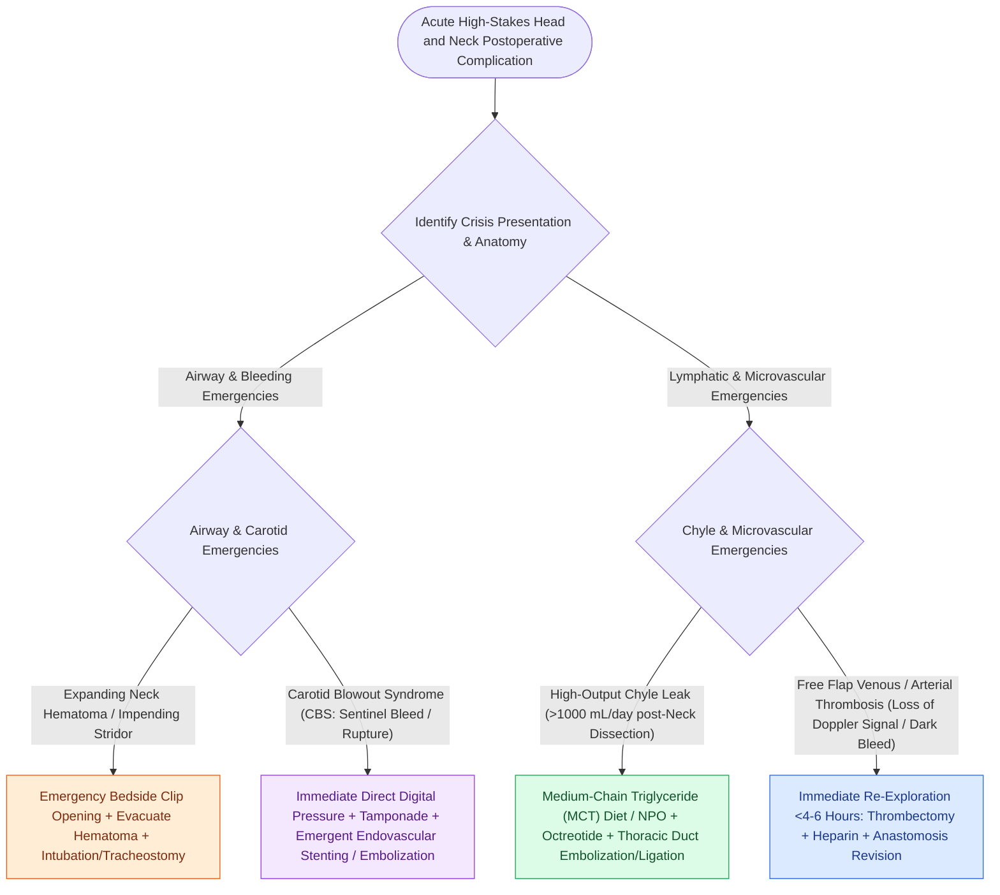

# High-stakes head and neck surgical oncology complications require rapid structured emergency rescue

## Active Recall

> [!question]- What is the immediate bedside management for an expanding neck hematoma causing stridor?
> *Answer / Clinical Rationale*: **Immediately open all skin and platysmal sutures at the bedside** and evacuate the hematoma manually.

> [!question]- What are the four highest-stakes postoperative surgical emergencies in head and neck oncology?
> *Answer / Clinical Rationale*: **Acute lost airway**, **expanding cervical hematoma**, **acute carotid blowout**, and **acute microvascular free flap thrombosis**.

## Core Clinical & Mechanistic Principles
Head and neck oncologic surgery encompasses some of the highest-stakes surgical emergencies in medicine. Mastery requires rapid, algorithmic execution:
- **The Four Critical Head & Neck Emergencies**:
  1. **Acute Upper Airway Obstruction / Lost Airway**:
     - *Action*: Cannot Intubate, Cannot Oxygenate (CICO) protocol $\r\r\rightarrow$ Immediate **cricothyroidotomy** or **emergency tracheostomy**.
  2. **Expanding Postoperative Cervical Hematoma**:
     - *Action*: **Immediate bedside incision opening** and manual clot evacuation before attempting intubation.
  3. **Acute Carotid Blowout Syndrome (CBS)**:
     - *Action*: Endotracheal tube cuff hyperinflation $\r\r\rightarrow$ Direct digital compression against transverse processes $\r\r\rightarrow$ Massive transfusion protocol $\r\r\rightarrow$ Immediate transfer to endovascular suite for covered stent / coil embolization.
  4. **Acute Free Flap Vascular Crisis**:
     - *Action*: Urgent bedside suture release $\r\r\rightarrow$ Immediate re-exploration in the OR within $<2$ hours $\r\r\rightarrow$ Thrombectomy + tPA flush + anastomotic revision.

### Surgical Technique & Critical Safety Checks
- **Crisis Resource Management (CRM)**: Clear closed-loop communication, early mobilization of operative teams, and predetermined emergency bedside kits (scalpel, suture removal, packing, cricothyroidotomy set) at every patient's bedside (see [[Postoperative neck hematoma after thyroidectomy or neck dissection requires emergent bedside wound opening for airway decompression|Postoperative Neck Hematoma Rescue]]).

## Connected Concepts & Graph Traversal
- **Expanding Cervical Hematoma**: [[Postoperative neck hematoma after thyroidectomy or neck dissection requires emergent bedside wound opening for airway decompression|Postoperative Neck Hematoma Rescue]]
- **Carotid Blowout Protocol**: [[Carotid blowout syndrome management includes throat packing, endovascular embolization, and carotid stenting|Carotid Blowout Management Protocol]]
- **Free Flap Pedicle Salvage**: [[Postoperative free flap compromise within forty-eight hours requires emergent surgical re-exploration for pedicle salvage|Free Flap Salvage Timeline]]
- **Emergency Airway Management**: [[Standard open tracheotomy utilizes horizontal intersinusoidal or Bjork flap entry|Emergency Surgical Airway]]
- **Pharyngocutaneous Fistula**: [[Pharyngocutaneous fistula is managed with wound care, nutritional support, and surgical flap closure|Pharyngocutaneous Fistula Management]]
