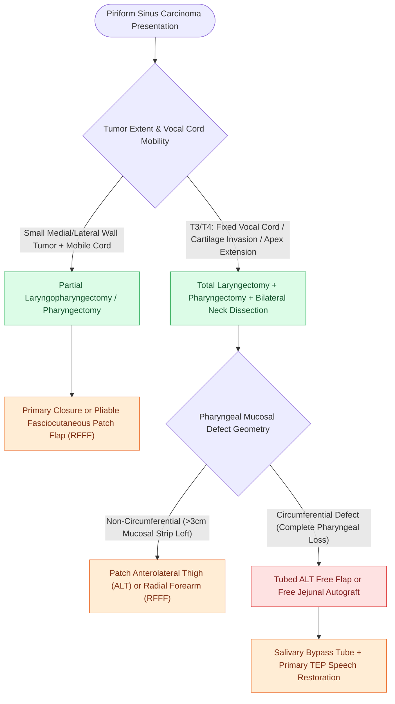

# Hypopharyngeal piriform sinus carcinoma requires partial or total laryngopharyngectomy

## Active Recall

> [!question]- Why do piriform sinus carcinomas typically present at an advanced stage?
> *Answer / Clinical Rationale*: The piriform sinus is a clinically silent, distensible reservoir with minimal early symptoms, allowing extensive submucosal and nodal spread before diagnosis.

> [!question]- What anatomical space does a medial piriform sinus tumor invade to cause true vocal cord fixation?
> *Answer / Clinical Rationale*: The **paraglottic space**.

## Core Clinical & Mechanistic Principles
Carcinomas of the **piriform sinus** represent $>70\%$ of all hypopharyngeal malignancies and are notoriously insidious, presenting with advanced Stage III/IV disease in $>75\%$ of cases:
- **Anatomical Subsites of Piriform Sinus**:
  - Medial wall (abuts aryepiglottic fold and paraglottic space).
  - Lateral wall (abuts thyroid cartilage lamina).
  - Apex (inferior angle extending toward cricopharyngeus).
- **Patterns of Infiltration**:
  - Direct invasion into the **paraglottic space** (causing vocal cord fixation), thyroid cartilage, and cricoid cartilage.
  - Early submucosal extension into the cervical esophagus.
  - High rate of **occult bilateral cervical nodal metastases** (Levels II, III, IV, and retropharyngeal nodes in $>60\%$).
- **Surgical Resection**:
  - *Partial Laryngopharyngectomy*: Reserved for rare localized medial/lateral wall tumors with normal vocal cord mobility.
  - *Total Laryngopharyngectomy*: Standard for T3/T4 tumors, resecting the entire larynx and involved pharyngeal walls, combined with bilateral neck dissections.

### Surgical Technique & Critical Safety Checks
- **Reconstruction**: Patch ALT or [[The radial forearm free flap provides thin, pliable fasciocutaneous tissue for oral and pharyngeal defects|RFFF]] flap for non-circumferential defects; tubed ALT or jejunal graft for circumferential defects.

## Connected Concepts & Graph Traversal
- **Circumferential Reconstruction**: [[Circumferential laryngopharyngectomy requires tubed microvascular or visceral flap reconstruction|Circumferential Defect Reconstruction]]
- **Total Laryngectomy Craft**: [[Total laryngectomy achieves en bloc laryngeal resection with permanent end-stoma|Total Laryngectomy Standards]]
- **Anterolateral Thigh Donor**: [[The anterolateral thigh free flap provides versatile soft tissue volume based on the LCFA|ALT Flap Volume]]
- **Thin Fasciocutaneous Donor**: [[The radial forearm free flap provides thin, pliable fasciocutaneous tissue for oral and pharyngeal defects|Radial Forearm Free Flap]]
- **Fistula Prevention**: [[Pectoralis major muscle flap reinforcement prevents pharyngocutaneous fistula in salvage laryngectomy|Pectoralis Muscle Reinforcement]]
- **Alaryngeal Speech**: [[Tracheoesophageal puncture TEP and voice prosthesis restore pulmonary-driven alaryngeal speech|TEP Voice Restoration]]
