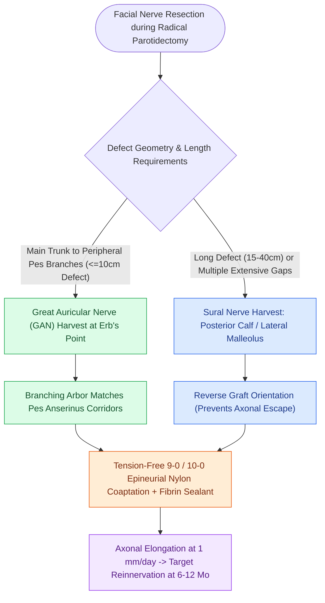

# Immediate facial nerve grafting with the great auricular or sural nerve restores facial reanimation

## Active Recall

> [!question]- What donor nerve is most commonly harvested for immediate facial nerve cable grafting in parotid surgery?
> *Answer / Clinical Rationale*: The **Great Auricular Nerve (GAN)**, due to its proximity in the same operative field and branching pattern.

> [!question]- What rate of axonal regeneration governs the recovery timeline following a cable nerve graft?
> *Answer / Clinical Rationale*: Approximately **$1.0\text{ mm per day}$** (resulting in clinical recovery at 6–12 months).

## Core Clinical & Mechanistic Principles
When the facial nerve or its branches are sacrificed during [[Total parotidectomy with facial nerve sacrifice is indicated for direct malignant nerve invasion|radical parotidectomy]], **immediate cable nerve grafting** provides the best opportunity for dynamic facial reanimation:
- **Donor Nerve Options**:
  1. **Great Auricular Nerve (GAN)**:
     - *Advantages*: Located in the same operative field (crosses mid-SCM at Erb's point); provides $5\text{–}10\text{ cm}$ of nerve length; natural branching pattern matching the pes anserinus.
  2. **Sural Nerve**:
     - *Advantages*: Provides up to $30\text{–}40\text{ cm}$ of non-branching cable graft; excellent diameter match for main trunk.
- **Microsurgical Coaptation Technique**:
  - Epineurial repair using **9-0 or 10-0 monofilament nylon sutures** or fibrin glue.
  - Tension-free coaptation with clean fascicular alignment (cut with fresh razor blade).
  - Reverse sural graft orientation (distal donor stump to proximal facial stump) to prevent axonal escape through branching points.

### Surgical Technique & Critical Safety Checks
- **Timeline of Recovery**: Axons regenerate across the graft at **$1.0\text{ mm/day}$**; clinical tone and voluntary motion return within **6 to 12 months** (typically achieving House-Brackmann Grade III recovery).

## Connected Concepts & Graph Traversal
- **Radical Parotid Resection**: [[Total parotidectomy with facial nerve sacrifice is indicated for direct malignant nerve invasion|Total Parotidectomy with Sacrifice]]
- **Parotid Facial Nerve Topography**: [[The facial nerve main trunk is localized using the tragal pointer, tympanomastoid suture, and digastric ridge|CN VII Surgical Landmarks]]
- **Erb's Point & Great Auricular Anatomy**: [[The spinal accessory nerve is identified at the Erb point and anterior border of the SCM|Erb's Point Topography]]
- **Masseteric Nerve Transfer**: [[The masseteric nerve provides a dense motor donor for single-stage facial reanimation|Masseteric Nerve Motor Donor]]
- **Adenoid Cystic Perineural Invasion**: [[Adenoid cystic carcinoma exhibits prominent perineural invasion and late distant hematogenous metastasis|Adenoid Cystic Carcinoma & CN VII]]
- **Facial Electroneuronography**: [[Electroneuronography showing greater than ninety percent degeneration within fourteen days indicates severe facial nerve axonal injury|ENoG & Axonal Degeneration]]
