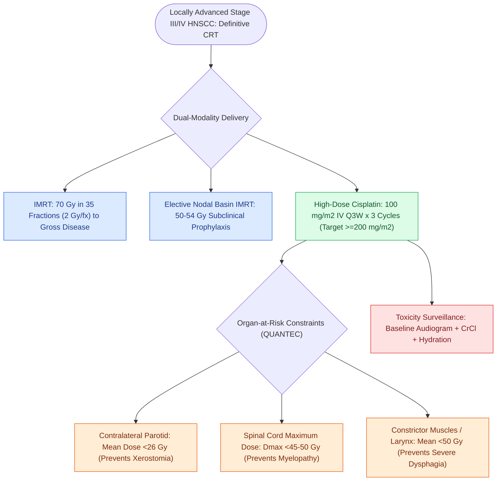

# Intensity-modulated radiation therapy and cisplatin radiosensitization form the standard definitive chemoradiation regimen

## Active Recall

> [!question]- What is the minimum cumulative dose of cisplatin required for optimal locoregional control?
> *Answer / Clinical Rationale*: A cumulative dose of **$\ge 200\text{ mg/m}^2$**.

> [!question]- What is the threshold mean radiation dose above which irreversible parotid salivary dysfunction occurs?
> *Answer / Clinical Rationale*: A mean dose exceeding **$26\text{ Gy}$**.

## Core Clinical & Mechanistic Principles
Concurrent chemoradiation for locally advanced (Stage III/IV) head and neck SCC:
- **Radiation Delivery**: **Intensity-Modulated Radiation Therapy (IMRT)** delivers high conformal doses while sparing critical organs at risk.
  - *Dosing*: **70 Gy in 35 daily fractions (2 Gy/day)** over 7 weeks to gross disease, and **50–54 Gy** to elective nodal basins.
- **Cisplatin Radiosensitization**:
  - Platinum-DNA adducts inhibit DNA repair and synchronize cells in G2/M phase.
  - *Standard Regimen*: High-dose intravenous **Cisplatin $100\text{ mg/m}^2$ Q3W for 3 cycles** (cumulative target $\ge 200\text{–}300\text{ mg/m}^2$).
  - *Weekly Regimen*: Cisplatin $40\text{ mg/m}^2$ weekly.

### Surgical Technique & Critical Safety Checks
- **Parotid Sparing Metric**: Mean dose to at least one parotid gland must be $<26\text{ Gy}$ to preserve salivary function.
- **Platinum Agent Selection & Ototoxic Micromechanics**:
  - *Cisplatin*: Highly nephrotoxic, emetogenic, and ototoxic; specifically produces reactive oxygen species causing apoptosis of outer hair cells (OHCs) in the basal turn of the organ of Corti and [[The stria vascularis generates the endocochlear potential of positive eighty millivolts|stria vascularis]], resulting in irreversible high-frequency sensorineural hearing loss and tinnitus.
  - *Carboplatin Substitution*: In patients with pre-existing renal impairment, peripheral neuropathy, or poor performance status who cannot tolerate high-dose cisplatin, carboplatin (AUC 5–6) is substituted. Mechanistically and contrastingly, **carboplatin ototoxicity preferentially injures inner hair cells (IHCs)** rather than outer hair cells, resulting in distinct electrophysiological and speech discrimination deficits.
  - *Monitoring Mandate*: Requires baseline comprehensive audiometry with extended high frequencies, serum creatinine/CrCl monitoring with pre/post-infusion volume hydration, and serial neuropathy assessments (see [[Post-radiation carotid vasculopathy and osteoradionecrosis represent severe late radiotherapy sequelae|Late Radiation Sequelae & ORN]]).

## Connected Concepts & Graph Traversal
- **Late Radiotherapy Toxicity**: [[Post-radiation carotid vasculopathy and osteoradionecrosis represent severe late radiotherapy sequelae|Late Radiation Sequelae & ORN]]
- **Targeted & Checkpoint Blockade**: [[Cetuximab targets EGFR overexpression while pembrolizumab and nivolumab inhibit PD-1 in head and neck SCC|Anti-EGFR & PD-1 Blockade]]
- **Adjuvant Chemoradiation Indication**: [[Extranodal extension in cervical lymph nodes upstages nodal disease and dictates adjuvant chemoradiotherapy|Extranodal Extension & Positive Margins]]
- **HPV De-escalation Paradigm**: [[The ECOG-3311 and ORATOR trials establish pathological risk-stratified de-escalation and functional trade-offs in HPV-positive OPSCC|ECOG-3311 & ORATOR De-escalation]]
- **Nasopharyngeal Chemoradiation**: [[Nasopharyngeal carcinoma is an EBV-driven malignancy treated primarily with radiation and concurrent chemotherapy|NPC Definitive Chemoradiation]]
- **Perioperative Immunotherapy**: [[KEYNOTE-689 establishes neoadjuvant and adjuvant pembrolizumab as standard for locally advanced head and neck squamous cell carcinoma|KEYNOTE-689 Perioperative Regimen]]
- **Radiobiologic Basis**: [[Altered radiation fractionation schemes exploit differential repair and repopulation kinetics to optimize the therapeutic ratio in head and neck cancer|Altered Fractionation Radiobiology]]
