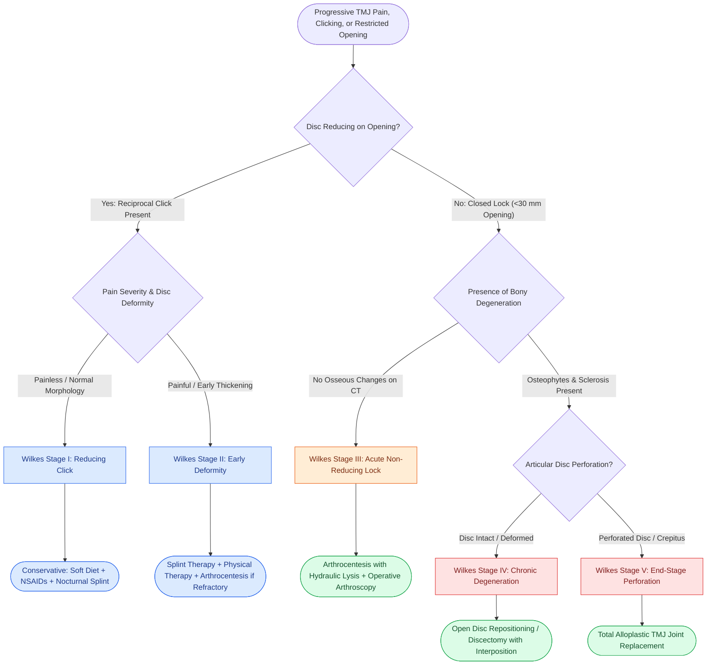

# Internal derangement of the temporomandibular joint is staged by the Wilkes classification from reducing clicking to disc perforation

## Active Recall

> [!question]- What clinical, imaging, and surgical criteria differentiate Wilkes Stages I through V of temporomandibular joint (TMJ) internal derangement?
> *Answer / Clinical Rationale*:
> - **Wilkes Stage I (Early)**: Painless reciprocal clicking, slightly anterior disc displacement with **complete reduction on opening**, normal osseous contours on imaging, anatomically normal disc morphology.
> - **Wilkes Stage II (Early / Intermediate)**: Occasional painful clicking, intermittent headache, anterior disc displacement with reduction, early disc deformation (thickening of posterior band), normal bone.
> - **Wilkes Stage III (Intermediate)**: Frequent pain, joint tenderness, episodic **closed lock** (inability to open mouth widely), restricted translation ($<30\text{ mm}$), non-reducing or incompletely reducing disc, disc thickening, no bony degenerative changes.
> - **Wilkes Stage IV (Intermediate / Late)**: Chronic joint pain, persistent restricted mouth opening, non-reducing anterior disc, degenerative osseous changes (subchondral sclerosis, osteophyte formation, flattening of condylar head), disc intact without perforation.
> - **Wilkes Stage V (Late / End-Stage)**: Variable pain, coarse **crepitus** on motion, marked functional limitation, non-reducing displaced disc, **disc perforation** with rupture of retrodiscal tissues, extensive degenerative joint disease (eburnation, flattening, severe osteophytosis).

> [!question]- What is the anatomical organization of the TMJ articular disc, and what vector of displacement characterizes internal derangement?
> *Answer / Clinical Rationale*: The TMJ is a bicompartmental ginglymoarthroidal joint divided by a fibrocartilaginous, biconcave articular disc into a **superior joint space** (responsible for translation / gliding) and an **inferior joint space** (responsible for hinge / rotation). The disc consists of three zones: an anterior band, a thin avascular and aneural intermediate zone (the physiologic load-bearing articulation between the condyle and articular eminence), and a thick posterior band. Posteriorly, it attaches to the highly vascular, richly innervated **bilaminar retrodiscal pad**. The superior head of the lateral pterygoid muscle inserts anteromedially into the disc capsule. Pathologic attenuation of the posterior discal attachments and hypertonicity of the lateral pterygoid cause the disc to displace **anteromedially**, displacing the posterior band beneath the condylar head and causing pain when loaded.

> [!question]- How does Technetium-99m bone scintigraphy determine surgical management in unilateral condylar hyperplasia?
> *Answer / Clinical Rationale*: Unilateral condylar hyperplasia is characterized by excessive, progressive overgrowth of one condylar head, causing facial asymmetry, chin deviation to the **contralateral side**, and crossbite. **Technetium-99m ($^{99m}\text{Tc}$) MDP SPECT bone scan** measures metabolic osteoblastic activity:
> - **Positive Bone Scan** ($>10\%$ increased uptake relative to contralateral normal condyle): Indicates **active ongoing condylar growth**. Treatment requires a **high (proportional) condylectomy** (excising the top 3–5 mm of the condylar head, including the cartilaginous hyperplastic growth zone) combined with compensatory contralateral mandibular ramus osteotomy and inferior border recontouring.
> - **Negative Bone Scan** (symmetric uptake): Indicates **arrested/completed growth**. Condylar resection is unnecessary; management relies on orthodontic alignment followed by standard orthognathic surgery ([[Pre-plating the intact mandible before osteotomy preserves accurate dental occlusion and contour|pre-plated]] BSSO / Le Fort I) to correct secondary skeletal asymmetries.

## Core Clinical & Mechanistic Principles

Internal derangement of the temporomandibular joint (TMJ) represents a disruption of the coordinated biomechanical relationship between the mandibular condyle, the articular disc, and the glenoid fossa / articular eminence:

### Pathomechanics: From Reciprocal Clicking to Closed Lock
1. **Reciprocal Clicking (Reducing Displacement)**:
   - In the intercuspal closed position, the posterior band of the disc is displaced anterior to the condyle.
   - Upon mouth opening, the condyle translates forward and snaps over the thickened posterior band onto the intermediate zone, producing an **opening click (reduction)**.
   - Upon closing, the condyle slips back off the disc into the glenoid fossa, producing a **closing click (dislocation)**.
2. **Closed Lock (Non-Reducing Displacement)**:
   - When displacement progresses, the disc remains bunched anterior to the condyle during maximum opening.
   - Translation is mechanically blocked, restricting mouth opening to **$<25\text{–}30\text{ mm}$** (normal $>40\text{ mm}$) with the mandible deviating toward the affected joint upon attempted opening.

### Wilkes Classification and Treatment Matrix *(Wilkes 1989; CummingsReview2017, Ch10, p.203–204)*

| Wilkes Stage | Clinical Hallmarks | MRI & Radiographic Features | First-Line Therapeutic Escalation |
| :--- | :--- | :--- | :--- |
| **Stage I** | Painless clicking, no locking, normal range of motion | Normal osseous contours; anterior disc displacement with complete reduction | Reassurance, soft diet, jaw rest, avoid wide yawning |
| **Stage II** | Episodic painful clicking, headache, mild restricted motion | Early disc deformity; anterior displacement with reduction; intact cortical bone | Flat-plane stabilization splint, NSAIDs, muscle relaxants |
| **Stage III** | Pain, joint tenderness, episodic closed lock, restricted translation | Disc thickening / deformity; anterior displacement **without reduction**; bone intact | **Arthrocentesis** (hydraulic distension/lysis of upper joint space) $\pm$ arthroscopy |
| **Stage IV** | Chronic aching pain, persistent restricted opening ($<30\text{ mm}$) | Non-reducing disc; subchondral sclerosis, flattening of condyle, osteophytes; intact disc | Arthroscopic capsular release or open **discplasty (plication)** vs **discectomy** |
| **Stage V** | Variable pain, coarse **crepitus**, severe functional restriction | **Perforated disc**, retrodiscal rupture, bone-on-bone contact, severe eburnation | Discectomy with interpositional graft (auricular cartilage/fat) or **total joint replacement** |

### Minimally Invasive vs Open TMJ Procedures
- **Arthrocentesis**: Dual-needle lavage of the superior joint compartment using 100–200 mL of lactated Ringer's solution under hydraulic pressure. It releases vacuum effect adhesions (hydraulic lysis), flushes out inflammatory cytokines (interleukin-1, TNF-alpha), and allows instillation of sodium hyaluronate or corticosteroids.
- **TMJ Arthroscopy**: Enables direct visualization of the superior joint space, targeted lysis of adhesions, electrocautery capsular release, and biopsy of synovial pathology.
- **Open TMJ Surgery**: Indicated for refractory Wilkes IV/V disease:
  - **Discectomy**: Excision of severely deformed or perforated disc; requires interposition of an autologous graft (temporalis muscle-fascia flap, dermis-fat, or ear conchal cartilage) to prevent heterotopic bone formation, distinct from the extensive resections required for [[Medication-related osteonecrosis of the jaw is staged by the AAOMS system to direct antiresorptive conservative and surgical therapy|medication-related osteonecrosis of the jaw]].
  - **Total Alloplastic Joint Replacement**: CAD/CAM patient-specific fossa and condylar-ramus prostheses (titanium and ultra-high-molecular-weight polyethylene) for end-stage ankylosis, severe autoimmune destruction, or failed autologous reconstructions.

## Connected Concepts & Graph Traversal
- **🔗 Orthognathic Reconstruction (Pediatrics)**: [[Le Fort I osteotomy and bilateral sagittal split osteotomy BSSO achieve rigid skeletal advancement in MMA|BSSO & Maxillomandibular Advancement]]
- **🔗 Trauma & Mandibular Biomechanics (FPRS)**: [[Mandible fractures require anatomical reduction and load-sharing miniplate fixation along Champy lines of ideal osteosynthesis|Mandible Biomechanics & Champy Lines]]
- **Maxillofacial Local Anesthesia**: [[Dental local anesthesia relies on anatomic landmarks to block the inferior alveolar, greater palatine, and superior alveolar nerves|Trigeminal Nerve Blocks]]
- **Masticator Space Pathology**: [[Retromolar trigone carcinoma invades the pterygomandibular raphe and masticator space|Masticator Space Anatomy]]
- **Mandibular Bone Pathology**: [[Craniofacial fibrous dysplasia and cherubism manifest as benign fibro-osseous jaw lesions managed with surgical contouring|Fibro-Osseous Lesions]]
