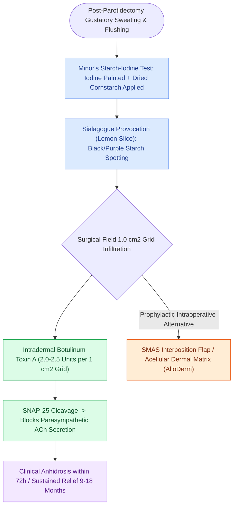

# Intradermal botulinum toxin and topical aluminum chloride treat symptomatic Frey syndrome

## Active Recall

> [!question]- What is the mechanism of action of Botulinum Toxin A in treating Frey's syndrome?
> *Answer / Clinical Rationale*: It cleaves SNAP-25, **inhibiting presynaptic acetylcholine release** at the neuromuscular/neuroglandular junctions of sweat glands.

> [!question]- What intraoperative barrier technique reduces the incidence of postoperative Frey's syndrome during parotidectomy?
> *Answer / Clinical Rationale*: Interposition of an **acellular dermal matrix (AlloDerm)** or **SMAS flap** between the parotid bed and skin flap.

## Core Clinical & Mechanistic Principles
Management of symptomatic Frey's syndrome focuses on blocking cholinergic transmission at the eccrine sweat glands:
- **Intradermal Botulinum Toxin A Injection (Gold Standard)**:
  - *Mechanism*: Cleaves SNAP-25, blocking presynaptic vesicle fusion and acetylcholine release from the misdirected parasympathetic nerve terminals.
  - *Protocol*:
    1. Perform **Minor's starch-iodine test** to map the precise zone of [[Frey syndrome results from aberrant auriculotemporal reinnervation of sweat glands after parotidectomy|gustatory sweating]].
    2. Grid the mapped area into $1.0\text{-cm}^2$ squares.
    3. Inject **$2.0\text{–}2.5\text{ units}$ of Botulinum Toxin A intradermally** per square (total dose typically 25–50 units).
    4. *Efficacy*: Complete cessation of sweating within 48–72 hours, with symptom relief lasting **9 to 18 months** (often with permanent reduction in sweating severity).
- **Topical Aluminum Chloride (20% Drysol)**:
  - Blocks sweat gland ducts; applied nightly as initial non-invasive therapy (can cause local skin irritation).

### Surgical Technique & Critical Safety Checks
- **Surgical Prevention**: Placing an acellular dermal matrix (AlloDerm), fascia lata graft, or thick SMAS flap over the parotid bed during initial [[The facial nerve main trunk is localized using the tragal pointer, tympanomastoid suture, and digastric ridge|parotidectomy]] acts as a barrier to prevent aberrant nerve sprouting.

## Connected Concepts & Graph Traversal
- **Aberrant Regeneration Pathophysiology**: [[Frey syndrome results from aberrant auriculotemporal reinnervation of sweat glands after parotidectomy|Frey Syndrome Pathogenesis]]
- **Parotidectomy Technique**: [[Superficial parotidectomy dissects the facial nerve branches to resect the lateral salivary lobe|Superficial Parotidectomy]]
- **Facial Nerve Landmarks**: [[The facial nerve main trunk is localized using the tragal pointer, tympanomastoid suture, and digastric ridge|Parotid Facial Nerve Corridors]]
- **SMAS Flap Elevation**: [[Deep-plane rhytidectomy mobilizes the skin and SMAS as a composite flap across retaining ligaments|SMAS Barrier Flaps]]
- **Salivary Neoplasms**: [[Warthin tumor presents as a cystic parotid neoplasm associated with smoking and bilateral occurrence|Warthin Tumor & Parotid Surgery]]
- **Benign Parotid Surgery**: [[Pleomorphic adenoma requires superficial parotidectomy with a cuff of normal tissue to prevent pseudopod recurrence|Pleomorphic Adenoma Excision]]
