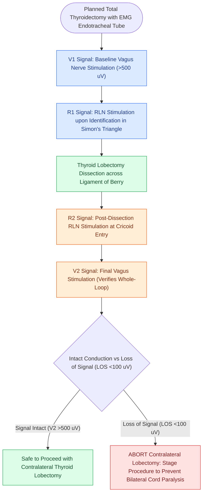

# Intraoperative neuromonitoring of the RLN and EBSLN verifies nerve integrity and aids nerve identification

## Active Recall

> [!question]- What is the four-step sequence (V1, R1, R2, V2) used in standardized intraoperative neuromonitoring of the thyroid?
> *Answer / Clinical Rationale*: **V1** (baseline vagus), **R1** (initial RLN), **R2** (post-dissection RLN), and **V2** (final vagus stimulation).

> [!question]- What action must the surgeon take if complete Loss of Signal (LOS) occurs after resecting the first thyroid lobe during a planned total thyroidectomy?
> *Answer / Clinical Rationale*: **Abort the contralateral lobectomy and perform a staged procedure** after vocal cord mobility is assessed postoperatively.

## Core Clinical & Mechanistic Principles
**Intraoperative Nerve Monitoring (IONM)** utilizes an endotracheal tube with integrated surface electrodes abutting the true vocal cords to assess RLN and EBSLN electrophysiology:
- **Standardized International IONM Four-Step Protocol**:
  1. **V1 Signal**: Stimulate the **vagus nerve** prior to thyroid dissection ($1.0\text{–}2.0\text{ mA}$) to establish baseline amplitude ($>500\ \mu\text{V}$) and latency.
  2. **R1 Signal**: Stimulate the **RLN** upon initial identification in Simon's triangle.
  3. **R2 Signal**: Stimulate the **RLN** at the completion of lobectomy/resection at the cricoid entry point.
  4. **V2 Signal**: Stimulate the **vagus nerve** after total resection to verify intact neural conduction along the entire pathway.
- **Loss of Signal (LOS) Protocol**:
  - Defined as electromyographic amplitude $<100\ \mu\text{V}$ following stimulation at $2.0\text{ mA}$.
  - *Type 1 (Segmental LOS)*: Focal point of injury (traction, thermal, clip); stimulus proximal to injury produces no signal, distal stimulation produces intact EMG.
  - *Type 2 (Global LOS)*: Diffuse loss of conduction throughout entire nerve and vagus.

### Surgical Technique & Critical Safety Checks
- **Staged Thyroidectomy Mandate**: If an unexpected Loss of Signal (LOS) occurs after the first lobe is resected during a planned total thyroidectomy, **terminate the operation and stage the contralateral lobectomy** to avoid bilateral vocal fold paralysis and tracheostomy (see [[The recurrent laryngeal nerve is identified within Simon's triangle and followed through Berry's ligament|RLN Identification in Simon's Triangle]]).

## Connected Concepts & Graph Traversal
- **RLN Surgical Topography**: [[The recurrent laryngeal nerve is identified within Simon's triangle and followed through Berry's ligament|RLN Identification in Simon's Triangle]]
- **EBSLN Cernea Protection**: [[The superior thyroid artery branches are divided flush on the thyroid capsule to protect the EBSLN|EBSLN Anatomy & Capsule Ligation]]
- **Post-Thyroidectomy Hypocalcemia**: [[Post-thyroidectomy hypocalcemia is managed with oral calcium, calcitriol, and intravenous calcium gluconate|Postoperative Hypocalcemia Management]]
- **Postoperative Expanding Hematoma**: [[Postoperative neck hematoma after thyroidectomy or neck dissection requires emergent bedside wound opening for airway decompression|Emergency Hematoma Evacuation]]
- **Central Compartment Lymphadenectomy**: [[Central compartment neck dissection clears level VI nodes between the carotid sheaths and suprasternal notch|Level VI Central Neck Dissection]]
- **TLM Glottic Resection**: [[Transoral laser microsurgery TLM resects early glottic carcinoma with vocal cord preservation|Transoral Laser Glottic Surgery]]
