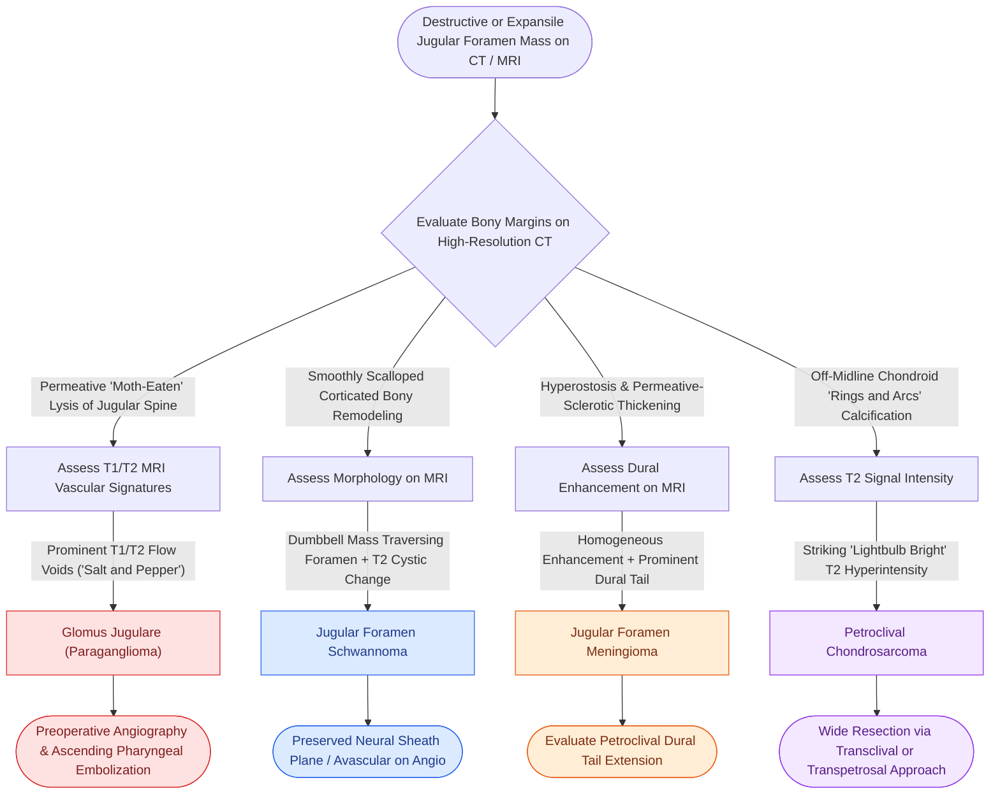

# Jugular foramen masses differentiate into paraganglioma, schwannoma, and meningioma based on bone erosion patterns and MRI signal characteristics

## Active Recall

> [!question]- What are the distinctive bony margin characteristics on high-resolution bone CT that differentiate glomus jugulare, jugular foramen schwannoma, and jugular foramen meningioma?
> *Answer / Clinical Rationale*: (1) **Glomus jugulare (paraganglioma)** demonstrates aggressive, permeative, irregular **"moth-eaten" bone erosion** centered on the caroticojugular spine and jugular spine, with hypotympanic floor dehiscence; (2) **Jugular foramen schwannoma** causes smooth, well-corticated, sharply marginated **scalloping and expansile remodeling** of the bony foramen without permeative destruction; (3) **Jugular foramen meningioma** characteristically produces **hyperostosis and permeative-sclerotic bone changes**, with irregular bony thickening and intratumoral calcifications rather than pure expansion.

> [!question]- How do MRI signal characteristics, specifically on T1, T2, and post-contrast sequences, distinguish a vascular glomus tumor from a schwannoma and a meningioma?
> *Answer / Clinical Rationale*: (1) **Glomus jugulare**: Demonstrates the pathognomonic **"salt-and-pepper" appearance** on T1 and T2 MRI, wherein the "pepper" represents serpiginous low-signal flow voids of high-velocity intratumoral vessels, and the "salt" represents high-signal subacute methemoglobin hemorrhage or slow flow, exhibiting avid, immediate, intense contrast enhancement; (2) **Schwannoma**: Lacks high-velocity flow voids, shows heterogeneous or cystic T2 hyperintensity (reflecting Antoni A and B regions), smooth dumbbell morphology traversing into the high cervical carotid space, and delayed heterogeneous contrast enhancement; (3) **Meningioma**: Exhibits intermediate T1/T2 signal, avid uniform contrast enhancement, and a characteristic **dural tail sign** extending along adjacent petrous dura or clivus.

> [!question]- What is the anatomical epicenter and cross-sectional imaging appearance of petroclival chondrosarcoma relative to the jugular foramen?
> *Answer / Clinical Rationale*: **Petroclival chondrosarcoma** originates off-midline along the **petro-occipital synchondrosis** (between the petrous apex and clivus), located anteromedial to the jugular foramen. On noncontrast CT, it characteristically displays a destructive mass containing matrix **"rings-and-arcs" chondroid calcification**; on MRI, it demonstrates **striking T2 hyperintensity ("lightbulb bright")** due to abundant hyaline cartilaginous matrix with heterogeneous nodular enhancement on post-gadolinium sequences.

## Core Clinical & Mechanistic Principles

The jugular foramen is a complex, canalicular conduit through the posterior skull base connecting the posterior cranial fossa to the suprahyoid carotid space. The foramen is anatomically subdivided by a fibrous or bony septum into two distinct compartments *(Cummings p.256–259, 284)*:
1. **Pars Nervosa** (anteromedial, smaller): Transmits the glossopharyngeal nerve (CN IX), the Jacobson tympanic nerve, and receives venous drainage from the inferior petrosal sinus.
2. **Pars Venosa** (posterolateral, larger): Transmits the internal jugular vein bulb, the vagus nerve (CN X), the spinal accessory nerve (CN XI), the Arnold auricular nerve, and the posterior meningeal branch of the ascending pharyngeal artery.

More than 90% of jugular foramen neoplasms are accounted for by three entities: **paraganglioma (glomus jugulare)**, **schwannoma**, and **meningioma**. Distinguishing these entities preoperatively on cross-sectional imaging is mandatory because their surgical approaches (Fisch infratemporal fossa Type A vs retrosigmoid vs transcervical) and need for preoperative embolization completely diverge:

### Jugular Foramen Radiologic Diagnostic Differential Matrix

| Diagnostic Feature | Glomus Jugulare (Paraganglioma) | Jugular Foramen Schwannoma | Jugular Foramen Meningioma | Petroclival Chondrosarcoma |
| :--- | :--- | :--- | :--- | :--- |
| **Epicenter of Origin** | Jugular bulb adventitia / caroticojugular crest | CN IX, X, or XI sheath within pars nervosa or venosa | Dural lining of jugular tubercle / petrous dura | Petro-occipital synchondrosis (anteromedial to foramen) |
| **Bone Window CT** | **Permeative "moth-eaten" bone destruction**; erosion of caroticojugular spine; dehiscent hypotympanic plate | **Smooth, well-corticated expansile remodeling**; scalloped margins; preserved cortical rim | **Permeative sclerosis and hyperostosis**; irregular canal narrowing; intratumoral calcifications | Destructive lytic lesion with **"rings-and-arcs" stippled chondroid calcification** |
| **T1-Weighted MRI** | Intermediate with punctate hyperintense foci ("salt") | Low-to-intermediate homogeneous signal | Isointense-to-hypointense to gray matter | Hypointense-to-intermediate matrix |
| **T2-Weighted MRI** | Heterogeneous with serpiginous **flow voids** ("pepper") | Heterogeneous **hyperintense** (Antoni B loose myxoid tissue / cysts) | Isointense with gray matter; no prominent flow voids | **Markedly hyperintense ("lightbulb bright")** |
| **Contrast Enhancement** | **Avid, intense, immediate** arterial enhancement | Heterogeneous, delayed enhancement; cystic non-enhancing zones | **Homogeneous, intense** enhancement with **dural tail sign** | Heterogeneous nodular/peripheral "rings and arcs" enhancement |
| **Tumor Morphology** | Irregular, infiltrative transosseous mass invading middle ear | **Smooth dumbbell shape** (intracranial and extracranial lobes) | Broad dural base; plaque-like or en plaque centrifugal extension | Lobulated off-midline mass centered at petro-occipital fissure |
| **Angiography / Embolization** | **Hypervascular**; early draining veins; ascending pharyngeal artery feeder; embolization indicated | Avascular or faint tumor blush; no embolization indicated | Moderate capillary blush; dual ICA/ECA dural vascular supply | Avascular mass; vessel displacement without tumor blush |

### Critical Surgical & Radiologic Pitfalls

1. **The Incomplete Dumbbell Schwannoma Fallacy**:
   - A schwannoma centered in the jugular foramen typically extends along the nerve of origin, dumbbell-shaped with an intracranial CPA component and an extracranial carotid space component.
   - Unlike glomus tumors, which bleed profusely upon biopsy, a schwannoma can be enucleated along its subperineurial plane with preservation of adjacent functional lower cranial nerve fascicles.

2. **The "Salt-and-Pepper" Mimic**:
   - High-velocity flow voids ("pepper") can occasionally be seen in large, hypervascular meningiomas or malignant solitary fibrous tumors/hemangiopericytomas.
   - *Distinction*: Glomus tumors show early filling on dynamic arterial-phase MRA and erosion of the caroticojugular crest, whereas meningiomas produce hyperostosis, dural tails, and derive blood supply predominantly from dural meningeal vessels rather than the glomus adventitial branches.

Comprehensive anatomical and therapeutic integration links these principles directly to [[Carotid body paragangliomas splay the bifurcation and are graded by the Shamblin classification|Paraganglioma Biology & Splaying]].

## Connected Concepts & Graph Traversal
- **Vagal Paraganglioma Differential**: [[Vagal paragangliomas present as lateral neck masses with Fontaine sign and anteromedial carotid displacement without bifurcation splaying|Vagal Paraganglioma]]
- **Carotid Paraganglioma Differential**: [[Carotid body paragangliomas splay the bifurcation and are graded by the Shamblin classification|Carotid Body Paraganglioma]]
- **Post-Styloid Space Localization**: [[Parapharyngeal space fat and styloid process displacement vectors localize deep neck masses and differentiate parotid, neurogenic, and mucosal lesions|Parapharyngeal Space Vectors]]
- **🔗 Otologic Paraganglioma (Otology)**: [[Jugular paragangliomas arise from the glomus body in the adventitia of the jugular bulb|Jugular Paraganglioma (Glomus Jugulare)]]
- **🔗 Lateral Skull Base Approach (Otology)**: [[Fisch infratemporal fossa approach Type A mobilizes the facial nerve and exposes the jugular foramen|Fisch Type A Infratemporal Fossa Exposure]]
- **🔗 Petroclival Endoscopic Corridor (Sinus)**: [[Transclival EEA provides midline access to clival chordomas and chondrosarcomas|Clival and Petroclival Chondrosarcoma]]
