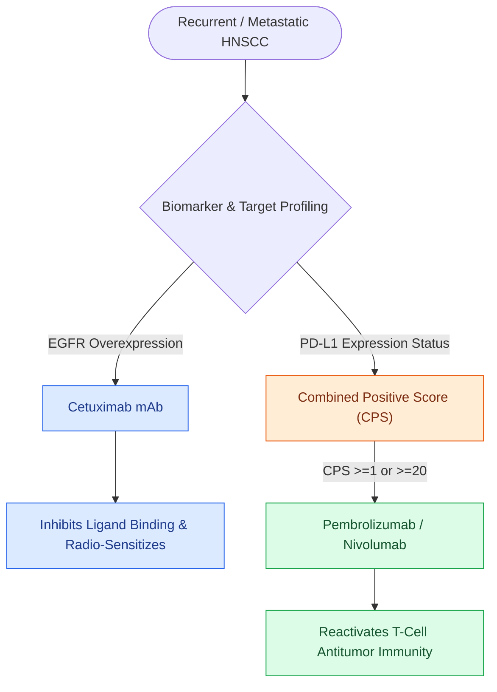

# KEYNOTE-689 establishes neoadjuvant and adjuvant pembrolizumab as standard for locally advanced head and neck squamous cell carcinoma

## Active Recall

> [!question]- Why is administering immunotherapy in the neoadjuvant window biologically superior to adjuvant-only administration in locally advanced HNSCC?
> *Answer / Clinical Rationale*: Having the intact primary tumor and regional lymphatic architecture present provides a **rich source of endogenous tumor neoantigens**, allowing anti-PD-1 therapy to prime and expand a robust, polyclonal systemic $\text{CD8}^+$ T-cell response before surgical removal.

> [!question]- What constitutes a Major Pathological Response (mPR) in resected HNSCC specimens following neoadjuvant checkpoint blockade?
> *Answer / Clinical Rationale*: The presence of **$\le 10\%$ residual viable tumor cells** in both the primary operative bed and resected regional lymph nodes.

> [!question]- Did neoadjuvant pembrolizumab in KEYNOTE-689 increase surgical delays or microvascular reconstructive failure rates?
> *Answer / Clinical Rationale*: No; phase III data confirmed that perioperative pembrolizumab **did not delay planned oncologic surgery** or increase wound breakdown, infection, or free flap anastomotic complications.

## Core Clinical & Mechanistic Principles
The landmark **KEYNOTE-689 Phase III Trial** redefined the management paradigm for locally advanced, surgically resectable **Head and Neck Squamous Cell Carcinoma (HNSCC)** by establishing the survival superiority of perioperative **anti-PD-1 immune checkpoint blockade**:

- **Study Design & Treatment Paradigm**:
  - *Patient Population*: Patients with untreated, surgically resectable Stage III or IVa (AJCC 8th edition) HNSCC of the oral cavity, larynx, hypopharynx, or p16-negative oropharynx.
  - *Intervention Arm*: **Neoadjuvant [[Cetuximab targets EGFR overexpression while pembrolizumab and nivolumab inhibit PD-1 in head and neck SCC|Pembrolizumab]]** (2 cycles of $200\text{ mg}$ IV every 3 weeks) $\rightarrow$ Definitive [[Transoral resection provides oncologic access for early-stage anterior oral cavity neoplasms|Surgical Resection]] + [[Selective neck dissection targets high-risk nodal basins while sparing low-risk cervical levels|Neck Dissection]] $\rightarrow$ Adjuvant **Pembrolizumab** (15 cycles) combined with risk-directed adjuvant radiotherapy or chemoradiotherapy (RT/CRT).
  - *Control Arm*: Upfront definitive surgery $\rightarrow$ standard adjuvant RT/CRT.
- **Key Primary & Pathological Endpoints**:
  - **Event-Free Survival (EFS)**: Perioperative pembrolizumab demonstrated a statistically significant and clinically meaningful reduction in the risk of disease recurrence, progression, or death compared to upfront surgery alone.
  - **Major Pathological Response (mPR)**: Defined as **$\le 10\%$ residual viable tumor cells** in the resected primary tumor and lymph node specimens. Patients achieving mPR or complete pathological response (pCR) demonstrated exceptional long-term regional control and distant metastasis-free survival.
- **Mechanistic Rationale of Neoadjuvant Checkpoint Inhibition**:
  - Administering anti-PD-1 therapy while the primary tumor and intact regional lymph node drainage basins are in situ maximizes **systemic tumor-antigen presentation**.
  - Neoadjuvant blockade expands high-affinity tumor-specific polyfunctional **$\text{CD8}^+$ cytotoxic T-lymphocytes**, which enter the systemic circulation to eradicate microscopic micrometastatic disease prior to surgical wound healing and immunosuppression.
- **Surgical Safety & Operative Window**:
  - Neoadjuvant pembrolizumab did not increase intraoperative surgical complications, wound dehiscence, microvascular flap thrombosis, or delay planned surgical resection (surgery was safely executed within 2–4 weeks of the final neoadjuvant dose).

### Surgical Technique & Critical Safety Checks
- **Pathological Response Grading**: Synoptic surgical pathology reports must quantify the percentage of residual viable tumor versus treatment-induced necrosis, histiocytic reaction, and keratin granulomas to assess mPR and guide post-surgical prognosis.

## Connected Concepts & Graph Traversal
- **Cutaneous Immunotherapy**: [[Neoadjuvant cemiplimab achieves high pathological response rates in resectable locally advanced cutaneous squamous cell carcinoma|Neoadjuvant Cemiplimab in cSCC]]
- **Elective Neck Dissection Evidence**: [[Selective neck dissection targets high-risk nodal basins while sparing low-risk cervical levels|Selective Neck Dissection & D'Cruz Trial]]
- **HPV De-escalation Trials**: [[The ECOG-3311 and ORATOR trials establish pathological risk-stratified de-escalation and functional trade-offs in HPV-positive OPSCC|ECOG-3311 & ORATOR Trials]]
- **Carcinoma of Unknown Primary**: [[HPV-positive carcinoma of unknown primary is localized by palatine tonsillectomy and TORS lingual mucosectomy|Carcinoma of Unknown Primary Workup]]
- **TORS Surgical Clearance**: [[Transoral robotic surgery TORS achieves en bloc resection of tonsillar and base of tongue neoplasms|TORS Oropharyngeal Resection]]
- **Carcinogenesis & P53**: [[Tobacco and alcohol carcinogenesis drives TP53 mutation and field cancerization in upper aerodigestive tract|HNSCC Carcinogenesis & Mutational Burden]]
