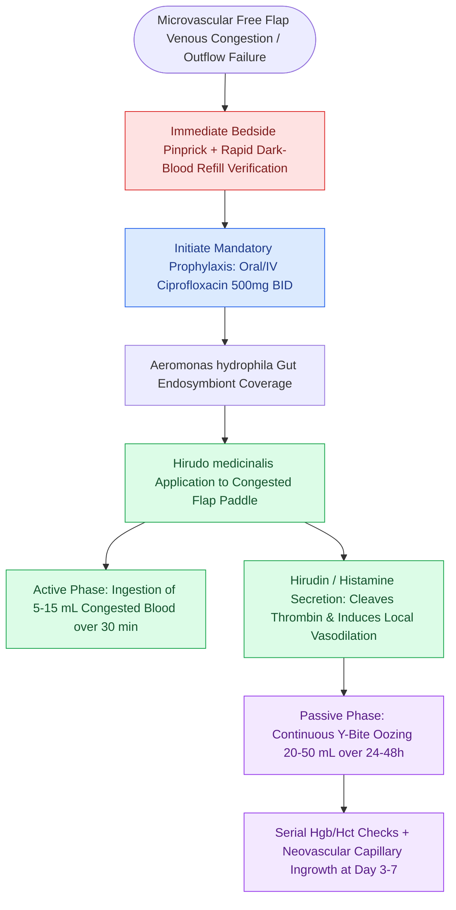

# Leech therapy with Hirudo medicinalis decompresses venous congested flaps with ciprofloxacin prophylaxis for Aeromonas hydrophila

## Active Recall

> [!question]- Which specific symbiotic bacterium resides in the gut of Hirudo medicinalis, and which antibiotic is mandatory to prevent flap destruction?
> *Answer / Clinical Rationale*: ***Aeromonas hydrophila*** is an obligate endosymbiont living in the gut of *Hirudo medicinalis*. Prophylactic administration of a **fluoroquinolone (ciprofloxacin or levofloxacin)** is strictly mandatory to prevent invasive necrotizing *Aeromonas* cellulitis, flap failure, and systemic sepsis.

> [!question]- What accounts for the majority of the blood decongestion achieved during leech therapy: active feeding or passive post-bite oozing?
> *Answer / Clinical Rationale*: **Passive post-bite oozing** accounts for the vast majority of volume decompression. While active feeding extracts only 5 to 15 mL, the local deposition of hirudin, vasodilators, and hyaluronidase causes continuous slow capillary oozing of 20 to 50 mL over the subsequent 24 to 48 hours.

## Core Clinical & Mechanistic Principles
Medicinal leech therapy (*Hirudinotherapy* utilizing *Hirudo medicinalis*) is an established salvage intervention for severe [[Postoperative free flap venous congestion presents with purple discoloration, rapid pinprick dark bleeding, and hyperdynamic Doppler signals|venous congestion]] in microvascular [[Postoperative free flap compromise within forty-eight hours requires emergent surgical re-exploration for pedicle salvage|free tissue transfer]] or pedicled flaps when surgical re-exploration fails to re-establish venous outflow (e.g., due to extensive microvenular thrombosis, no suitable recipient vein, or severe intra-flap venous spasm).

The therapeutic efficacy of leeches operates via a dual mechanical and biochemical mechanism:
1. **Active Sanguinivorous Extraction**: A single hungry leech ingests $5\text{ to }15\text{ mL}$ of blood over 20 to 45 minutes of active feeding.
2. **Passive Post-Feeding Bleeding**: Salivary secretions contain **hirudin** (a potent direct thrombin inhibitor), **bdellin** (plasmin inhibitor), **hyaluronidase** (spreading factor), and **histamine-like vasodilators**. These compounds induce localized, painless, continuous passive oozing from the $Y$-shaped bite wound for **24 to 48 hours**, extracting an additional $20\text{ to }50\text{ mL}$ of congested venous blood per site and maintaining capillary outflow until intrinsic neovascular capillary ingrowth occurs (typically 3 to 7 days).

### Antimicrobial Prophylaxis & Clinical Management Protocol
- ***Aeromonas hydrophila* Prophylaxis (Mandatory)**:
  - *Aeromonas hydrophila* is an obligate enteric endosymbiont within the gut of *Hirudo medicinalis*, necessary for the enzymatic digestion of ingested blood.
  - Leech bites inoculate *Aeromonas* directly into the congested, ischemic flap, risking catastrophic myonecrosis, flap liquefaction, and sepsis in up to $20\%$ of unprotected patients.
  - **Mandatory Prophylactic Coverage**: Initiate **Ciprofloxacin ($500\text{ mg}$ PO BID or $400\text{ mg}$ IV q12h)** or **Levofloxacin ($500\text{ mg}$ IV/PO daily)** prior to the first leech application and continue for 48 hours after the final leech detachment. If fluoroquinolone-resistant *Aeromonas* is reported locally, use third-generation cephalosporins (ceftriaxone) or trimethoprim-sulfamethoxazole.
- **Application Technique & Monitoring**:
## References
1. Chepeha, D.B. (2013). Reconstructive Microsurgery of the Head and Neck. In Johnson, J.J., Rosen, C.A. (Eds.), *Bailey’s Head and Neck Surgery-Otolaryngology* 5e (pp. 2824-2848). Baltimore, MD: Lippincott Williams & Wilkins.
2. Whitaker, I.S., et al. (2004). The medicinal leech: an old treatment revisited. *Postgrad Med J*, 80(947):509-513.
3. Sartor, C., et al. (2002). Leech therapy in reconstructive surgery: review of the literature and proposal for a protocol of antimicrobial prophylaxis. *J Hosp Infect*, 52(4):259-265.

## Connected Concepts & Graph Traversal
- **Physiological Basis**: [[Postoperative free flap venous congestion presents with purple discoloration, rapid pinprick dark bleeding, and hyperdynamic Doppler signals|Free Flap Venous Congestion]]
- **Surgical Salvage**: [[Postoperative free flap compromise within forty-eight hours requires emergent surgical re-exploration for pedicle salvage|Free Flap Surgical Salvage]]
- **Workhorse Free Flap**: [[The radial forearm free flap provides thin, pliable fasciocutaneous tissue for oral and pharyngeal defects|Radial Forearm Free Flap]]
- **Monitoring Techniques**: [[Postoperative free flap monitoring includes Doppler ultrasound, pinprick bleeding, and capillary refill checks|Flap Monitoring & Doppler Signals]]
- **Neck Wound Safety**: [[Postoperative neck hematoma after thyroidectomy or neck dissection requires emergent bedside wound opening for airway decompression|Postoperative Neck Hematoma]]
