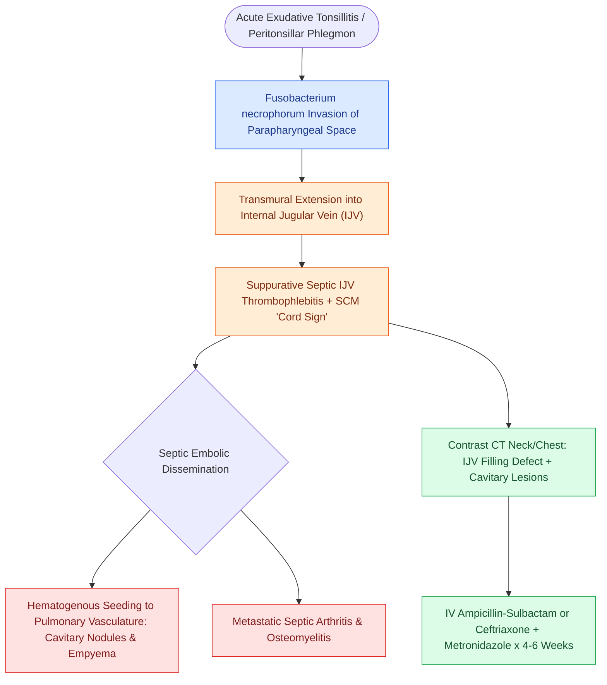

# Lemierre syndrome involves Fusobacterium necrophorum internal jugular thrombophlebitis and septic emboli

## Active Recall

> [!question]- What is the classic pathogen responsible for Lemierre's syndrome?
> *Answer / Clinical Rationale*: ***Fusobacterium necrophorum***.

> [!question]- What diagnostic imaging study confirms the diagnosis of Lemierre's syndrome?
> *Answer / Clinical Rationale*: **Contrast-enhanced CT of the neck and chest**.

## Core Clinical & Mechanistic Principles
**Lemierre's Syndrome** (post-anginal septicemia):
- **Primary Pathogen**: ***Fusobacterium necrophorum*** (anaerobic Gram-negative rod).
- **Pathogenesis**:
  1. Acute tonsillitis/pharyngitis.
  2. Direct [[Deep neck space infections spread along cervical fascial planes between the pharynx, mediastinum, and skull base|parapharyngeal space]] invasion via tonsillar veins.
  3. **Suppurative thrombophlebitis of the Internal Jugular Vein (IJV)**.
  4. Systemic dissemination of septic pulmonary emboli.
- **Presentation**: High fevers, rigors, neck tenderness along anterior SCM ("cord-like" induration), pleuritic chest pain, and hemoptysis.

### Surgical Technique & Critical Safety Checks
- **Diagnosis**: **Contrast-enhanced CT of neck and chest**, showing IJV intraluminal filling defect and cavitary lung nodules.
- **Therapy**: Prolonged IV beta-lactamase resistant anaerobic coverage (Ampicillin-Sulbactam or Ceftriaxone + Metronidazole) for 3–6 weeks. Anticoagulation remains controversial and is reserved for retrograde propagation into the cavernous sinus or refractory septic emboli despite antibiotics.

## Connected Concepts & Graph Traversal
- **Deep Fascial Compartments**: [[Deep cervical fascia divides into superficial, middle, and deep layers that define surgical planes|Deep Cervical Fascial Layers]]
- **Parapharyngeal Space Corridor**: [[The parapharyngeal space is an inverted pyramid connecting peritonsillar, masticator, parotid, and retropharyngeal spaces|Parapharyngeal Space]]
- **Retropharyngeal Space & Mediastinum**: [[The retropharyngeal space extends from skull base to tracheal bifurcation and contains lymph nodes draining the nasopharynx|Danger Space & Mediastinitis]]
- **Submandibular Floor Infection**: [[Ludwig angina presents with bilateral submandibular cellulitis and woody floor of mouth induration compromising the airway|Ludwig Angina]]
- **Antimicrobial Stewardship**: [[Antimicrobial stewardship in otolaryngology selects targeted bactericidal agents based on tissue penetration and pathogen resistance|Antimicrobial Selection in Neck Infections]]
- **Internal Jugular Vein Dissection**: [[Levels II through IV internal jugular chain dissection mobilizes the carotid sheath packet|IJV Surgical Mobilization]]
