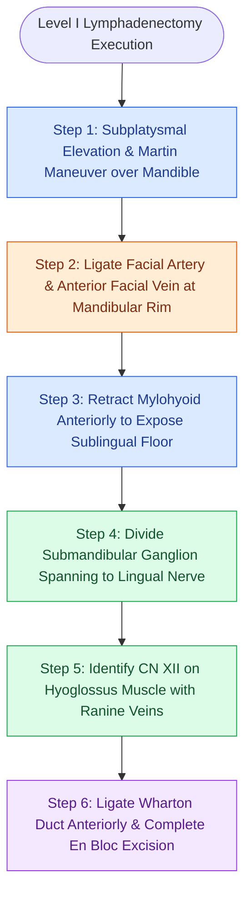

# Level I dissection requires facial vessel ligation and preservation of the lingual and hypoglossal nerves

## Active Recall

> [!question]- What nerve is suspended superior to the submandibular gland and connected to it via a secretomotor ganglion?
> *Answer / Clinical Rationale*: The **lingual nerve (CN V3)**, connected via the **submandibular ganglion**.

> [!question]- Across which muscle does the hypoglossal nerve (CN XII) course in the floor of Level IB?
> *Answer / Clinical Rationale*: The **hyoglossus muscle** (deep to the intermediate tendon of the digastric).

## Core Clinical & Mechanistic Principles
Dissection of **Level I** encompasses the submental (IA) and submandibular (IB) triangles:
- **Level IA (Submental Triangle)**: Bound by the anterior bellies of the digastric muscles and the hyoid bone. Skeletonize the mylohyoid muscle floor.
- **Level IB (Submandibular Triangle)**: Bound by the anterior and posterior digastric bellies and the inferior border of the mandible.
- **Surgical Step-by-Step**:
  1. Incise investing fascia along inferior submandibular border; perform **[[Subplatysmal flap elevation and Martin's maneuver protect the marginal mandibular nerve|Martin's maneuver]]** to protect the marginal mandibular nerve.
  2. Ligate and divide the **facial artery and anterior facial vein** at the inferior mandibular margin.
  3. Retract the submandibular gland inferiorly and divide the facial artery at its origin off the external carotid artery deep to the posterior digastric.
  4. Retract the mylohyoid muscle anteriorly to expose the sublingual space.
  5. Identify the **lingual nerve** suspended superiorly; clamp, ligate, and divide the **submandibular parasympathetic ganglion** to release the gland.
  6. Identify the **hypoglossal nerve (CN XII)** coursing deep to the intermediate tendon of the digastric on the hyoglossus muscle, accompanied by the ranine veins.
  7. Ligate and divide the **[[Wharton duct sialolithiasis is managed with transoral sialodochoplasty or sialendoscopy|Wharton]] (submandibular) duct** anteriorly.

### Surgical Technique & Critical Safety Checks
- **Neural Preservation Safeguards**:
  - Never place unipolar cautery near the lingual nerve (taste/sensation loss to anterior 2/3 of tongue) or CN XII (tongue paralysis/deviation).
  - Ligate the submandibular ganglion cleanly away from the lingual nerve trunk to avoid traction injury.

## Connected Concepts & Graph Traversal
- **Martin's Maneuver**: [[Subplatysmal flap elevation and Martin's maneuver protect the marginal mandibular nerve|Martin's Maneuver]]
- **Submandibular Excision**: [[Submandibular gland excision requires preservation of the marginal mandibular, lingual, and hypoglossal nerves|Submandibular Excision]]
- **Oral Tongue SCC**: [[Oral tongue carcinoma spreads along intrinsic lingual musculature to bilateral cervical lymphatics|Oral Tongue SCC]]
- **Anatomical Foundation**: [[Post-radiation carotid vasculopathy and osteoradionecrosis represent severe late radiotherapy sequelae]]
- **Surgical Lymphadenectomy**: [[Cervical chyle leaks are managed with MCT diet, octreotide, or surgical thoracic duct ligation]]
- **Oncologic Resection & Margins**: [[Floor of mouth carcinoma requires sublingual gland excision and Wharton duct relocation]]
- **Aerodigestive / Pharyngolaryngeal**: [[Tracheoesophageal puncture TEP and voice prosthesis restore pulmonary-driven alaryngeal speech]]
