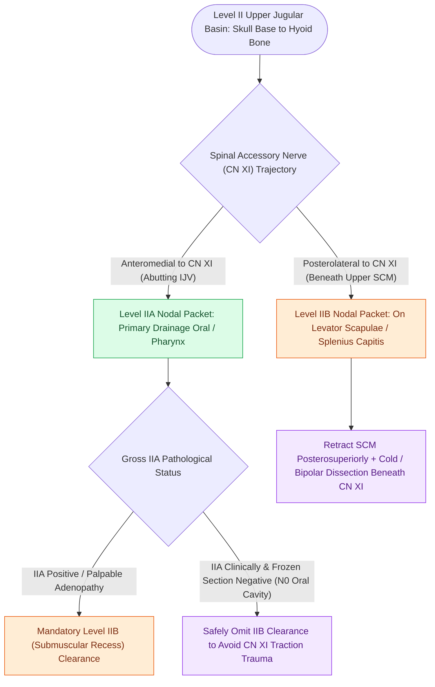

# Level II lymph nodes are anatomically divided into IIA and IIB by the spinal accessory nerve

## Active Recall

> [!question]- What anatomical structure serves as the boundary between Level IIA and Level IIB?
> *Answer / Clinical Rationale*: The **spinal accessory nerve (CN XI)**.

> [!question]- Under what oncologic condition can Level IIB dissection be safely omitted in oral cavity cancer?
> *Answer / Clinical Rationale*: In a **clinically N0 neck** with no suspicious nodes in Level IIA.

## Core Clinical & Mechanistic Principles
Level II extends from the skull base to the hyoid bone:
- **Dividing Landmark**: The **spinal accessory nerve (CN XI)**.
- **Level IIA**: Situated **anteromedial** to CN XI, abutting the IJV. Drains oral cavity, oropharynx, larynx, and hypopharynx.
- **Level IIB (Submuscular Recess)**: Situated **posterolateral** to CN XI, lying on splenius capitis and levator scapulae beneath the upper SCM.
- **Clinical Relevance**: Level IIB involvement is rare in N0 oral cavity cancers ($<3\%$), permitting selective preservation of Level IIB in supraomohyoid neck dissections unless gross Level IIA disease is present.

### Surgical Technique & Critical Safety Checks
- **Technique for Level IIB Clearance**: Retract SCM laterally, identify CN XI at its entrance, gently elevate the nerve, and sweep the packet beneath the nerve superior-to-inferior.
- **Nerve Protection**: Avoid unipolar cautery within $1\text{ cm}$ of CN XI to prevent thermal neuropraxia (see [[Cervical lymph node levels I through VII define regional metastatic drainage basins|Cervical Lymph Node Levels]]).

## Connected Concepts & Graph Traversal
- **Cervical Nodal Levels Overview**: [[Cervical lymph node levels I through VII define regional metastatic drainage basins|Cervical Lymph Node Levels]]
- **Spinal Accessory Topography**: [[The spinal accessory nerve is identified at the Erb point and anterior border of the SCM|CN XI Identification at Erb's Point]]
- **Selective Lymphadenectomy**: [[Selective neck dissection targets high-risk nodal basins while sparing low-risk cervical levels|Selective Neck Dissection Principles]]
- **Carotid Sheath Chain Dissection**: [[Levels II through IV internal jugular chain dissection mobilizes the carotid sheath packet|Levels II-IV Jugular Dissection]]
- **Oral Depth of Invasion**: [[AJCC 8th edition incorporates depth of invasion into oral cavity T-staging|Oral Cavity T-Staging & DOI]]
- **HPV Cystic Presentation**: [[HPV-positive oropharyngeal squamous cell carcinoma exhibits distinct biological behavior and staging|HPV-Positive OPSCC Level II Nodes]]
