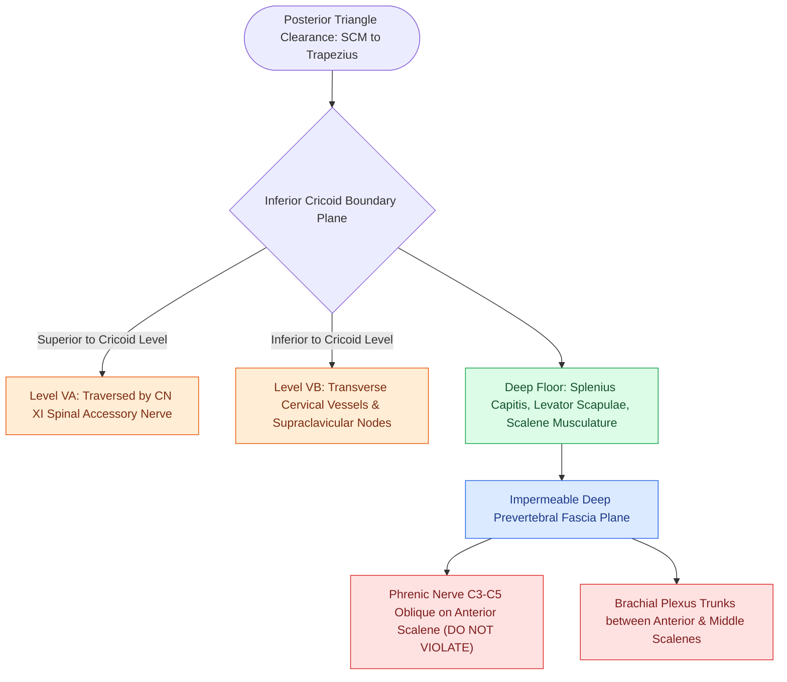

# Level V dissection requires skeletonization of the prevertebral fascia while protecting the phrenic nerve

## Active Recall

> [!question]- Across which muscle does the phrenic nerve course obliquely in the neck, and under which fascial layer is it protected?
> *Answer / Clinical Rationale*: The **anterior scalene muscle**, protected beneath the **deep prevertebral fascia**.

> [!question]- What boundary divides Level VA from Level VB in the posterior triangle?
> *Answer / Clinical Rationale*: The horizontal plane at the **inferior border of the cricoid cartilage**.

## Core Clinical & Mechanistic Principles
Dissection of **Level V (Posterior Triangle)** encompasses the fibrofatty lymphatic tissue bound by the posterior border of the SCM, anterior border of the trapezius, and clavicle:
- **Sub-levels**: Split by the horizontal plane of the inferior cricoid ring into **Level VA** (superior, traversed by CN XI) and **Level VB** (inferior, containing supraclavicular nodes and transverse cervical vessels).
- **Floor of the Posterior Triangle**: Formed by the splenius capitis, levator scapulae, and scalene muscles (posterior, middle, anterior), all covered by the **deep prevertebral fascia**.
- **Critical Neural Structures Beneath Prevertebral Fascia**:
  - **Phrenic Nerve (C3, C4, C5)**: Courses obliquely from lateral to medial across the anterior surface of the anterior scalene muscle beneath the prevertebral fascia.
  - **Brachial Plexus Trunks**: Emerge between the anterior and middle scalene muscles.
- **Surgical Craft**: Dissect strictly **superficial to the prevertebral fascia**. Leaving this fascia intact provides an impermeable barrier protecting the phrenic nerve and brachial plexus from mechanical and thermal injury.

### Surgical Technique & Critical Safety Checks
- **Transverse Cervical Artery & Vein**: Traverse Level VB; preserve branches unless required for flap donor pedicle or involved by metastatic disease.
- **Phrenic Nerve Injury Consequence**: Diaphragmatic elevation and paresis, leading to severe dyspnea in patients with baseline COPD (see [[The spinal accessory nerve is identified at the Erb point and anterior border of the SCM|CN XI Identification]]).

## Connected Concepts & Graph Traversal
- **Spinal Accessory Nerve**: [[The spinal accessory nerve is identified at the Erb point and anterior border of the SCM|CN XI Identification]]
- **Fascial Planes**: [[Deep cervical fascia divides into superficial, middle, and deep layers that define surgical planes|Fascial Planes]]
- **Radical Neck Dissection**: [[Radical neck dissection removes levels I through V while sacrificing CN XI, the IJV, and the SCM|Radical Neck Dissection]]
- **Anatomical Foundation**: [[Intensity-modulated radiation therapy and cisplatin radiosensitization form the standard definitive chemoradiation regimen]]
- **Surgical Lymphadenectomy**: [[Postoperative neck hematoma after thyroidectomy or neck dissection requires emergent bedside wound opening for airway decompression]]
- **Oncologic Resection & Margins**: [[Buccal mucosa carcinoma exhibits high rates of local recurrence and Stensen duct involvement]]
- **Aerodigestive / Pharyngolaryngeal**: [[Circumferential laryngopharyngectomy requires tubed microvascular or visceral flap reconstruction]]
