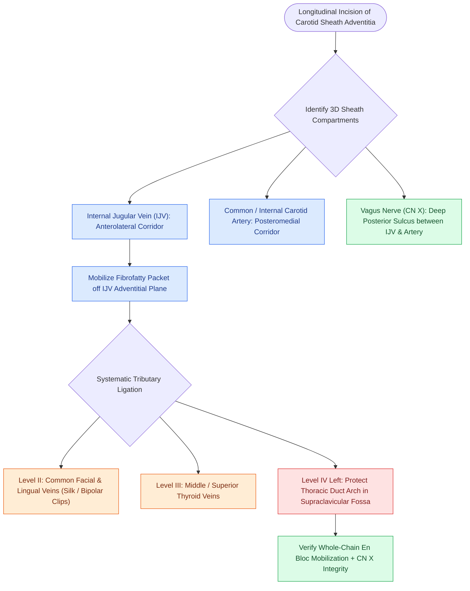

# Levels II through IV internal jugular chain dissection mobilizes the carotid sheath packet

## Active Recall

> [!question]- What is the precise spatial relationship of the vagus nerve (CN X) within the carotid sheath?
> *Answer / Clinical Rationale*: CN X lies **posteriorly in the groove between the carotid artery medially and the IJV laterally**.

> [!question]- Which venous tributaries of the IJV are routinely divided during jugular chain mobilization?
> *Answer / Clinical Rationale*: The **common facial vein**, **lingual vein**, and **superior thyroid vein**.

## Core Clinical & Mechanistic Principles
Dissection of the **internal jugular chain (Levels II, III, and IV)** represents the core of anterolateral and functional neck dissections:
- **Anatomical Boundaries**:
  - **Level II**: Skull base to hyoid bone.
  - **Level III**: Hyoid bone to cricoid cartilage / omohyoid tendon.
  - **Level IV**: Cricoid cartilage to clavicle / thoracic duct insertion.
- **Carotid Sheath Relationships**:
  - **Internal Jugular Vein (IJV)**: Located anterolaterally.
  - **Common & Internal Carotid Arteries**: Located posteromedially.
  - **Vagus Nerve (CN X)**: Courses posteriorly in the groove between artery and vein.
- **Surgical Execution**:
  1. Incise the adventitial carotid sheath longitudinally along the IJV.
  2. Retract the SCM posteriorly.
  3. Strip the fibrofatty lymph node packet medially off the anterior and lateral surfaces of the IJV using sharp dissection.
  4. Ligate and divide tributary veins (common facial, lingual, superior thyroid veins) with fine silk sutures or bipolar clips.

### Surgical Technique & Critical Safety Checks
- **Vagus Nerve Safeguard**: Always visualize CN X posteriorly before clamping or dividing deep tissue along the carotid artery.
- **Ansa Cervicalis**: The superior root (descendens hypoglossi) courses on the anterior carotid sheath; it can be preserved or harvested for laryngeal reinnervation (see [[Cervical lymph node levels I through VII define regional metastatic drainage basins|Cervical Lymph Levels]]).

## Connected Concepts & Graph Traversal
- **Cervical Nodal Levels**: [[Cervical lymph node levels I through VII define regional metastatic drainage basins|Cervical Lymph Levels]]
- **Level II Subcompartments**: [[Level II lymph nodes are anatomically divided into IIA and IIB by the spinal accessory nerve|Level IIA and IIB Subdivisions]]
- **Left Level IV Thoracic Duct**: [[Thoracic duct anatomy in the left level IV space predisposes to intraoperative chyle fistula|Thoracic Duct Anatomy & Chyle Fistula]]
- **Neck Dissection Classifications**: [[Modified radical neck dissection types I, II, and III preserve non-lymphatic structures|Modified Radical Neck Dissections]]
- **Radical Sacrifice Criteria**: [[Radical neck dissection removes levels I through V while sacrificing CN XI, the IJV, and the SCM|Radical Neck Dissection]]
- **Carotid Sheath in Deep Spaces**: [[The parapharyngeal space is an inverted pyramid connecting peritonsillar, masticator, parotid, and retropharyngeal spaces|Carotid Sheath in Parapharyngeal Space]]
