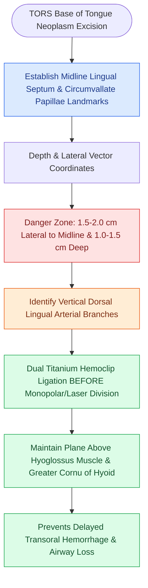

# Lingual artery branches require clip ligation during TORS base of tongue resection

## Active Recall

> [!question]- Where is the main trunk of the lingual artery located relative to the midline lingual septum during TORS tongue base resection?
> *Answer / Clinical Rationale*: Approximately **$1.5\text{–}2.0\text{ cm}$ lateral to the midline lingual septum** and $1.0\text{–}1.5\text{ cm}$ deep to the mucosal surface.

> [!question]- Which branches of the lingual artery supply the base of tongue and must be clipped during TORS resection?
> *Answer / Clinical Rationale*: The **dorsal lingual arteries**.

## Core Clinical & Mechanistic Principles
Resection of base of tongue (BOT) carcinoma via TORS requires precise knowledge of the **3D intramural course of the lingual artery**:
- **Anatomical Course of the Lingual Artery**:
  - Arises from the external carotid artery at the level of the greater horn of the hyoid bone.
  - Courses anteriorly deep to the hyoglossus muscle, giving off the **dorsal lingual arteries** supplying the posterior base of tongue, before dividing into the sublingual and deep lingual (ranine) arteries.
- **Topographical Landmarks in TORS**:
  - The main trunk of the lingual artery lies **$1.5\text{–}2.0\text{ cm}$ lateral to the midline lingual septum** and **$1.0\text{–}1.5\text{ cm}$ deep to the mucosal surface** at the level of the vallecula.
  - Dorsal lingual branches penetrate vertically into the lingual tonsil tissue.

### Surgical Technique & Critical Safety Checks
- **Technical Protocol**:
  - Use Maryland bipolar forceps and needle-tip cautery; systematically identify and **clip with titanium hemoclips** every dorsal lingual branch before dividing.
  - Resect tongue base tissue in a subfascial plane above the hyoid bone (see [[Transoral robotic surgery TORS achieves en bloc resection of tonsillar and base of tongue neoplasms|TORS Resection Standards]]).

## Connected Concepts & Graph Traversal
- **TORS Oropharyngeal Resection**: [[Transoral robotic surgery TORS achieves en bloc resection of tonsillar and base of tongue neoplasms|TORS Resection Standards]]
- **Transcervical Vessel Control**: [[Prophylactic transcervical external carotid ligation reduces fatal secondary hemorrhage after TORS|Prophylactic ECA Ligation]]
- **Submandibular & Lingual Topography**: [[Submandibular gland excision requires preservation of the marginal mandibular, lingual, and hypoglossal nerves|Lingual Nerve & Artery Relations]]
- **TORS Lateral Pharyngeal Safety**: [[TORS radical tonsillectomy requires careful identification of the internal carotid artery posterolaterally|TORS Internal Carotid Proximity]]
- **HPV Base of Tongue Staging**: [[HPV-positive oropharyngeal squamous cell carcinoma exhibits distinct biological behavior and staging|HPV-Positive Base of Tongue Neoplasms]]
- **Transcervical Exposure Corridor**: [[Transcervical pull-through resection mobilizes oral tongue tumors without dividing the mandible|Transcervical Pull-Through Corridors]]
