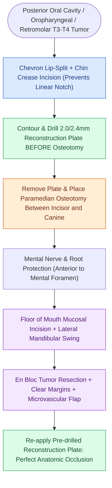

# Lip-split paramedian mandibulotomy provides wide exposure for posterior oral cavity and oropharyngeal tumors

## Active Recall

> [!question]- Why is pre-plating the mandible performed before making the mandibulotomy cut?
> *Answer / Clinical Rationale*: To guarantee that the exact **pre-morbid dental occlusion and 3D mandibular arch contour** are restored during closure.

> [!question]- Where is the osteotomy placed in a paramedian mandibulotomy to protect the mental nerve?
> *Answer / Clinical Rationale*: **Anterior to the mental foramen**, between the lateral incisor and canine teeth.

## Core Clinical & Mechanistic Principles
**Lip-split paramedian mandibulotomy** (mandibular swing approach) provides the widest possible surgical exposure for massive posterior oral cavity, oropharyngeal, and [[Deep neck space infections spread along cervical fascial planes between the pharynx, mediastinum, and skull base|parapharyngeal space]] neoplasms:
- **Indications**: Large T3/T4 tumors of the posterior oral tongue, base of tongue, tonsillar pillar, retromolar trigone, and posterior pharyngeal wall requiring complex microvascular reconstruction.
- **Surgical Step-by-Step Execution**:
  1. **Lip Incision**: Mark a zig-zag or chevron incision through the vermilion border to prevent linear contracture (notch deformity); extend around the chin pad in the mental crease down into the submental neck incision.
  2. **Pre-Plating the Mandible**: Contour and screw-fix a rigid 2.0-mm or 2.4-mm titanium reconstruction plate across the planned osteotomy site *before* cutting the bone to guarantee exact anatomic occlusion and contour upon closure.
  3. **Osteotomy Placement**: Place the osteotomy **paramedian** (between the lateral incisor and canine), anterior to the mental foramen to preserve the inferior alveolar / mental nerve.
  4. **Swing**: Divide the floor-of-mouth mucosa and swing the mandibular halves laterally, exposing the entire oral cavity and oropharynx.

### Surgical Technique & Critical Safety Checks
- **Technical Hazards**:
  - Injury to the mental nerve (causes lower lip numbness).
  - Tooth root transection (avoided by placing osteotomy between divergent roots).
  - Postoperative osteotomy non-union or plate infection (minimized by rigid fixation and healthy vascularized tissue coverage).

## Connected Concepts & Graph Traversal
- **Step-Cut Mandibulotomy**: [[Step-cut chevron mandibulotomy maximizes bone surface contact and rotational stability|Step-Cut Chevron Geometry]]
- **Pre-Plating Technique**: [[Pre-plating the intact mandible before osteotomy preserves accurate dental occlusion and contour|Mandibular Pre-Plating Craft]]
- **Transcervical Pull-Through**: [[Transcervical pull-through resection mobilizes oral tongue tumors without dividing the mandible|Pull-Through Alternative]]
- **Mandibular Reconstruction Plating**: [[Mandibular reconstruction plates require rigid bicortical screw fixation to withstand masticatory load|Rigid Bicortical Fixation]]
- **Retromolar Trigone Invasion**: [[Retromolar trigone carcinoma invades the pterygomandibular raphe and masticator space|Retromolar Trigone Exposure]]
- **Marginal Mandibulectomy**: [[Marginal mandibulectomy preserves basilar bone height when tumor abuts but does not invade marrow|Marginal vs Mandibulotomy]]
