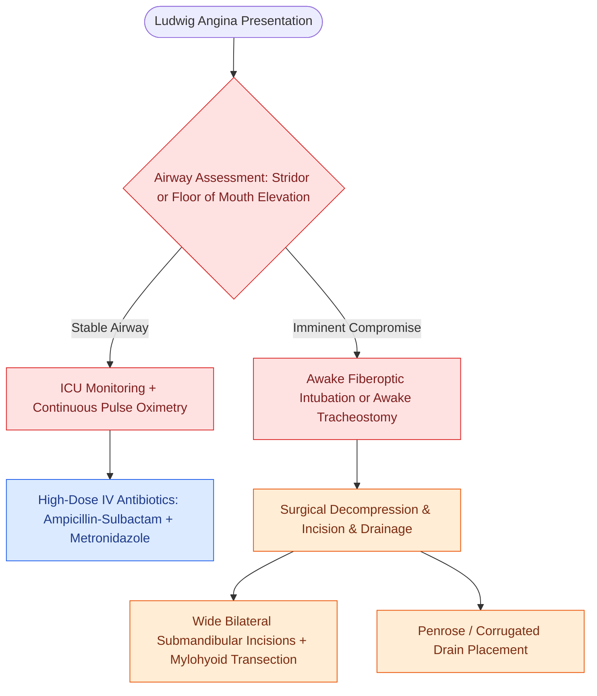

# Ludwig angina presents with bilateral submandibular cellulitis and woody floor of mouth induration compromising the airway

## Active Recall

> [!question]- Why do infections from the 2nd and 3rd mandibular molars preferentially spread to the submandibular space?
> *Answer / Clinical Rationale*: Because the roots of the 2nd and 3rd molars extend **inferior to the mylohyoid muscle line**, allowing infection to drain directly into the submandibular space.

> [!question]- What is the safest method for establishing an airway in a patient with severe Ludwig angina, and why is rapid sequence intubation (RSI) contraindicated?
> *Answer / Clinical Rationale*: **Awake fiberoptic intubation** or **awake tracheostomy under local anesthesia**. Neuromuscular blockade during RSI abolishes pharyngeal muscle tone and triggers immediate complete upper airway collapse.

## Core Clinical & Mechanistic Principles
**Ludwig Angina** (first described by Wilhelm Friedrich von Ludwig in 1836) is a rapidly progressive, non-suppurative, gangrenous cellulitis involving the **submandibular and sublingual spaces bilaterally**:
- **Odontogenic Etiology ($>80\text{–}90\%$ of cases)**:
  - Arises from periapical infection of the **mandibular 2nd and 3rd molars**.
  - *Anatomical Key*: The roots of the 2nd and 3rd molars extend **inferior to the mylohyoid muscle line of insertion** on the inner mandibular cortex, allowing dental root abscesses to erode directly into the submandibular space and spread across the midline without fascial resistance.
- **Classic Clinical Hallmarks**:
  - **"Woody" induration** of the anterior and lateral [[Submandibular gland excision requires preservation of the marginal mandibular, lingual, and hypoglossal nerves|submandibular triangle]].
  - Elevation and posterior displacement of the tongue against the palate, causing acute airway occlusion, drooling, trismus, and muffled "hot potato" voice.
  - Characterized by brawny cellulitis and tissue necrosis with minimal or late fluctuant pus formation.
- **Airway Management Protocol (First Priority)**:
  - Blind oral or nasal endotracheal intubation is **contraindicated** due to risk of complete laryngeal spasm or abscess rupture.
  - Awake fiberoptic intubation or surgical airway is the standard of care for securing the airway.
- **Surgical Drainage Technique**:
  - Wide bilateral submandibular horizontal incisions $2\text{ cm}$ below the mandible.
  - Transect the **mylohyoid muscle** to decompress the sublingual space into the submandibular wound; place corrugated or Penrose drains.

### Surgical Technique & Critical Safety Checks
- **Antimicrobial Therapy**: High-dose IV broad-spectrum antibiotics covering polymicrobial oral anaerobes and streptococci (Ampicillin-Sulbactam + Metronidazole $\pm$ Vancomycin).

## Connected Concepts & Graph Traversal
- **Deep Neck Spaces**: [[Deep neck space infections spread along cervical fascial planes between the pharynx, mediastinum, and skull base|Deep Neck Spaces]]
- **Submandibular Triangle**: [[Submandibular gland excision requires preservation of the marginal mandibular, lingual, and hypoglossal nerves|Submandibular Triangle Anatomy]]
- **Lemierre Syndrome**: [[Lemierre syndrome involves Fusobacterium necrophorum internal jugular thrombophlebitis and septic emboli|Lemierre Syndrome]]
- **Necrotizing Fasciitis**: [[Cervical necrotizing fasciitis requires emergent surgical debridement and broad-spectrum antimicrobial coverage|Necrotizing Fasciitis]]
- **Danger Space Mediastinitis**: [[The danger space permits unrestricted infection spread from skull base to posterior mediastinum|Danger Space Infection Spread]]
