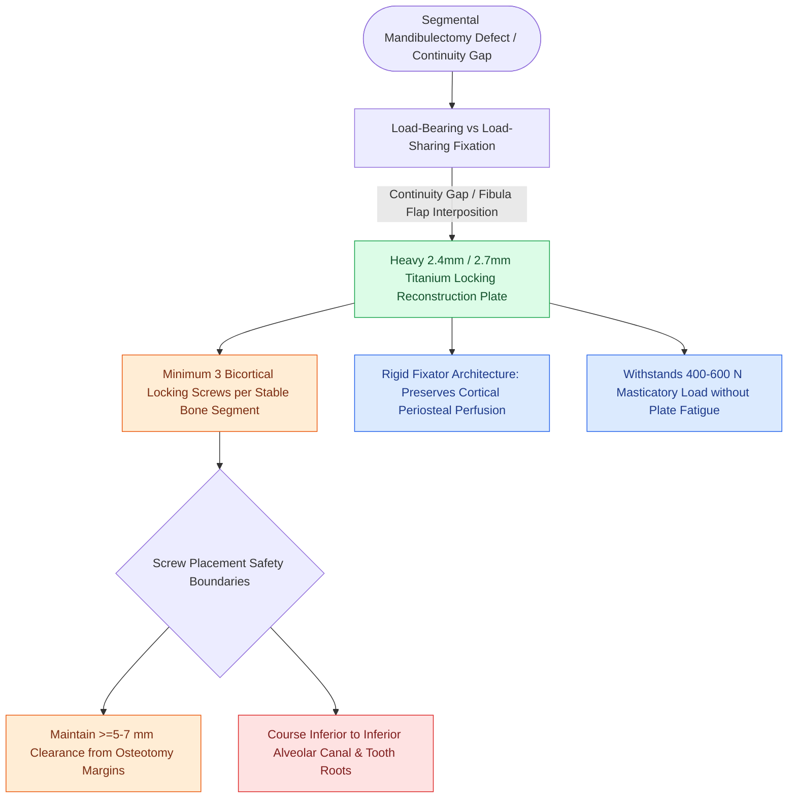

# Mandibular reconstruction plates require rigid bicortical screw fixation to withstand masticatory load

## Active Recall

> [!question]- How many bicortical screws per bone segment are required for a load-bearing mandibular reconstruction plate?
> *Answer / Clinical Rationale*: A minimum of **three bicortical screws** in each stable bone segment.

> [!question]- What is the major biological advantage of a locking reconstruction plate system?
> *Answer / Clinical Rationale*: It locks the screw directly into the plate, **preventing compression of the periosteum** and preserving cortical vascularity.

## Core Clinical & Mechanistic Principles
Rigid internal fixation of the mandible following segmental resection or mandibulotomy must withstand the highest mechanical loads in the facial skeleton:
- **Biomechanical Loads**: Masticatory muscle vectors (masseter, temporalis, medial pterygoid) generate bite forces up to $400\text{–}600\text{ N}$, producing bending, torsional, and shear stresses.
- **Fixation Standards (AO/ASIF Principles)**:
  - **Reconstruction Plate Size**: Heavy **2.4-mm or 2.7-mm titanium reconstruction plate** (or locking plate system).
  - **Screw Requirements**: A minimum of **three bicortical locking screws** in each healthy mandibular bone segment (proximal and distal) to achieve absolute load-bearing stability.
  - **Screw Placement**: Screws must be placed at least $5\text{–}7\text{ mm}$ away from the osteotomy line and inferior to the dental roots and inferior alveolar nerve canal.

### Surgical Technique & Critical Safety Checks
- **Locking vs. Non-Locking Plates**: Locking screw-plate systems create a rigid internal fixator that does not compress the plate against the periosteum, preserving cortical blood supply and reducing hardware loosening (see [[Pre-plating the intact mandible before osteotomy preserves accurate dental occlusion and contour|Mandibular Pre-Plating Craft]]).

## Connected Concepts & Graph Traversal
- **Pre-Plating Occlusal Safeguards**: [[Pre-plating the intact mandible before osteotomy preserves accurate dental occlusion and contour|Mandibular Pre-Plating Craft]]
- **Step-Cut Mandibulotomy Geometry**: [[Step-cut chevron mandibulotomy maximizes bone surface contact and rotational stability|Step-Cut Chevron Osteotomy]]
- **Vascularized Bone Harvest**: [[The fibula osteocutaneous free flap provides up to twenty-five centimeters of vascularized bone for mandible reconstruction|Fibula Free Flap Reconstruction]]
- **Mandibular Exposure Corridors**: [[Lip-split paramedian mandibulotomy provides wide exposure for posterior oral cavity and oropharyngeal tumors|Lip-Split Mandibulotomy]]
- **Oncologic Margin Standards**: [[Oncologic clear margins require at least five millimeters of histological normal tissue|Five-Millimeter Clear Margins]]
- **Marginal vs Segmental Mandibulectomy**: [[Marginal mandibulectomy preserves basilar bone height when tumor abuts but does not invade marrow|Marginal Mandibulectomy Standards]]
