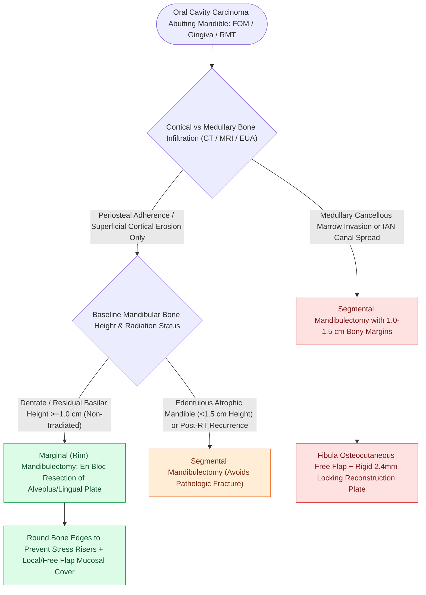

# Marginal mandibulectomy preserves basilar bone height when tumor abuts but does not invade marrow

## Active Recall

> [!question]- What is the minimum residual basilar bone height required during a marginal mandibulectomy to prevent pathologic fracture?
> *Answer / Clinical Rationale*: At least **$1.0\text{ cm}$** of intact basilar bone.

> [!question]- Why is an edentulous, atrophic mandible a contraindication to marginal mandibulectomy?
> *Answer / Clinical Rationale*: Because the vertical height of an atrophic mandible is often $<1.5\text{ cm}$; performing a rim resection leaves a fragile bone strut that inevitably fractures under mastication.

## Core Clinical & Mechanistic Principles
**Marginal (rim) mandibulectomy** involves the en bloc resection of the alveolar ridge or inner lingual cortical plate of the mandible while preserving the continuity of the inferior basilar border:
- **Oncologic Indications**:
  - Oral cavity carcinoma (floor of mouth, gingiva, retromolar trigone) abutting or adherent to the mandibular periosteum.
  - Superficial erosion of the cortical bone without radiographic or clinical evidence of medullary marrow invasion.
- **Contraindications**:
  1. Gross tumor invasion into the medullary cancellous marrow space.
  2. Tumor invasion into the inferior alveolar nerve canal.
  3. Recurrent tumor in a heavily irradiated mandible.
  4. **Atrophic, edentulous mandible** (where baseline bone height is $<1.5\text{ cm}$).
- **The $1.0\text{-cm}$ Basilar Bone Rule**: To prevent pathologic fracture, the residual inferior basilar bone height must measure **$\ge 1.0\text{ cm}$** of healthy cortical bone.

### Surgical Technique & Critical Safety Checks
- **Surgical Craft**: Use a high-speed sagittal saw or reciprocating saw; round all sharp bone corners to prevent plate/mucosal ulceration; avoid notch defects that act as stress risers for fracture (see [[Segmental mandibulectomy resects full-thickness bone for medullary invasion and irradiated bone recurrence|Segmental Mandibulectomy Indications]]).

## Connected Concepts & Graph Traversal
- **Full-Thickness Resection Alternative**: [[Segmental mandibulectomy resects full-thickness bone for medullary invasion and irradiated bone recurrence|Segmental Mandibulectomy Indications]]
- **Floor of Mouth Carcinoma**: [[Floor of mouth carcinoma requires sublingual gland excision and Wharton duct relocation|Floor of Mouth En Bloc Resection]]
- **Microvascular Mandibular Reconstruction**: [[The fibula osteocutaneous free flap provides up to twenty-five centimeters of vascularized bone for mandible reconstruction|Fibula Free Flap Reconstruction]]
- **Rigid Internal Fixation Principles**: [[Mandibular reconstruction plates require rigid bicortical screw fixation to withstand masticatory load|AO Mandibular Plating]]
- **Pull-Through Corridor**: [[Transcervical pull-through resection mobilizes oral tongue tumors without dividing the mandible|Transcervical Pull-Through Corridor]]
- **Oral Cavity T-Staging & DOI**: [[AJCC 8th edition incorporates depth of invasion into oral cavity T-staging|Oral Cavity Staging & DOI]]
