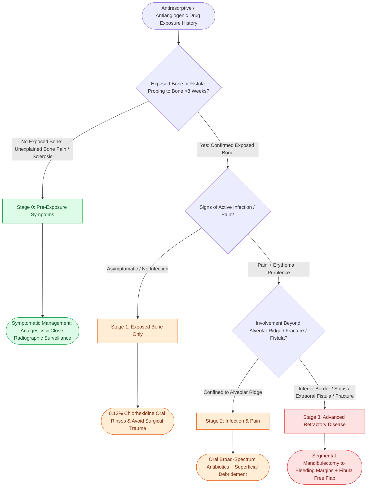

# Medication-related osteonecrosis of the jaw is staged by the AAOMS system to direct antiresorptive conservative and surgical therapy

## Active Recall

> [!question]- What three mandatory clinical and historical criteria establish the formal diagnosis of medication-related osteonecrosis of the jaw (MRONJ)?
> *Answer / Clinical Rationale*: According to the American Association of Oral and Maxillofacial Surgeons (AAOMS), all three criteria must be fulfilled:
> 1. Current or previous treatment with **antiresorptive agents** (intravenous/oral bisphosphonates, denosumab [RANKL inhibitor]) or **antiangiogenic agents** (bevacizumab, sunitinib, tyrosine kinase inhibitors).
> 2. **Exposed necrotic bone** or bone that can be probed through an intraoral or extraoral fistula in the maxillofacial region that has persisted for **longer than 8 weeks**.
> 3. **No history of radiation therapy to the craniofacial skeleton** and no obvious metastatic neoplastic disease involving the jaws.

> [!question]- How does the AAOMS staging system stratify MRONJ from Stage 0 through Stage 3, and what threshold mandates aggressive surgical intervention?
> *Answer / Clinical Rationale*:
> - **Stage 0 (Non-exposed)**: No clinical evidence of exposed necrotic bone, but nonspecific clinical symptoms (dull jaw aching, altered neurosensory function, unexplained tooth mobility) and radiographic changes (unexplained osteosclerosis, thickened lamina dura, alveolar cortical bone thickening).
> - **Stage 1**: Exposed necrotic bone or fistulae probing to bone; patient is **completely asymptomatic** with **no clinical evidence of infection** or erythema. Managed conservatively with topical antimicrobial rinses (0.12% chlorhexidine).
> - **Stage 2**: Exposed necrotic bone or fistulae probing to bone associated with **infection, erythema, localized pain**, and purulent discharge. Managed with oral broad-spectrum antimicrobials and chlorhexidine rinses.
> - **Stage 3**: Exposed necrotic bone or fistulae probing to bone with infection and pain, PLUS at least one of: (a) extension beyond alveolar bone (e.g., to the mandibular inferior border, ascending ramus, or maxillary sinus floor/zygoma), (b) **pathologic mandibular fracture**, (c) **extraoral cutaneous fistula**, or (d) osteolysis extending through the inferior border. Stage 3 mandates **definitive surgical resection** (segmental mandibulectomy or partial maxillectomy) with vascularized free flap reconstruction.

> [!question]- How does the pathophysiological mechanism of nitrogen-containing bisphosphonates differ from denosumab in skeletal residence time and clinical reversibility?
> *Answer / Clinical Rationale*: **Bisphosphonates** (e.g., zoledronic acid, pamidronate, alendronate) avidly bind to hydroxyapatite crystals within the mineralized bone matrix and are internalized by active osteoclasts during resorption, inhibiting the enzyme **farnesyl pyrophosphate synthase (FPPS)** in the mevalonate pathway. This disrupts intracellular prenylation of GTPases, triggering osteoclast apoptosis. Because bisphosphonates incorporate directly into the bone skeleton, their biological terminal half-life exceeds **10 to 12 years**, rendering their antiresorptive suppression largely permanent. In contrast, **denosumab** is a fully human monoclonal antibody that binds and neutralizes extracellular **RANKL (Receptor Activator of Nuclear Factor-κB Ligand)**, preventing activation of RANK on osteoclast precursors. Denosumab does not incorporate into the mineralized matrix; its serum half-life is approximately **25 to 28 days**, and its antiresorptive effects are completely reversible within 6 to 12 months after cessation.

## Core Clinical & Mechanistic Principles

Medication-related osteonecrosis of the jaw (MRONJ) is an antiresorptive- and antiangiogenic-induced failure of physiological bone remodeling. The jaws are uniquely susceptible compared to other skeletal sites due to constant masticatory microtrauma, thin mucosal coverage, direct exposure to a complex polymicrobial oral microbiome, and high baseline alveolar remodeling rates (up to 10-fold higher than long bones):

### Pathophysiological Divergence: MRONJ vs Osteoradionecrosis
MRONJ must be rigorously differentiated from [[Post-radiation carotid vasculopathy and osteoradionecrosis represent severe late radiotherapy sequelae|osteoradionecrosis (ORN)]]:
- **ORN**: Etiology is high-dose ionizing external beam radiation ($>60\text{ Gy}$); mechanism involves radiation-induced endarteritis obliterans, generating the classic **Marx 3H triad (Hypovascularity, Hypocellularity, Hypoxia)** and fibroatrophic osteocyte destruction.
- **MRONJ**: Arises without radiation exposure; mechanism is profound suppression of osteoclastic bone resorption combined with direct mucosal epithelial toxicity, microvascular anti-angiogenesis, and local immune dysfunction.

### AAOMS Staging and Clinical Protocol Matrix

| Stage | Clinical Presentation | Radiographic Hallmarks | Management Protocol |
| :--- | :--- | :--- | :--- |
| **At Risk** | Asymptomatic patients on oral or IV antiresorptive agents; no exposed bone | Normal baseline | Patient education, meticulous hygiene, preventative dental optimization |
| **Stage 0** | No exposed bone; dull jaw aching, sinus pain, tooth mobility, paresthesia | Alveolar osteosclerosis, thickened lamina dura, osteolysis, persistent extraction socket | Conservative symptomatic therapy, systemic analgesics, treat odontogenic infection |
| **Stage 1** | Exposed necrotic bone or fistulae; **asymptomatic**, zero erythema/purulence | Localized alveolar crest resorption or sclerosis | Daily 0.12% chlorhexidine gluconate oral rinses, quarterly clinical follow-up |
| **Stage 2** | Exposed necrotic bone or fistulae; **symptomatic** with pain, swelling, purulent drainage | Alveolar osteolysis extending to periapical regions | Oral broad-spectrum antibiotics (amoxicillin-clavulanate, clindamycin), analgesics, antiseptic rinses, superficial sequestrectomy |
| **Stage 3** | Exposed necrotic bone extending past alveolar ridge, **pathologic fracture**, extraoral fistula, oral-antral/nasal communication | Osteolysis extending to inferior border, ramus, or sinus floor; extensive sequestrum | Surgical en bloc or segmental resection to bleeding margins; microvascular free tissue transfer |

### Risk Mitigation and Prevention Strategies
1. **Pre-Therapy Dental Optimization**:
   - The single most effective intervention is a comprehensive dental evaluation prior to initiating antiresorptive or antiangiogenic therapy.
   - All non-restorable teeth, advanced periodontal lesions, and planned surgical extractions must be completed **at least 14 to 21 days** prior to commencing intravenous antiresorptive therapy to allow complete mucosal re-epithelialization.
2. **Management of Patients on Active Therapy**:
   - Elective invasive dentoalveolar surgery (extractions, implants, apical endodontic surgery) should be strictly avoided.
   - For mandatory extractions: utilize atraumatic extraction techniques, alveoloplasty to eliminate sharp bony spicules, and achieve primary mucosal closure without tension using mucoperiosteal flaps.
   - For high-risk Stage 3 disease with complete loss of mandibular continuity, definitive reconstructive rescue mandates [[The fibula osteocutaneous free flap provides up to twenty-five centimeters of vascularized bone for mandible reconstruction|microvascular free fibula transfer]] and [[Mandibular reconstruction plates require rigid bicortical screw fixation to withstand masticatory load|rigid reconstruction plate fixation]].

## Connected Concepts & Graph Traversal
- **🔗 Odontogenic Sinus Conduit (Sinus)**: [[Odontogenic sinusitis arises from periapical maxillary dental pathology and oroantral fistulas|Odontogenic Infections]]
- **Radical Bony Resection**: [[Segmental mandibulectomy resects full-thickness bone for medullary invasion and irradiated bone recurrence|Segmental Mandibulectomy]]
- **Cortical Preservation**: [[Marginal mandibulectomy preserves basilar bone height when tumor abuts but does not invade marrow|Marginal Mandibulectomy]]
- **Dental Anatomic Notation**: [[The Universal Numbering System and Palmer Notation designate primary and permanent dentition across four oral quadrants|Dental Topography]]
- **Deep Neck Space Phlegmon**: [[Deep neck space infections spread along cervical fascial planes between the pharynx, mediastinum, and skull base|Deep Neck Infection Pathways]]
- **Osteonecrosis Pathophysiologic Differential**: [[Post-radiation carotid vasculopathy and osteoradionecrosis represent severe late radiotherapy sequelae|Late Radiation Osteoradionecrosis]]
