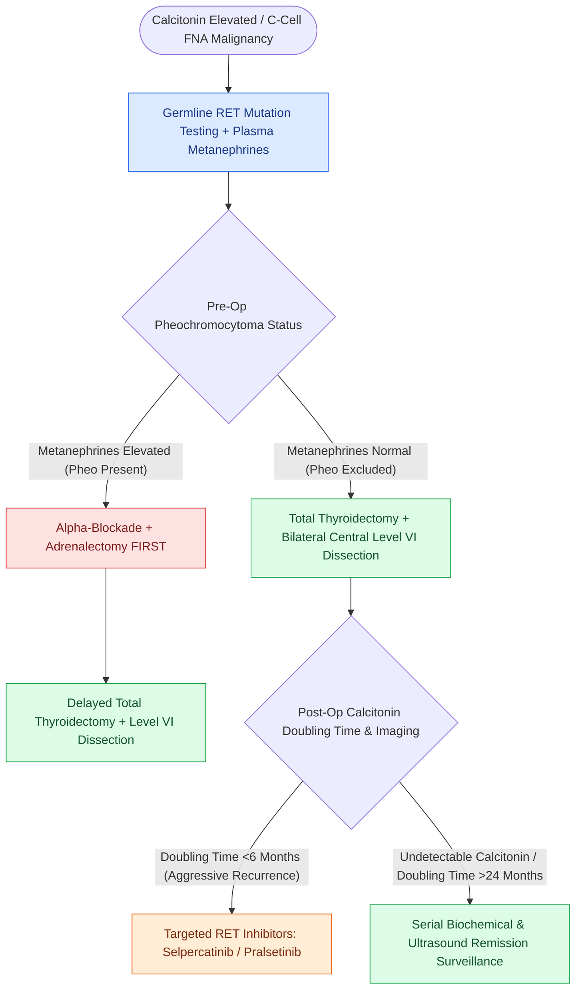

# Medullary thyroid carcinoma arises from parafollicular C cells and mandates RET testing with calcitonin surveillance

## Active Recall

> [!question]- Why is radioactive iodine useless in MTC?
> *Answer / Clinical Rationale*: C cells are neural crest derivatives that neither trap iodine nor make thyroglobulin — the follicular machinery is absent.

> [!question]- What must be biochemically excluded before thyroidectomy in RET-positive disease and why?
> *Answer / Clinical Rationale*: Pheochromocytoma (plasma metanephrines) — operating on an unblocked pheo risks fatal intraoperative catecholamine crisis; the adrenal comes first.

## Core Clinical & Mechanistic Principles
- Cell of origin: **parafollicular C cells** (ultimobranchial/neural crest) concentrated in the posterolateral upper poles — hence no iodine avidity, **no RAI role**, and calcitonin/CEA as faithful tumor markers.
- Germline **RET mutations** define MEN2A (MTC + pheochromocytoma + hyperparathyroidism) and MEN2B (M918T: earliest/most aggressive MTC, mucosal neuromas, marfanoid habitus); a quarter of apparently sporadic MTC is germline — **every MTC patient gets RET testing**.
- Codon risk stratification times **prophylactic thyroidectomy** in carriers: highest-risk (M918T) within the first year of life; high-risk (C634) by age five; moderate-risk by calcitonin surveillance.
- Preoperative non-negotiable: **exclude pheochromocytoma** (plasma metanephrines) before any operation — an unrecognized pheo is the anesthetic catastrophe of this disease.

### Management & Critical Safety Checks
- Surgery is the therapy: total thyroidectomy with [[Central compartment neck dissection clears level VI nodes between the carotid sheaths and suprasternal notch|central compartment dissection]]; lateral dissections by imaging and calcitonin thresholds; postop **calcitonin/CEA doubling times** are the prognosis in two numbers.
- Advanced disease: selective RET inhibitors (selpercatinib/pralsetinib) and multikinase agents (vandetanib/cabozantinib) — genotype-directed therapy done properly.

## Connected Concepts & Graph Traversal
- **Hereditary RET Codon Management**: [[The RET proto-oncogene dictates medullary thyroid carcinoma aggression and timing of prophylactic thyroidectomy in MEN 2|RET Mutations & Prophylactic Surgery]]
- **Central Compartment Neck Dissection**: [[Central compartment neck dissection clears level VI nodes between the carotid sheaths and suprasternal notch|Level VI Central Dissection]]
- **Differentiated Thyroid Contrast**: [[Papillary thyroid carcinoma spreads via cervical lymphatics to central and lateral neck compartments|Papillary vs Medullary Thyroid Carcinoma]]
- **Anaplastic Dedifferentiation**: [[Anaplastic thyroid carcinoma is an airway and molecular emergency requiring immediate BRAF testing|Anaplastic Thyroid Emergency]]
- **Recurrent Laryngeal Nerve Protection**: [[The recurrent laryngeal nerve is identified within Simon's triangle and followed through Berry's ligament|RLN Identification in Thyroidectomy]]
