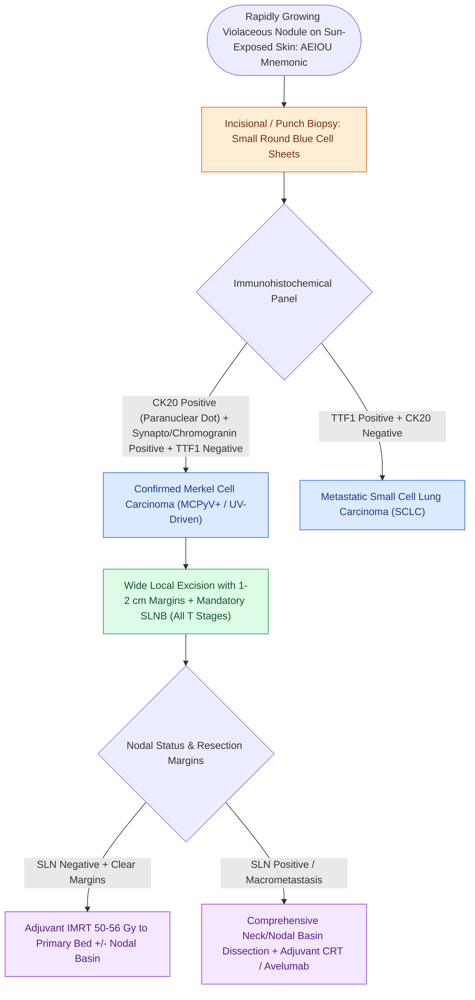

# Merkel cell carcinoma is an aggressive neuroendocrine cutaneous malignancy staged by SLNB and managed with wide excision and adjuvant radiotherapy

## Active Recall

> [!question]- What immunohistochemical staining pattern definitively distinguishes Merkel cell carcinoma from metastatic small cell lung carcinoma?
> *Answer / Clinical Rationale*: **CK-20 positive with a characteristic paranuclear dot-like pattern** and **TTF-1 negative** in MCC; metastatic small cell lung cancer is typically **CK-20 negative and TTF-1 positive**.

> [!question]- Why is Sentinel Lymph Node Biopsy (SLNB) performed routinely in all patients with clinical T1 N0 Merkel cell carcinoma?
> *Answer / Clinical Rationale*: MCC has a high propensity for early lymphatic dissemination, with an **occult nodal micrometastasis rate of approximately $30\%$ even in tumors $<1\text{ cm}$ in diameter**.

> [!question]- What is the role of adjuvant radiation therapy in Merkel cell carcinoma?
> *Answer / Clinical Rationale*: MCC is **exquisitely radiosensitive**; adjuvant radiotherapy ($50\text{–}60\text{ Gy}$) to the primary tumor bed and draining nodal basin substantially decreases local and regional recurrence rates.

## Core Clinical & Mechanistic Principles
**Merkel Cell Carcinoma (MCC)** is a rare, highly aggressive cutaneous neuroendocrine carcinoma with a mortality rate exceeding that of cutaneous melanoma:

- **Etiology & Pathophysiology**:
  - **Merkel Cell Polyomavirus (MCPyV)**: Clonally integrated into host DNA in $\sim 80\%$ of cases; drives oncogenesis via large T and small T viral antigens inactivating Rb and p53.
  - **Ultraviolet (UV) Radiation**: Drives the remaining $\sim 20\%$ of virus-negative MCC, characterized by high tumor mutational burden (TMB) with signature UV-induced C $\rightarrow$ T transitions.
  - **Immunosuppression**: Chronic immunosuppression (organ transplant recipients, CLL, HIV) increases MCC risk up to 30- to 50-fold and correlates with worse clinical outcomes.

- **Clinical Presentation & The AEIOU Mnemonic**:
  - **A**: Asymptomatic (non-tender)
  - **E**: Expanding rapidly ($\le 3\text{ months}$)
  - **I**: Immune-compromised host
  - **O**: Older age ($>50\text{ years}$, peak 7th–8th decades)
  - **U**: UV-exposed skin of the head and neck ($>50\%$ occur on head and neck)

- **Histopathology & Immunohistochemistry (IHC)**:
  - Dermal sheets of small, round blue cells with finely stippled "salt-and-pepper" chromatin and high mitotic/apoptotic rates.
  - **Cytokeratin-20 (CK-20)**: Shows a pathognomonic **paranuclear dot-like pattern** in $>95\%$ of cases.
  - **Neuroendocrine Markers**: Positive for Synaptophysin, Chromogranin A, and CD56.
  - **Thyroid Transcription Factor-1 (TTF-1) & CK-7**: **Strictly NEGATIVE**; critical to distinguish MCC from metastatic small cell lung carcinoma (SCLC, which is CK-20 negative, TTF-1 positive).

### Surgical & Radiation Management Craft
1. **Primary Excision Margins**: Wide local excision with **$1\text{–}2\text{ cm}$ surgical margins** down to deep fascia or periosteum. When critical facial anatomy precludes $2\text{ cm}$ margins, Mohs micrographic surgery or margin-controlled excision followed by postoperative radiotherapy is performed.
2. **Sentinel Lymph Node Biopsy Mandate**: Unlike melanoma where SLNB is thresholded by thickness, **SLNB is recommended for ALL operable MCC patients**, regardless of primary tumor size, because even small tumors ($<1\text{ cm}$) have a $30\%$ rate of [[Elective neck dissection is indicated for oral cavity squamous cell carcinoma with depth of invasion exceeding four millimeters|occult nodal metastasis]].
3. **Adjuvant Radiotherapy**: MCC is extraordinarily radiosensitive. Postoperative radiation therapy ($50\text{–}60\text{ Gy}$) to the primary site and regional nodal basin significantly improves local control and disease-free survival.

## Connected Concepts & Graph Traversal
- **Landmark Melanoma Trials**: [[The MSLT-1 and MSLT-2 trials establish sentinel lymph node biopsy utility and ultrasound surveillance safety in melanoma|MSLT-1 & MSLT-2 Trials]]
- **Cutaneous Melanoma Staging**: [[Cutaneous head and neck melanoma is staged by Breslow depth and sentinel lymph node biopsy|Cutaneous Melanoma Workup]]
- **High-Risk Cutaneous SCC**: [[High-risk cutaneous squamous cell carcinoma drains first to parotid and perifacial nodal basins|Cutaneous SCC Nodal Basins]]
- **Cervical Nodal Levels**: [[Cervical lymph node levels I through VII define regional metastatic drainage basins|Cervical Lymph Node Levels I–VII]]
- **Neoadjuvant Checkpoint Inhibitors**: [[Neoadjuvant cemiplimab achieves high pathological response rates in resectable locally advanced cutaneous squamous cell carcinoma|Neoadjuvant Cemiplimab in cSCC]]
- **Neuroendocrine Differential**: [[Biphasic sinonasal malignancies exhibit divergent epithelial, mesenchymal, and neural differentiation requiring diagnostic immunohistochemical panels|Sinonasal Neuroendocrine Differential]]
