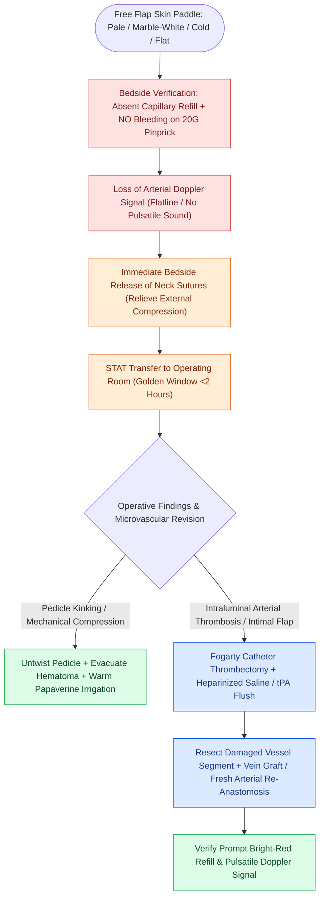

# Microvascular arterial thrombosis presents with a pale, flat flap and requires immediate surgical exploration

## Active Recall

> [!question]- What is the classic clinical appearance and pinprick response of a free flap with arterial thrombosis?
> *Answer / Clinical Rationale*: The flap is **pale, cold, and flaccid**, with **no bleeding on 20-gauge needle puncture**.

> [!question]- What is the maximum ischemic window for successful free flap surgical salvage before irreversible failure occurs?
> *Answer / Clinical Rationale*: Re-exploration within **$<2\text{ hours}$** provides the highest salvage rate ($>80\text{–}90\%$).

## Core Clinical & Mechanistic Principles
**Microvascular arterial thrombosis** is a surgical emergency occurring in $1\text{–}3\%$ of head and neck free flaps, typically within the first 24–48 hours:
- **Etiology & Triggers**:
  - Mechanical: Intimal flap dissection, adventitial inversion into lumen, kinking, twisting, or excessive tension on the arterial pedicle.
  - Systemic: Hypotension, hypovolemia, vasopressor use, hypercoagulable state (Factor V Leiden, protein C/S deficiency).
  - External: Neck hematoma compressing the pedicle or tight tracheostomy ties.
- **Clinical Presentation**:
  - **Color**: Pale, marble-white, or ashen-gray.
  - **Temperature**: Cold to touch.
  - **Turgor**: Flaccid, flat, and dehydrated.
  - **Capillary Refill**: Absent or severely prolonged ($>3\text{–}5\text{ seconds}$).
  - **Pinprick Test**: **No bleeding whatsoever** upon 20-gauge needle puncture.
  - **Doppler**: Complete loss of arterial Doppler signal.

### Surgical Technique & Critical Safety Checks
- **The Golden Window**: Flap re-exploration must occur within **$<2\text{ hours}$** of onset (see [[Postoperative free flap compromise within forty-eight hours requires emergent surgical re-exploration for pedicle salvage|Free Flap Surgical Salvage]]) to prevent microcirculatory endothelial necrosis and irreversible "no-reflow" phenomenon.

## Connected Concepts & Graph Traversal
- **Venous Thrombosis Contrast**: [[Microvascular venous thrombosis presents with violaceous congestion and rapid dark bleeding on pinprick|Venous Congestion Contrast]]
- **Flap Salvage Protocols**: [[Postoperative free flap compromise within forty-eight hours requires emergent surgical re-exploration for pedicle salvage|Free Flap Surgical Salvage]]
- **Postoperative Flap Monitoring**: [[Postoperative free flap monitoring includes Doppler ultrasound, pinprick bleeding, and capillary refill checks|Flap Monitoring Standards]]
- **Venous Anastomotic Couplers**: [[Microvascular venous couplers achieve rapid and reliable end-to-end and end-to-side anastomoses|Venous Anastomosis Technology]]
- **Thin Fasciocutaneous Flap**: [[The radial forearm free flap provides thin, pliable fasciocutaneous tissue for oral and pharyngeal defects|Radial Forearm Free Flap]]
- **Leech Therapy for Outflow**: [[Leech therapy with Hirudo medicinalis decompresses venous congested flaps with ciprofloxacin prophylaxis for Aeromonas hydrophila|Hirudinotherapy Decompression]]
