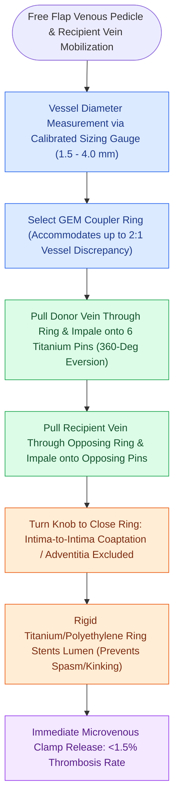

# Microvascular venous couplers achieve rapid and reliable end-to-end and end-to-side anastomoses

## Active Recall

> [!question]- What are the primary clinical advantages of using a microvascular venous coupler over hand-sewn sutures?
> *Answer / Clinical Rationale*: **Faster anastomotic time (3–5 min)**, **perfect 360-degree intima-to-intima eversion**, and **rigid stenting** that prevents luminal collapse and kinking.

> [!question]- What vessel diameter discrepancy can be safely accommodated by a microvascular coupler?
> *Answer / Clinical Rationale*: Discrepancies up to **$1.5:1\text{ to }2:1$**.

## Core Clinical & Mechanistic Principles
Mechanical **Microvascular Anastomotic Coupling Devices (MACDs / GEM Couplers)** have become the gold standard for venous anastomoses in head and neck microvascular reconstruction:
- **Biomechanical & Clinical Advantages**:
  1. **Drastic Time Reduction**: Completes venous anastomosis in **$3\text{–}5\text{ minutes}$** (vs. 15–25 minutes for hand-sewn sutures).
  2. **Intima-to-Intima Eversion**: Rings mechanically evert the endothelial edges $360^\circ$, completely excluding thrombogenic adventitia from the blood stream.
  3. **Rigid Stenting**: The rigid polyethylene/titanium ring prevents external vessel compression, kinking, and vasospasm.
  4. **Low Thrombosis Rate**: [[Microvascular venous thrombosis presents with violaceous congestion and rapid dark bleeding on pinprick|Venous thrombosis]] rates are **$<1.5\%$** (superior or equal to hand-sewn 9-0 nylon).
- **Sizing & Technique**:
  - Select ring size ($1.5\text{–}4.0\text{ mm}$) matching the outer vessel diameter using a vessel measuring gauge.
  - Pull vessel through ring, pin evenly onto 6 titanium pins, repeat for recipient vein, and approximate coupler.

### Surgical Technique & Critical Safety Checks
- **Vessel Discrepancy Accommodation**: Couplers can comfortably bridge up to **$1.5:1\text{ to }2:1$ vessel diameter discrepancies** by gentle asymmetric stretching of the smaller vessel over the pins.

## Connected Concepts & Graph Traversal
- **Interposition Vein Grafts**: [[Great saphenous vein interposition grafts bridge vascular defects during free flap revascularization|Saphenous Vein Grafts]]
- **Venous Thrombosis Rescue**: [[Microvascular venous thrombosis presents with violaceous congestion and rapid dark bleeding on pinprick|Venous Outflow Failure]]
- **Postoperative Flap Monitoring**: [[Postoperative free flap monitoring includes Doppler ultrasound, pinprick bleeding, and capillary refill checks|Flap Doppler & Monitoring Protocols]]
- **Free Flap Surgical Salvage**: [[Postoperative free flap compromise within forty-eight hours requires emergent surgical re-exploration for pedicle salvage|Free Flap Re-Exploration Timeline]]
- **Radial Forearm Microvascular Flap**: [[The radial forearm free flap provides thin, pliable fasciocutaneous tissue for oral and pharyngeal defects|Radial Forearm Free Flap Donor]]
- **Leech Therapy for Venous Stasis**: [[Leech therapy with Hirudo medicinalis decompresses venous congested flaps with ciprofloxacin prophylaxis for Aeromonas hydrophila|Hirudinotherapy Decongestion]]
