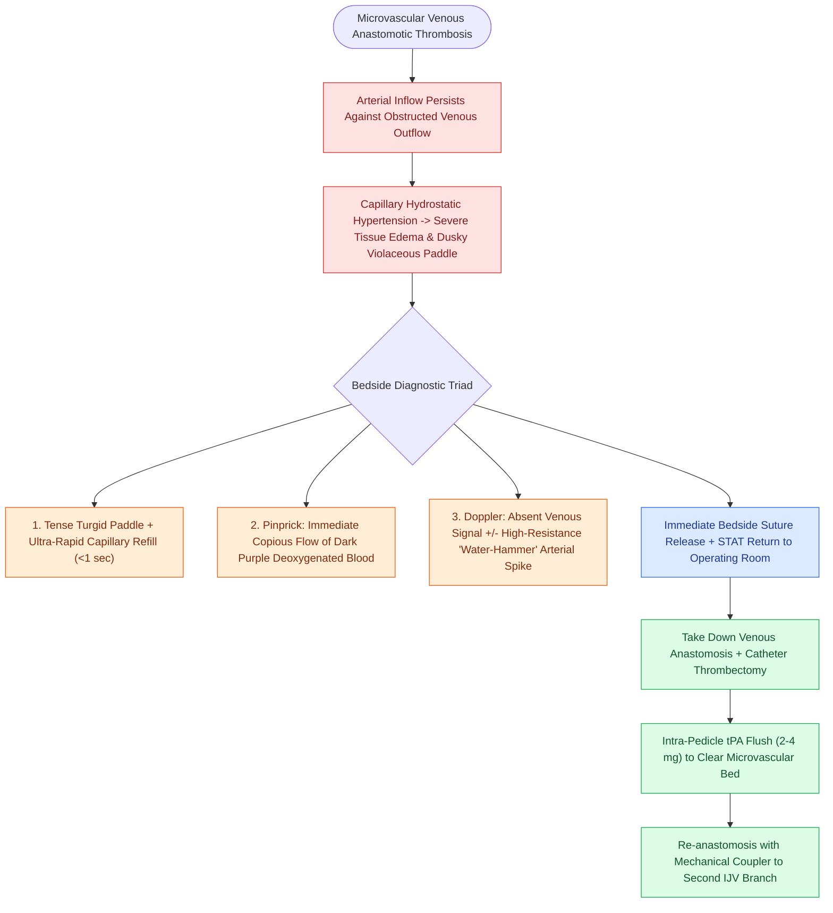

# Microvascular venous thrombosis presents with violaceous congestion and rapid dark bleeding on pinprick

## Active Recall

> [!question]- Why is needle pinprick bleeding dark purple and rapid in free flap venous thrombosis?
> *Answer / Clinical Rationale*: Because venous outflow obstruction causes **high-pressure capillary pooling of deoxygenated blood** that immediately escapes under pressure when punctured.

> [!question]- What thrombolytic drug is flushed into the flap pedicle to dissolve microvascular clots during venous revision?
> *Answer / Clinical Rationale*: **Tissue Plasminogen Activator (tPA)** (2–4 mg).

## Core Clinical & Mechanistic Principles
**Venous thrombosis** is the most common cause of microvascular free flap failure ($60\text{–}70\%$ of all vascular crises):
- **Pathophysiology**:
  - Occlusion of the [[Microvascular venous couplers achieve rapid and reliable end-to-end and end-to-side anastomoses|venous anastomosis]] causes acute cessation of venous drainage while arterial inflow continues under systemic pressure.
  - Microcirculatory beds engorge with deoxygenated blood; capillary hydrostatic pressure skyrockets, causing massive tissue edema, microthrombi formation, and secondary arterial standstill.
- **Pathognomonic Clinical Signs**:
  - **Color**: Dark blue, violaceous, or purple mottling.
  - **Turgor**: Extremely tense, turgid, and swollen ("firm wooden" feel).
  - **Capillary Refill**: Ultra-rapid, brisk refill ($<1.0\text{ second}$).
  - **Pinprick Test**: **Immediate brisk flow of dark, blackish-purple venous blood**.
  - **Venous Doppler**: Absent venous flow (arterial Doppler may initially show high-resistance "hammering" spikes before dying).

### Surgical Technique & Critical Safety Checks
- **Thrombolytic Protocol**: Intra-arterial or intra-venous flush of **Tissue Plasminogen Activator (tPA, 2–4 mg in 20 mL saline)** directly into the flap bed to dissolve microvascular clots.

## Connected Concepts & Graph Traversal
- **Arterial Thrombosis Contrast**: [[Microvascular arterial thrombosis presents with a pale, flat flap and requires immediate surgical exploration|Arterial Thrombosis Distinction]]
- **Flap Salvage Protocols**: [[Postoperative free flap compromise within forty-eight hours requires emergent surgical re-exploration for pedicle salvage|Free Flap Re-Exploration Timeline]]
- **Venous Anastomotic Couplers**: [[Microvascular venous couplers achieve rapid and reliable end-to-end and end-to-side anastomoses|Venous Anastomotic Couplers]]
- **Leech Decongestive Salvage**: [[Leech therapy with Hirudo medicinalis decompresses venous congested flaps with ciprofloxacin prophylaxis for Aeromonas hydrophila|Hirudinotherapy Protocol]]
- **Postoperative Flap Monitoring**: [[Postoperative free flap monitoring includes Doppler ultrasound, pinprick bleeding, and capillary refill checks|Flap Monitoring & Doppler Assessment]]
- **Interposition Vein Grafts**: [[Great saphenous vein interposition grafts bridge vascular defects during free flap revascularization|Saphenous Vein Grafts]]
