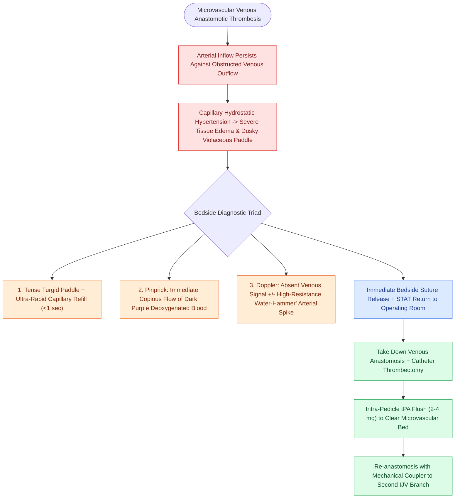

# Microvascular venous thrombosis presents with violaceous congestion and rapid dark bleeding on pinprick

## Active Recall

> [!question]- Why is needle pinprick bleeding dark purple and rapid in free flap venous thrombosis?
> *Answer / Clinical Rationale*: Because venous outflow obstruction causes **high-pressure capillary pooling of deoxygenated blood** that immediately escapes under pressure when punctured.

> [!question]- What thrombolytic drug is flushed into the flap pedicle to dissolve microvascular clots during venous revision?
> *Answer / Clinical Rationale*: **Tissue Plasminogen Activator (tPA)** (2–4 mg).

## Core Clinical & Mechanistic Principles
**Venous thrombosis** or mechanical outflow obstruction is the most common cause of microvascular free flap failure (**$60\text{–}80\%$** of all vascular crises, outnumbering arterial compromise by $>3$-fold):
- **Pathophysiology**:
  - Occlusion of the [[Microvascular venous couplers achieve rapid and reliable end-to-end and end-to-side anastomoses|venous anastomosis]] causes acute cessation of venous drainage while arterial inflow continues under systemic pressure.
  - Microcirculatory beds engorge with deoxygenated blood; capillary hydrostatic pressure skyrockets, causing massive interstitial edema, microthrombi formation, and the **"no-reflow" phenomenon**, precipitating progressive [[Microvascular arterial thrombosis presents with a pale, flat flap and requires immediate surgical exploration|arterial thrombosis]] and irreversible flap necrosis within **4 to 8 hours**.
- **Pathognomonic Clinical Signs & Bedside Diagnostics**:
  - **Color**: Progressive dusky, dark blue, violaceous, or purple mottling.
  - **Turgor**: Extremely tense, turgid, boggy, and non-compressible ("firm wooden" feel).
  - **Capillary Refill**: Ultra-rapid, brisk refill ($<1.0\text{ second}$) early due to venous pooling, progressing to mottled non-blanching stasis.
  - **Pinprick / Scratch Test (25G/27G needle or light 15-blade)**: **Immediate brisk welling of dark, blackish-purple deoxygenated venous blood** (contrasting with arterial insufficiency, which produces no bleeding or only dry straw-colored interstitial fluid).
  - **Doppler Ultrasound (8-MHz pencil or Cook-Swartz probe)**: Loss of continuous low-frequency respiratory-phasic "venous hum," accompanied by a paradoxical high-resistance, sharp, abrupt **"water-hammer" arterial spike** as inflow hits a rigid non-compliant vascular bed.

### Surgical Technique & Critical Safety Checks
- **Immediate Bedside Actions**: Immediately release tight circumferential neck dressings, tracheostomy collars/ties, or compressive skin sutures overlying the pedicle, position flat (or head-up $15^\circ$) with neutral neck alignment, and activate STAT OR take-back.
- **Thrombolytic Protocol**: Intra-arterial or intra-venous flush of **Tissue Plasminogen Activator (tPA, 2–4 mg in 20 mL saline)** directly into the flap bed to dissolve microvascular clots, followed by catheter thrombectomy and venous re-anastomosis.

## References
1. Chepeha, D.B. (2013). Reconstructive Microsurgery of the Head and Neck. In Johnson, J.J., Rosen, C.A. (Eds.), *Bailey’s Head and Neck Surgery-Otolaryngology* 5e (pp. 2824-2848). Baltimore, MD: Lippincott Williams & Wilkins.
2. Novakovic, D., Patel, R.S., Goldstein, D.P., et al. (2009). Salvage of failed free flaps used in head and neck reconstruction. *Head Neck Oncol*, 1:33.
3. Başaran, B., Ünsaler, S., Kesimli, M.C., et al. (2021). Free flap reconstruction of the head and neck region: A series of 127 flaps performed by otolaryngologists. *Turk Arch Otorhinolaryngol*, 59(2):103-110.

## Connected Concepts & Graph Traversal
- **Arterial Thrombosis Contrast**: [[Microvascular arterial thrombosis presents with a pale, flat flap and requires immediate surgical exploration|Arterial Thrombosis Distinction]]
- **Flap Salvage Protocols**: [[Postoperative free flap compromise within forty-eight hours requires emergent surgical re-exploration for pedicle salvage|Free Flap Re-Exploration Timeline]]
- **Venous Anastomotic Couplers**: [[Microvascular venous couplers achieve rapid and reliable end-to-end and end-to-side anastomoses|Venous Anastomotic Couplers]]
- **Leech Decongestive Salvage**: [[Leech therapy with Hirudo medicinalis decompresses venous congested flaps with ciprofloxacin prophylaxis for Aeromonas hydrophila|Hirudinotherapy Protocol]]
- **Postoperative Flap Monitoring**: [[Postoperative free flap monitoring includes Doppler ultrasound, pinprick bleeding, and capillary refill checks|Flap Monitoring & Doppler Assessment]]
- **Interposition Vein Grafts**: [[Great saphenous vein interposition grafts bridge vascular defects during free flap revascularization|Saphenous Vein Grafts]]
