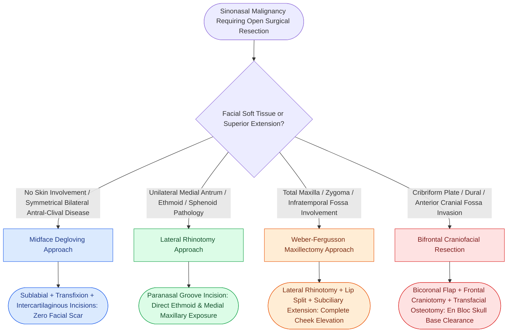

# Midface degloving, lateral rhinotomy, and Weber-Fergusson approaches provide graded open exposure for sinonasal and skull base malignancies

## Active Recall

> [!question]- What four distinct incisions comprise the midface degloving approach, and what is its chief oncologic advantage over transfacial incisions?
> *Answer / Clinical Rationale*: The midface degloving combines: (1) a **complete bilateral sublabial gingivolabial sulcus incision** from maxillary tuberosity to tuberosity, (2) a **complete transfixion incision** separating the columella from the caudal cartilaginous septum, (3) **bilateral intercartilaginous incisions** between the upper and lower lateral cartilages, and (4) **pyriform aperture releasing incisions**. Its chief advantage is providing **extensive, symmetrical bilateral exposure of the nasal cavity, maxillary sinuses, clivus, and central skull base with complete avoidance of external facial scars** and facial nerve branches.

> [!question]- How does the Weber-Fergusson approach extend the exposure of a lateral rhinotomy, and what anatomical landmarks guide the lip-split and subciliary incisions?
> *Answer / Clinical Rationale*: The **Weber-Fergusson approach** extends the lateral rhinotomy: (1) **inferiorly via a midline or philtral-trough upper-lip split** that steps across the vermilion border at 90 degrees to avoid linear contracture, and (2) **superiorly and laterally via a subciliary (or infraorbital rim) incision** positioned 2–3 mm below the lower eyelid ciliary margin extending toward the lateral canthus. This allows elevation of the entire anterior cheek soft-tissue flap off the anterior maxilla and zygomatic buttress, providing complete exposure for **total maxillectomy, orbital exenteration, and infratemporal fossa clearance**.

> [!question]- During a bifrontal craniotomy / coronal flap elevation for anterior craniofacial resection, at what anatomical landmark must dissection transition deep to the deep layer of temporalis fascia, and why?
> *Answer / Clinical Rationale*: The dissection must transition deep to the **deep layer of temporalis fascia (or deep temporalis fat pad)** approximately **1.5 cm posterior and superior to the lateral orbital rim and zygomatic arch**. This protects the **frontal (temporal) branch of the facial nerve**, which courses within the superficial temporal fascia (innominate fascia/temporoparietal fascia) directly superficial to the deep temporalis fascia layer.

## Core Clinical & Mechanistic Principles

Surgical clearance of malignant sinonasal tumors requiring open resection depends on an escalating reconstructive and exposure ladder tailored to tumor volume, anterior cranial fossa involvement, and facial skin abutment.

### The Graded Exposure Spectrum: From Degloving to Craniofacial Resection

### 1. Midface Degloving Approach *(Cummings p.96–97, Fig. 5.16)*
- **Incisions**:
  1. *Sublabial Gingivolabial Sulcus*: From right first molar across the midline to left first molar, leaving a 5-mm mucosal cuff on the gingiva for watertight closure.
  2. *Bilateral Complete Transfixion*: Releases the columella from the caudal nasal septum.
  3. *Bilateral Intercartilaginous*: Between upper and lower lateral cartilages, connecting laterally to pyriform aperture incisions.
  4. *Pyriform Circumferential Release*: Detaches the soft-tissue envelope from the bony pyriform margin.
- **Surgical Plane**: Subperiosteal elevation over the canine fossae, anterior maxillary walls, infraorbital nerves (visualized and preserved), and nasal bones up to the nasion.
- **Indications**: Inverted papilloma, juvenile nasopharyngeal angiofibroma (JNA), clival chordoma, bilateral inferior maxillectomy, and low-stage central sinonasal tumors.
- **Key Limitations**: Inadequate superior access to the frontal sinus, cribriform plate, and orbital roof.

### 2. Lateral Rhinotomy Approach *(Cummings p.98, Fig. 5.17)*
- **Incisions**: Begins midway between the medial canthus and anterior dorsal nasal profile, curves inferiorly along the paranasal facial groove, sweeps around the alar facial crease, and enters the nostril floor.
- **Critical Danger Zones & Structures Exposed**:
  - *Angular vessels*: Divided and cauterized/ligated at the superior aspect.
  - *Medial palpebral ligament*: Detached subperiosteally; requires precise anatomic repositioning to prevent telecanthus.
  - *Lacrimal sac and nasolacrimal duct*: Dissected from the lacrimal groove; the duct is sharply divided flush with the bony meatus to prevent postoperative dacryocystitis.
  - *Infraorbital nerve*: Identified exiting its foramen inferior to the rim.
- **Access**: Provides exposure for medial maxillectomy, complete unilateral ethmoidectomy, sphenoidotomy, and lateral wall resection.

### 3. Weber-Fergusson Approach *(Cummings p.98, Fig. 5.18)*
- **Extension**: Adds two critical limbs to the lateral rhinotomy:
  1. *Subciliary / Infraorbital Limb*: Courses 2–3 mm below the lower lid margin laterally past the lateral canthus, elevated in the preseptal plane.
  2. *Upper-Lip Split*: Extends vertically through the philtral column, stepping at the vermilion-cutaneous junction to prevent notch contracture.
- **Exposure**: Mobilizes the entire hemifacial soft-tissue envelope laterally off the malar eminence and maxillary skeleton, providing line-of-sight access for Brown Class III/IV total maxillectomies, orbital exenteration, and infratemporal fossa clearance requiring [[Orbital floor blowout fractures with muscle entrapment or significant enophthalmos mandate reconstruction|orbital floor reconstruction]].

### 4. Bifrontal Craniotomy / Craniofacial Resection *(Cummings p.99, Fig. 5.19)*
- **Coronal Incision**: Preauricular crease anterior to the tragus, arching over the vertex to the contralateral preauricular crease.
- **Interfascial Dissection Technique**: Dissection proceeds in the subgaleal plane superficial to the pericranium between the superior temporal lines. Approximately **1.5 cm posterior to the superior orbital rim**, an incision is made through the superficial layer of deep temporalis fascia; dissection continues deep to this layer within the deep temporal fat pad to safeguard the **frontal branch of the facial nerve**.
- **Combined Osteotomies**: A bifrontal bone flap allows intracranial retraction of the frontal lobes and olfactory bulbs, while transfacial osteotomies (via lateral rhinotomy or transnasal endoscopic portals) divide the cribriform plate and fovea ethmoidalis, achieving en bloc resection with clear dural margins.

### Contraindications to Pure Endoscopic Resection *(Cummings p.99)*
While endonasal endoscopic surgery has supplanted open approaches for many benign and early malignant sinonasal tumors, open approaches remain mandatory when:
1. Extensive soft-tissue extension involves facial skin, subcutaneous fat, or the anterior maxillary wall.
2. Tumor invades the hard palate, maxillary alveolar ridge, or anterior/lateral antral walls beyond endoscopic angular visualization.
3. Gross lateral orbital apex invasion or widespread orbital soft tissue involvement necessitates orbital exenteration.
4. Extensive lateral frontal sinus involvement exists beyond Draf III reach.
5. Extensive dural and parenchymal brain invasion requires microvascular free flap skull base reconstruction.

## Connected Concepts & Graph Traversal
- **Anatomical Foundation**: [[Hard palate and upper alveolar carcinoma require partial or total maxillectomy|Maxillectomy Defect Classification]]
- **🔗 Prognostic Stratification (Sinus)**: [[Ohngren line divides the maxillary sinus into anteroinferior and posterosuperior prognostic compartments|Ohngren Line Maxillary Prognosis]]
- **Olfactory Skull Base Malignancy**: [[Esthesioneuroblastoma arises from olfactory neuroepithelium and is staged by the Kadish classification|Esthesioneuroblastoma Kadish Staging]]
- **Reconstructive Strategy**: [[The latissimus dorsi myocutaneous free flap covers massive soft tissue and skull base defects|Skull Base Free Flap Reconstruction]]
- **Danger Zone**: [[Lip-split paramedian mandibulotomy provides wide exposure for posterior oral cavity and oropharyngeal tumors|Lip-Split & Vermilion Alignment Principles]]
- **Critical Safety**: [[Carotid blowout syndrome management includes throat packing, endovascular embolization, and carotid stenting|Carotid Bleeding Rescue]]
