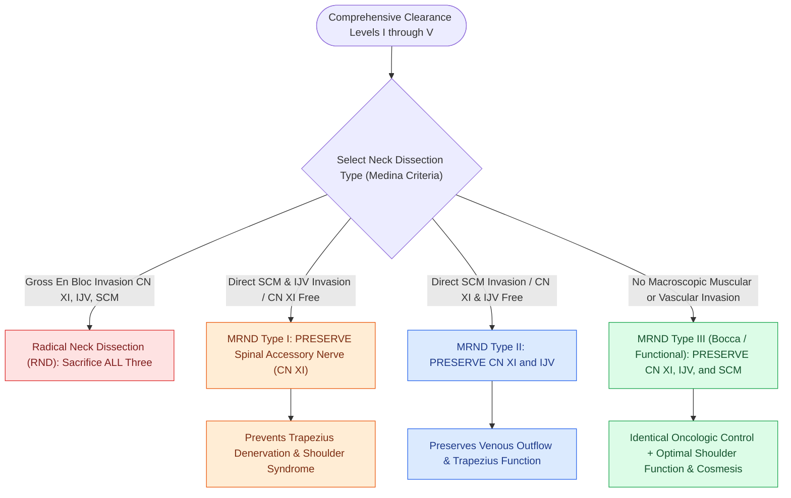

# Modified radical neck dissection types I, II, and III preserve non-lymphatic structures

## Active Recall

> [!question]- Which non-lymphatic structures are preserved in an MRND Type I vs. MRND Type III?
> *Answer / Clinical Rationale*: **MRND Type I preserves only CN XI**; **MRND Type III preserves all three (CN XI, IJV, and SCM)**.

> [!question]- Why is MRND Type III preferred over classic RND in patients without gross muscular or vascular invasion?
> *Answer / Clinical Rationale*: It provides **equivalent oncologic control** while preserving shoulder function, venous drainage, and cosmetic neck contour.

## Core Clinical & Mechanistic Principles
**Modified [[Radical neck dissection removes levels I through V while sacrificing CN XI, the IJV, and the SCM|Radical Neck Dissection]] (MRND)** achieves comprehensive clearance of **Levels I through V** while selectively preserving one or more non-lymphatic structures (Medina classification):
- **MRND Type I**: Preserves the **Spinal Accessory Nerve (CN XI)**; sacrifices the IJV and SCM.
- **MRND Type II**: Preserves the **Spinal Accessory Nerve (CN XI)** and **Internal Jugular Vein (IJV)**; sacrifices the SCM.
- **MRND Type III (Functional Neck Dissection / Bocca)**: Preserves **ALL THREE** non-lymphatic structures (CN XI, IJV, and SCM).
- **Oncologic Equivalence**: In the absence of direct macroscopic tumor invasion of the nerve, vein, or muscle, MRND Type III provides identical locoregional control to RND while vastly reducing shoulder disability, facial edema, and cosmetic deformity.

### Surgical Technique & Critical Safety Checks
- **Fascial Envelope Dissection Technique**: In MRND Type III, the investing fascia is incised along the anterior and posterior borders of the SCM, the muscle is mobilized, and the lymph node packets are resected by stripping the fascial envelopes from the IJV and carotid sheath.
- **Bilateral Clearance**: When bilateral comprehensive neck dissection is required, MRND Type III preserves venous return and prevents massive acute head and neck edema.

## Connected Concepts & Graph Traversal
- **Radical Sacrifice Benchmark**: [[Radical neck dissection removes levels I through V while sacrificing CN XI, the IJV, and the SCM|Radical Neck Dissection]]
- **Selective Lymphadenectomy**: [[Selective neck dissection targets high-risk nodal basins while sparing low-risk cervical levels|Selective Neck Dissection]]
- **Spinal Accessory Topography**: [[The spinal accessory nerve is identified at the Erb point and anterior border of the SCM|CN XI Identification at Erb's Point]]
- **Internal Jugular Chain Mobilization**: [[Levels II through IV internal jugular chain dissection mobilizes the carotid sheath packet|Carotid Sheath & IJV Mobilization]]
- **Level V Posterior Triangle**: [[Level V dissection requires skeletonization of the prevertebral fascia while protecting the phrenic nerve|Level V Posterior Triangle Dissection]]
- **Subplatysmal Flap Elevation**: [[Subplatysmal flap elevation and Martin's maneuver protect the marginal mandibular nerve|Subplatysmal Flap Elevation]]
