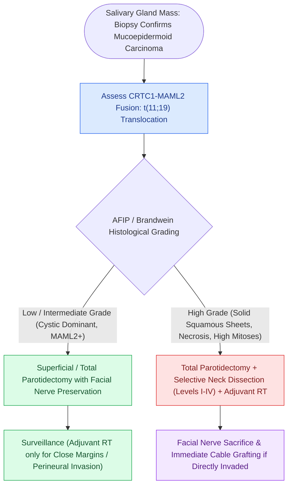

# Mucoepidermoid carcinoma is graded by AFIP Brandwein criteria and driven by CRTC1-MAML2 translocation

## Active Recall

> [!question]- What specific gene fusion resulting from a t(11;19) translocation characterizes mucoepidermoid carcinoma?
> *Answer / Clinical Rationale*: The **CRTC1-MAML2 gene fusion**.

> [!question]- What are the three cellular components that define mucoepidermoid carcinoma on histology?
> *Answer / Clinical Rationale*: **Mucin-secreting cells**, **squamous (epidermoid) cells**, and **intermediate cells**.

## Core Clinical & Mechanistic Principles
**Mucoepidermoid Carcinoma (MEC)** is the most common primary malignant neoplasm of both major and minor salivary glands:
- **Histopathological Composition**:
  - Variable mixture of three cell types: (1) **Mucin-secreting cells**, (2) **Squamous (epidermoid) cells**, and (3) **Intermediate (clear) cells**.
- **Molecular Hallmark**:
  - The **$\mathbf{t(11;19)(q21;p13)}$ translocation**, fusing the *CRTC1* (formerly *MECT1*) and *MAML2* genes.
  - *CRTC1-MAML2* fusion is present in $>60\text{–}80\%$ of low/intermediate-grade MECs and correlates with significantly better overall survival.
- **Histologic Grading (AFIP / Brandwein System)**:
  - **Low-Grade**: Mucin-rich cysts, minimal pleomorphism; $<5\%$ nodal spread.
  - **Intermediate-Grade**: Solid nests mixed with cysts; moderate atypia.
  - **High-Grade**: Predominantly solid squamous sheets, necrosis, high mitotic rate, perineural/lymphovascular invasion; mimics squamous cell carcinoma ($>50\text{–}70\%$ nodal metastasis).

### Surgical Technique & Critical Safety Checks
- **Surgical Management**:
  - *Low-Grade*: [[Superficial parotidectomy dissects the facial nerve branches to resect the lateral salivary lobe|Superficial parotidectomy]] with [[Oncologic clear margins require at least five millimeters of histological normal tissue|clear margins]] and facial nerve preservation.
  - *High-Grade*: Total [[The facial nerve main trunk is localized using the tragal pointer, tympanomastoid suture, and digastric ridge|parotidectomy]] + Neck dissection (Levels I–III / I–IV) + Postoperative Adjuvant Radiotherapy.

## Connected Concepts & Graph Traversal
- **Adenoid Cystic Carcinoma**: [[Adenoid cystic carcinoma exhibits prominent perineural invasion and late distant hematogenous metastasis|Adenoid Cystic Carcinoma]]
- **Salivary Duct Carcinoma**: [[Salivary duct carcinoma is an aggressive high-grade malignancy expressing androgen receptors and HER2|Salivary Duct Carcinoma]]
- **Facial Nerve Sacrifice & Grafting**: [[Total parotidectomy with facial nerve sacrifice is indicated for direct malignant nerve invasion|Total Parotidectomy with CN VII Sacrifice]]
- **Immediate Cable Nerve Grafting**: [[Immediate facial nerve grafting with the great auricular or sural nerve restores facial reanimation|Immediate Cable Nerve Grafting]]
- **Parotid Landmarks**: [[The facial nerve main trunk is localized using the tragal pointer, tympanomastoid suture, and digastric ridge|Parotid Facial Nerve Corridors]]
- **Neck Dissection Standards**: [[Modified radical neck dissection types I, II, and III preserve non-lymphatic structures|Modified Radical Neck Dissection]]
- **Clear Cell Differential**: [[Salivary clear cell neoplasms comprise a challenging diagnostic spectrum characterized by distinct immunohistochemical profiles and recurrent gene fusions|Salivary Clear Cell Neoplasm Spectrum]]
- **Malignant Degeneration Differential**: [[Carcinoma ex pleomorphic adenoma arises from longstanding benign mixed tumors and is stratified by capsular invasion into noninvasive, minimally invasive, and widely invasive subtypes|Carcinoma ex Pleomorphic Adenoma]]
