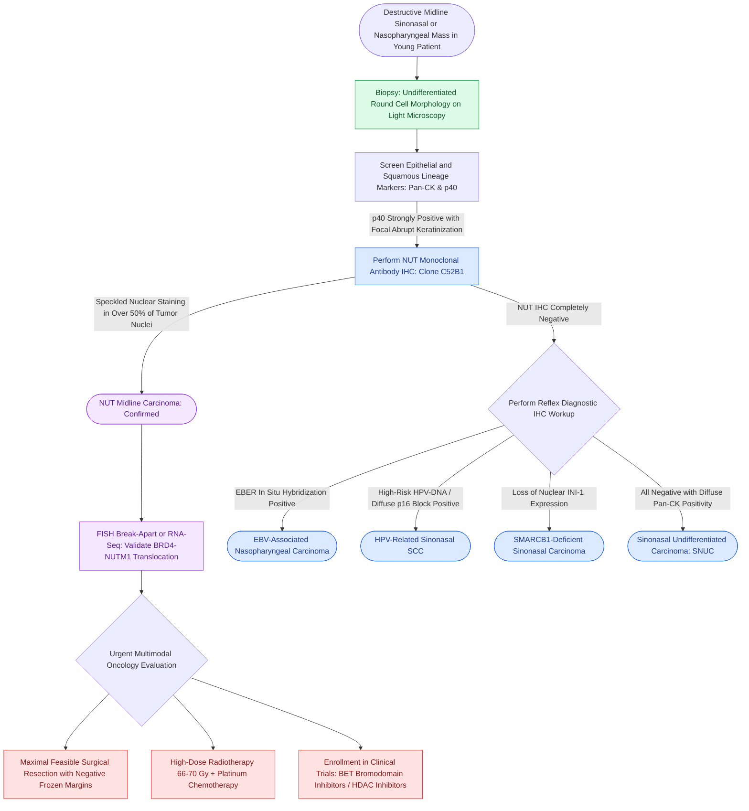

# NUT midline carcinoma is an aggressive poorly differentiated squamous neoplasm harboring BRD4-NUT fusions with abrupt keratinization

## Active Recall

> [!question]- What pathognomonic chromosomal translocation defines NUT midline carcinoma, and what chimeric fusion oncoprotein does it generate?
> *Answer / Clinical Rationale*: **t(15;19)(q14;p13.1)**, which fuses the **BRD4** gene on chromosome 19p13.1 to the **NUTM1** (NUT midline carcinoma family member 1) gene on chromosome 15q14. In approximately one-third of cases, variant fusions occur with *BRD3* or *NSD3*. The BRD4-NUT chimeric protein acts as an epigenetic driver by tethering histone acetyltransferases (such as p300) to acetylated chromatin, creating hyperacetylated "megadomains" that suppress squamous differentiation and drive unrelenting cellular proliferation.

> [!question]- What is the pathognomonic histopathologic appearance of NUT carcinoma on hematoxylin and eosin (H&E) staining?
> *Answer / Clinical Rationale*: Sheets or lobules of **monomorphic, poorly differentiated round-to-ovoid cells** with high nuclear-to-cytoplasmic ratios, prominent nucleoli, and brisk mitotic activity, punctuated by foci of **abrupt squamous differentiation**. Unlike conventional squamous cell carcinoma, where keratinization progresses through a continuous cytologic gradient of dyskeratosis and intercellular bridging, NUT carcinoma exhibits sudden, well-formed keratin pearls immediately adjacent to totally undifferentiated, primitive round cells.

> [!question]- What diagnostic immunohistochemical stain confirms the diagnosis of NUT carcinoma, and what staining pattern is observed?
> *Answer / Clinical Rationale*: **NUT monoclonal antibody (clone C52B1)**. It demonstrates a distinctive, **diffuse speckled (punctate) nuclear staining pattern** in $\ge 50\%$ of tumor cell nuclei, which is $>95\%$ sensitive and $>99\%$ specific. Conventional cytokeratins and squamous markers (p63, p40) are positive, while neuroendocrine (chromogranin) and viral markers (EBV-EBER, HPV-p16) are typically negative.

## Core Clinical & Mechanistic Principles

NUT midline carcinoma (NMC) is an extraordinarily aggressive, genetically distinct poorly differentiated malignancy defined by rearrangements of the *NUTM1* gene *(Cummings p.227–234)*. Historically misclassified as sinonasal undifferentiated carcinoma (SNUC), lymphoepithelioma-like carcinoma, or basaloid squamous cell carcinoma, NMC predominantly arises along the anatomic midline of the upper aerodigestive tract (nasal cavity, paranasal sinuses, nasopharynx, epiglottis) and mediastinum in young adults and children *(Cummings p.231–234)*.

### Molecular Pathogenesis & Epigenetic Arrest

The driving molecular engine of NMC is the **BRD4-NUTM1** chimeric fusion oncoprotein:
- **BRD4** is a bromodomain and extra-terminal (BET) family epigenetic reader that binds acetylated lysines on histones H3 and H4.
- The fusion recruits the histone acetyltransferase **p300**, catalyzing broad regions of hyperacetylated chromatin ("super-enhancers" or "megadomains") that stimulate continuous transcription of oncogenes such as *MYC* and *TP63*.
- Concurrently, this sequestered epigenetic machinery causes global histone hypoacetylation across the remainder of the genome, shutting down transcription of genes required for squamous epithelial maturation.
- The cells remain frozen in an undifferentiated, highly proliferative state, explaining the striking histology where undifferentiated sheets abruptly transition into mature squamous keratin pearls.

### Histopathologic Characteristics

1. **Undifferentiated Cytologic Matrix**:
   - Monomorphic round to slightly ovoid primitive cells arranged in diffuse sheets, nests, or vague trabeculae.
   - Cells display vesicular chromatin, prominent central nucleoli, brisk mitoses, and extensive apoptosis with karyorrhectic debris.
   - Prominent neutrophilic infiltration is frequently scattered among the malignant cells.
2. **Abrupt Squamous Differentiation**:
   - Foci of distinct keratinization with glassy pink cytoplasm and concentric squamous pearls that emerge sharply from the sea of primitive blast-like cells.
   - Absence of intermediate maturing squamous layers or dysplastic transitional zones.

### Diagnostic Immunohistochemical Profile

| Biomarker | Staining Pattern in NUT Carcinoma | Differential Utility |
| :--- | :--- | :--- |
| **NUT (Clone C52B1)** | **Diffuse (>50%) speckled nuclear positivity** | Definitive pathognomonic diagnostic confirmation |
| **p40 / p63** | Strong and diffuse nuclear positivity | Establishes squamous lineage; excludes lymphoma and sarcoma |
| **Pan-Cytokeratin (AE1/AE3)** | Moderate to strong cytoplasmic positivity | Confirms epithelial carcinoma nature |
| **CK5/6** | Patchy to diffuse positive | Further supports squamous differentiation |
| **p16 (INK4a)** | Typically negative or focal non-block | Distinguishes from HPV-mediated multiphenotypic carcinoma |
| **EBER (EBV in situ)** | Strictly negative | Excludes non-keratinizing nasopharyngeal carcinoma (NPC) |
| **Synaptophysin / Chromo** | Negative (rarely weak focal synaptophysin) | Excludes high-grade neuroendocrine carcinoma |
| **SMARCB1 (INI-1)** | Retained normal nuclear expression | Excludes INI-1 deficient sinonasal carcinoma |

### Clinical Behavior & Therapeutic Realities

- **Prognosis**: Historically dismal, with a median overall survival of 6.7 to 9.7 months. Patients rapidly develop extensive local destruction, early cervical lymph node metastasis, and distant hematogenous spread to bone, lungs, and liver.
- **Surgical Role**: In non-metastatic resectable disease, initial complete gross surgical resection achieving [[Oncologic clear margins require at least five millimeters of histological normal tissue|histologic negative margins]] combined with early postoperative radiotherapy offers the best opportunity for prolonged local control.
- **Targeted Therapies**: Novel therapeutic strategies directly target the epigenetic fusion mechanism:
  1. **BET Bromodomain Inhibitors** (e.g., molibresib, birabresib): Competitively displace BRD4-NUT from chromatin, promoting rapid squamous differentiation and growth arrest.
  2. **Histone Deacetylase (HDAC) Inhibitors**: Reverse global histone hypoacetylation, synergizing with BET inhibitors in preclinical and clinical trials.

## Connected Concepts & Graph Traversal
- **🔗 Undifferentiated Diagnostic Benchmark (Sinus)**: [[Sinonasal undifferentiated carcinoma exhibits aggressive neuroendocrine features requiring multimodal therapy|Sinonasal Undifferentiated Carcinoma]]
- **Viral-Driven Nasopharyngeal Differential**: [[Nasopharyngeal carcinoma is an EBV-driven malignancy treated primarily with radiation and concurrent chemotherapy|Nasopharyngeal Carcinoma]]
- **Viral-Driven Oropharyngeal Counterpart**: [[HPV-positive oropharyngeal squamous cell carcinoma exhibits distinct biological behavior and staging|HPV-Positive Oropharyngeal Carcinoma]]
- **Radiotherapeutic Fractionation Kinetics**: [[Altered radiation fractionation schemes exploit differential repair and repopulation kinetics to optimize the therapeutic ratio in head and neck cancer|Radiation Fractionation Principles]]
- **🔗 Endoscopic Skull Base Corridor (Sinus)**: [[Transcribriform EEA provides access to olfactory groove meningiomas and esthesioneuroblastomas|Transcribriform EEA Corridor]]
- **Biphasic Multilineage Malignancy**: [[Biphasic sinonasal malignancies exhibit divergent epithelial, mesenchymal, and neural differentiation requiring diagnostic immunohistochemical panels|Biphasic Sinonasal Malignancies]]
