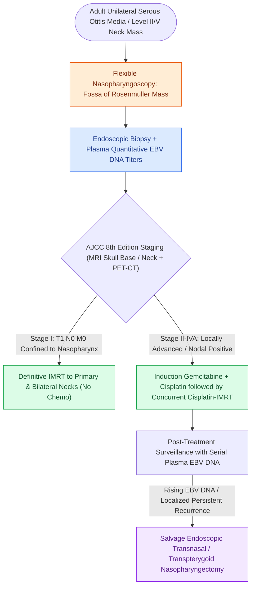

# Nasopharyngeal carcinoma is an EBV-driven malignancy treated primarily with radiation and concurrent chemotherapy

## Active Recall

> [!question]- Why does unilateral serous otitis media open the NPC diagnostic pathway?
> *Answer / Clinical Rationale*: Tumor at the fossa of Rosenmuller obstructs the eustachian tube orifice — effusion is the tumor's first ambassador.

> [!question]- What does circulating EBV DNA add across the disease course?
> *Answer / Clinical Rationale*: Endemic screening, pretreatment prognostication, and sensitive post-treatment surveillance — rises antedate clinical relapse.

## Core Clinical & Mechanistic Principles
- Epidemiology-biology lock: endemic (southern China, Southeast Asia, North Africa) **WHO type III undifferentiated non-keratinizing** disease is EBV-driven; sporadic keratinizing (WHO I) behaves more like conventional SCC; risk cofactors include salted-fish nitrosamines and HLA associations.
- Presentation is drainage anatomy: painless level II/V and **retropharyngeal (Rouviere)** nodes, unilateral serous otitis (tubal obstruction), epistaxis, and cranial neuropathies (V, VI via petroclival extension) — half present with a neck mass.
- **Plasma EBV DNA** is a working biomarker: screening in endemic regions, prognosis, and post-treatment surveillance; rising titers precede clinical recurrence.
- The fossa of Rosenmuller is the origin; primary surgery has essentially no role at presentation because the anatomy is unresectable and the tumor is exquisitely radiosensitive.

### Management & Critical Safety Checks
- Treatment: **IMRT** to primary and necks; concurrent cisplatin for stage II and above, with induction or adjuvant chemotherapy by risk (gemcitabine-cisplatin induction in locoregionally advanced disease has trial support).
- Otolaryngology's roles: diagnosis (endoscopic biopsy), eustachian sequelae, and **salvage nasopharyngectomy** (endoscopic or maxillary-swing) for localized radiorecurrent disease (see [[Adult unilateral otitis media with effusion mandates nasopharyngoscopy to exclude nasopharyngeal carcinoma|Adult Unilateral OME Diagnostic Flag]]).

## Connected Concepts & Graph Traversal
- **Otologic Presentation**: [[Adult unilateral otitis media with effusion mandates nasopharyngoscopy to exclude nasopharyngeal carcinoma|Adult Unilateral OME Diagnostic Flag]]
- **Nodal Drainage Anatomy**: [[Cervical lymph node levels I through VII define regional metastatic drainage basins|Levels II, V & Node of Rouviere]]
- **Skull Base Corridor**: [[Transpterygoid EEA exposes juvenile nasopharyngeal angiofibromas and lateral sphenoid defects|Transpterygoid Endoscopic Corridors]]
- **Radiation Toxicity**: [[Post-radiation carotid vasculopathy and osteoradionecrosis represent severe late radiotherapy sequelae|Late Radiation Sequelae]]
- **Systemic Therapy**: [[Cetuximab targets EGFR overexpression while pembrolizumab and nivolumab inhibit PD-1 in head and neck SCC|Systemic Chemotherapy & PD-1 Blockade]]
- **🔗 Differential Diagnosis (Pediatrics)**: [[Pediatric head and neck rhabdomyosarcoma stratifies into favorable orbital and unfavorable parameningeal sites managed with multimodality chemoradiation|Parameningeal RMS as Pediatric Nasopharyngeal Malignancy]]
- **Poorly Differentiated Midline Differential**: [[NUT midline carcinoma is an aggressive poorly differentiated squamous neoplasm harboring BRD4-NUT fusions with abrupt keratinization|NUT Midline Carcinoma]]
