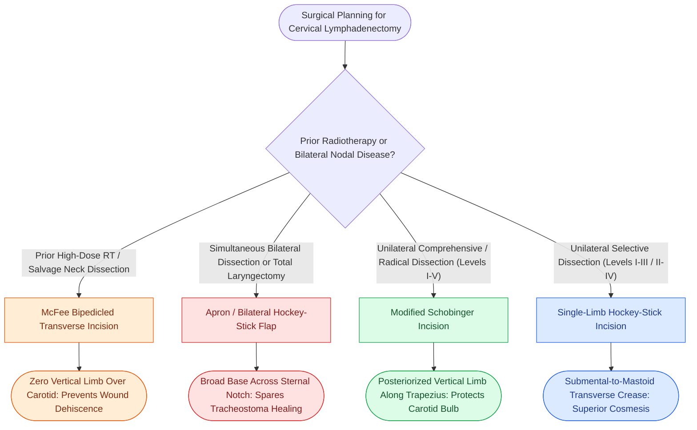

# Neck dissection incision design balances surgical exposure against carotid coverage and vascular compromise in irradiated tissue

## Active Recall

> [!question]- Why is the McFee parallel incision specifically favored in salvage neck dissection following definitive chemoradiation?
> *Answer / Clinical Rationale*: The **McFee incision** utilizes **two separate, parallel transverse incisions** (a superior submandibular incision placed 2 cm below the inferior border of the mandible, and an inferior supraclavicular incision 2 cm above the clavicle) **without any vertical connecting limb**. In irradiated, microvascularly compromised cervical skin, vertical limbs that cross Langer's lines suffer high rates of distal flap ischemia and wound breakdown directly over the carotid sheath. The McFee incision creates a bipedicled cutaneous bridge whose blood supply is nourished axially from both the anterior and posterior dermal plexuses, **virtually eliminating carotid blowout from overlying flap breakdown**.

> [!question]- How does the Modified Schobinger incision protect against carotid blowout compared with historic trifurcation incisions (e.g., Crile or Martin)?
> *Answer / Clinical Rationale*: Historic incisions placed a tri-radiate or T-junction directly over the carotid bifurcation—precisely where flap tips suffer maximal ischemia, leading to dehiscence and direct salivary exposure of the carotid artery. The **Modified Schobinger incision** avoids this by: (1) raising a broad anterosuperior platysmal flap based on the submental and facial vasculature, and (2) **directing the vertical descending limb posteriorly along the anterior border of the trapezius muscle**. If tip slough occurs, the carotid sheath remains safely protected beneath the muscular bed of the sternocleidomastoid and intact anterior skin.

> [!question]- What anatomical landmarks dictate the placement of a unilateral hockey-stick incision, and what are its surgical limitations?
> *Answer / Clinical Rationale*: The **hockey-stick incision** begins in the mastoid crease behind the lobule, curves anteriorly along a natural mid-cervical skin crease at or below the level of the hyoid bone, and turns superiorly toward the submental symphysis. Its chief limitation is that while it affords excellent, scar-camouflaged exposure for **selective neck dissection (Levels I–III or II–IV)**, accessing Level Vb (supraclavicular triangle) requires excessive upward retraction that risks traction neuropraxia of the spinal accessory nerve.

## Core Clinical & Mechanistic Principles

Every cervical lymphadenectomy incision must satisfy four non-negotiable oncologic and surgical mandates:
1. Provide adequate visualization of all targeted nodal boundaries.
2. Preserve reliable axial and random blood supply to the elevated cervical cutaneous flaps.
3. Avoid placing a trifurcation or healing scar directly over the common and internal carotid arteries.
4. Minimize scar contracture by aligning transverse incisions within natural skin relaxation tension lines (Langer's lines).

### Incision Taxonomy & Biomechanical Profile *(Cummings p.78–79, Fig. 5.2)*

### Comparative Ledger of Standard Incisions

| Incision Pattern | Design Geometry *(Fig. 5.2)* | Primary Indication | Critical Advantage | Craft Limitation |
| :--- | :--- | :--- | :--- | :--- |
| **Hockey Stick** | Curvilinear transverse limb in upper/mid neck with anterior submental curve | Unilateral selective neck dissection (Levels I–III or II–IV) | Superior aesthetic camouflage; zero vertical scar crossing neck | Difficult exposure of Level Vb; requires vigorous retraction |
| **Boomerang** | Angled single-limb incision curving from mastoid across mid-jugular region | Lateral neck dissection (Levels II–IV) | Fast opening and closure; avoids submental extension | Incomplete Level I clearance |
| **McFee** | Two parallel transverse incisions separated by at least 6 cm skin bridge | Post-radiation salvage neck dissection | Bipedicled cutaneous bridge maintains axial flow; zero carotid exposure | Tunneling beneath skin bridge increases operative time |
| **Modified Schobinger** | Transverse submandibular limb with posteriorized descending limb along trapezius | Comprehensive neck dissection (MRND or Radical) | Eliminates trifurcation over carotid bifurcation | Posterior flap tip can suffer marginal ischemia if thinned |
| **Apron Flap** | Bilateral mastoid-to-mastoid incision curving across low neck / sternal notch | Bilateral neck dissection / Total laryngectomy | Expansive bilateral exposure; keeps scar away from pharyngeal closure | Dependent inferior edema of the large anterior apron |

Exposure of the posterior cervical triangle during modified radical and lateral dissections requires early identification of [[The spinal accessory nerve is identified at the Erb point and anterior border of the SCM|cranial nerve XI]] as it enters the sternocleidomastoid muscle, especially during [[Selective neck dissection targets high-risk nodal basins while sparing low-risk cervical levels|selective neck dissection]].

### Surgical Craft: Subplatysmal Elevation & Nerve Safeguards
- **Flap Elevation Plane**: Dissection must proceed strictly in the subplatysmal plane, maintaining the superficial layer of deep cervical fascia intact over the nodal basins. This ensures that the subdermal vascular plexus of the platysma is preserved on the skin flap.
- **Marginal Mandibular Nerve Protection**: Along the superior limb of any neck incision, the marginal mandibular branch of the facial nerve is protected by elevating the submandibular fascia cephalad to the inferior border of the mandible (Martin's maneuver) or by dividing the posterior facial vein and reflecting it superiorly with the cervical fascia.
- **Carotid Sheath Cushioning**: In radical neck dissections where the internal jugular vein and sternocleidomastoid muscle are sacrificed, the carotid artery should be cushioned using a local muscle transfer (e.g., levator scapulae or digastric muscle transposition) or dermal matrix prior to closing skin flaps.

## Connected Concepts & Graph Traversal
- **Anatomical Foundation**: [[Cervical lymph node levels I through VII define regional metastatic drainage basins|Lymph Node Levels I Through VII]]
- **Surgical Craft**: [[Subplatysmal flap elevation and Martin's maneuver protect the marginal mandibular nerve|Subplatysmal Elevation & Marginal Nerve Protection]]
- **Radical Procedure**: [[Radical neck dissection removes levels I through V while sacrificing CN XI, the IJV, and the SCM|Radical Neck Dissection]]
- **Critical Safety / Complication**: [[Carotid blowout syndrome is classified into threatened, impending, and acute hemorrhage|Carotid Blowout Pathogenesis]]
- **Vascularized Muscle Flap Coverage**: [[Pectoralis major muscle flap reinforcement prevents pharyngocutaneous fistula in salvage laryngectomy|Pectoralis Major Carotid Protection]]
- **Therapeutic Context**: [[Intensity-modulated radiation therapy and cisplatin radiosensitization form the standard definitive chemoradiation regimen|Irradiated Salvage Neck Considerations]]
