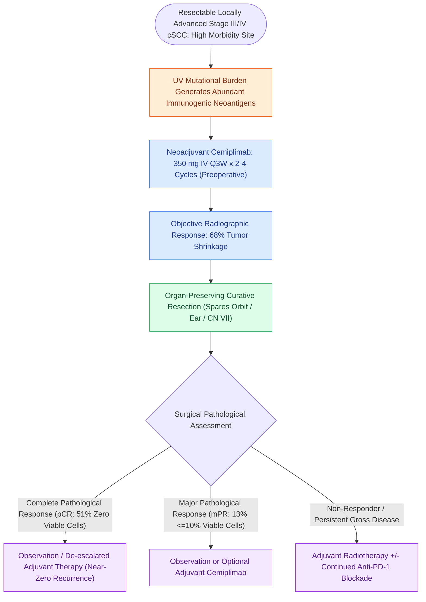

# Neoadjuvant cemiplimab achieves high pathological response rates in resectable locally advanced cutaneous squamous cell carcinoma

## Active Recall

> [!question]- Why does cutaneous squamous cell carcinoma exhibit profound susceptibility to anti-PD-1 immunotherapy compared to many other epithelial malignancies?
> *Answer / Clinical Rationale*: Chronic UV radiation generates an exceptionally **high tumor mutational burden (TMB)** with numerous somatic mutations, creating abundant immunogenic neoantigens that cytotoxic T-cells recognize once PD-1 inhibition is lifted.

> [!question]- What pathological complete response (pCR) rate was demonstrated in the pivotal Gross et al. NEJM trial for neoadjuvant cemiplimab in cSCC?
> *Answer / Clinical Rationale*: A **$51\%$ complete pathological response rate ($0\%$ residual viable tumor)**, with an overall major pathological response rate of over $70\%$.

> [!question]- How does neoadjuvant cemiplimab alter surgical decision-making in periorbital and auriculo-temporal cSCC?
> *Answer / Clinical Rationale*: Marked tumor involution allows for **organ-preserving resections**, frequently avoiding planned orbital exenterations, extensive cranial base resections, or total ear amputations.

## Core Clinical & Mechanistic Principles
The groundbreaking **Phase II Neoadjuvant Cemiplimab Trial (Gross et al., *New England Journal of Medicine* 2022)** revolutionized the management of surgically resectable, locally advanced **Cutaneous Squamous Cell Carcinoma (cSCC)** of the head and neck:

- **Trial Design & Protocol**:
  - *Study Population*: Patients with stage III or IV (M0) resectable cSCC involving the head, neck, or trunk where upfront surgical resection would result in extensive morbidity (e.g., orbital exenteration, total auriculectomy, extensive [[Total parotidectomy with facial nerve sacrifice is indicated for direct malignant nerve invasion|facial nerve sacrifice]], or major craniectomy).
  - *Regimen*: **Cemiplimab ($350\text{ mg}$ IV every 3 weeks for up to 4 cycles / 2–4 doses preoperatively)** $\rightarrow$ curative-intent [[High-risk cutaneous squamous cell carcinoma drains first to parotid and perifacial nodal basins|surgical resection and parotid/neck lymphadenectomy]] $\rightarrow$ optional adjuvant cemiplimab or radiation.
- **Unprecedented Pathological & Clinical Response Rates**:
  - **Complete Pathological Response (pCR)**: **$51\%$** of patients had zero residual viable tumor cells on surgical histopathology.
  - **Major Pathological Response (mPR)**: **$13\%$** had $\le 10\%$ residual tumor cells (yielding an overall **pathological response rate of $64\text{–}73\%$**).
  - **Objective Radiographic Response Rate (ORR)**: **$68\%$** by central review.
  - **Event-Free Survival**: Exceptional 1- and 2-year event-free survival ($>85\%$), with pathological responders experiencing near-zero local or distant recurrences.
- **Surgical & Functional Paradigm Shift (Organ Preservation)**:
  - Dramatic tumor shrinkage and immune-mediated clearance converted extensive, mutilating surgical operations into focused, **organ-preserving procedures**, sparing the orbit, globe, facial nerve trunks, and external ear canal.
- **High Tumor Mutational Burden (TMB) in cSCC**:
  - Cutaneous SCC exhibits one of the highest tumor mutational burdens among all human solid malignancies due to chronic ultraviolet (UV) radiation-induced DNA damage.
  - This extreme mutational density produces abundant novel immunogenic neoantigens, rendering cSCC exceptionally sensitive to **PD-1 checkpoint inhibition**.

### Surgical Technique & Critical Safety Checks
- **Margin Assessment in Post-Immunotherapy Resections**: The resected surgical specimen frequently demonstrates massive histiocytic infiltrate, cholesterol clefts, dense fibrosis, and foreign-body giant cell reactions replacing tumor. Frozen sections and permanent margins must be carefully oriented to confirm true absence of residual neoplastic cells.

## Connected Concepts & Graph Traversal
- **Cutaneous Nodal Basins**: [[High-risk cutaneous squamous cell carcinoma drains first to parotid and perifacial nodal basins|Cutaneous SCC Lymphatic Drainage & Parotid Basin]]
- **Perioperative Mucosal Immunotherapy**: [[KEYNOTE-689 establishes neoadjuvant and adjuvant pembrolizumab as standard for locally advanced head and neck squamous cell carcinoma|KEYNOTE-689 Trial in HNSCC]]
- **Melanoma Sentinel Node Biopsy**: [[Cutaneous head and neck melanoma is staged by Breslow depth and sentinel lymph node biopsy|Head and Neck Melanoma & MSLT Trials]]
- **Parotidectomy Craft**: [[Superficial parotidectomy dissects the facial nerve branches to resect the lateral salivary lobe|Superficial Parotidectomy for Cutaneous Metastasis]]
- **Microvascular Scalp Reconstruction**: [[The latissimus dorsi myocutaneous free flap covers massive soft tissue and skull base defects|Scalp & Skull Base Reconstruction]]
