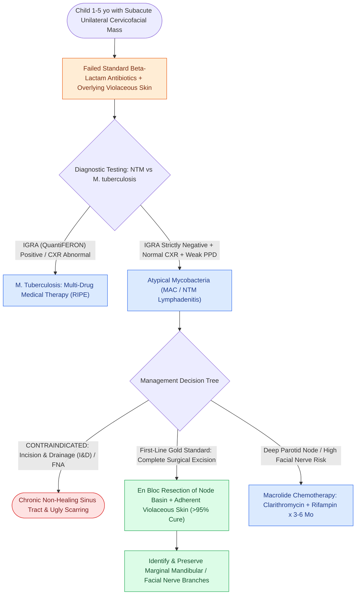

# Nontuberculous mycobacterial lymphadenitis presents as a violaceous cervicofacial mass treated with complete surgical excision

## Active Recall

> [!question]- What is the first-line treatment of choice for nontuberculous mycobacterial (NTM) cervicofacial lymphadenitis in a 2-year-old child, and why is simple incision and drainage (I&D) contraindicated?
> *Answer / Clinical Rationale*: **Complete surgical excision** of the involved lymph node basin with adherent skin is the standard of care ($>95\%$ cure rate). **Incision and drainage is strictly contraindicated** because it reliably creates a chronic, non-healing, draining sinus tract.

> [!question]- How does an Interferon-Gamma Release Assay (IGRA / QuantiFERON) help differentiate NTM lymphadenitis from Mycobacterium tuberculosis lymphadenitis?
> *Answer / Clinical Rationale*: IGRA is **strictly negative in NTM infections** (because MAC lacks the specific antigens ESAT-6 and CFP-10 present in *M. tuberculosis*), whereas it is positive in tuberculosis.

## Core Clinical & Mechanistic Principles
**Nontuberculous Mycobacterial (NTM) Lymphadenitis** (also termed atypical mycobacterial infection) is a localized chronic granulomatous infection of head and neck lymph nodes in immunocompetent young children:

- **Epidemiology & Pathogens**:
  - Classic age range: **$1\text{ to }5\text{ years}$** (peak around $2\text{–}3\text{ years}$, coinciding with oral exploratory behavior and primary dentition eruption).
  - Primary organism: **$Mycobacterium\ avium\text{-}intracellulare$ complex (MAC, $>80\%$)**, followed by *M. scrofulaceum* and *M. kansasii*.
  - Source: Ingestion of environmental water, soil, or dust; **not transmitted person-to-person**.

- **Clinical Progression & The "Violaceous Sign"**:
  1. **Early Stage**: Painless, unilateral, non-tender cervical (submandibular or preauricular/parotid) lymphadenopathy that fails standard empiric beta-lactam antibiotics.
  2. **Intermediate Stage**: Lymph node liquefies; the overlying skin thins and turns a characteristic **erythematous to violaceous (purplish) hue**.
  3. **Late Stage**: Spontaneous rupture through the attenuated skin, producing a **chronic draining sinus tract** with unsightly scarring that may persist for months to years if not excised.
  4. **Absence of Systemic Signs**: Patients lack fever, weight loss, night sweats, or pulmonary symptoms.

- **Diagnostic Workup & Differentiation from Tuberculosis (TB)**:
  - **Tuberculin Skin Test (PPD)**: Typically negative or weakly reactive ($<10\text{ mm}$ induration). An induration $\ge 15\text{ mm}$ strongly suggests *M. tuberculosis*.
  - **Interferon-Gamma Release Assay (IGRA / QuantiFERON-TB Gold)**: **Strictly NEGATIVE** in NTM (specifically targets ESAT-6 and CFP-10 proteins found only in *M. tuberculosis* complex).
  - **Chest Radiograph**: Normal (no hilar lymphadenopathy or parenchymal infiltrates).
  - **AFB Stain & Mycobacterial Culture**: Acid-fast bacilli (AFB) seen in only $30\text{–}50\%$ of smears; automated broth culture (MGIT) and PCR confirm the species.

### Surgical Strategy & Craft Nuance
1. **First-Line Standard of Care: Complete Surgical Excision**:
   - Complete en bloc excision of the involved lymph nodes and any adherent, attenuated violaceous skin achieves **$>95\%$ immediate cure rate** with minimal recurrence.
   - **Critical Safety Guard**: Facial nerve branches (marginal mandibular or frontal branches) must be carefully identified and protected during dissection, as surrounding granulomatous inflammation distorts soft tissue planes.
2. **Strict Contraindication to Incision & Drainage (I&D) or Fine-Needle Aspiration (FNA)**:
   - Simple I&D or aspiration invariably leads to **chronic sinus tract formation with non-healing purulent drainage for $>6\text{–}12\text{ months}$**.
3. **Medical Therapy (Macrolide-Based)**:
   - Indicated only when complete surgical excision carries excessive risk of permanent facial nerve paralysis (e.g., deep parotid lobe involvement) or in recurrent disease.
   - Regimen: **Clarithromycin or Azithromycin + Rifampin** (or Ethambutol) for $3\text{–}6\text{ months}$ (see [[Deep cervical fascia divides into superficial, middle, and deep layers that define surgical planes|Cervical Fascial Spaces]]).

## Connected Concepts & Graph Traversal
- **Deep Cervical Fascia & Spaces**: [[Deep cervical fascia divides into superficial, middle, and deep layers that define surgical planes|Cervical Fascial Spaces]]
- **Marginal Mandibular Nerve Protection**: [[The marginal mandibular nerve courses deep to platysma over the facial vessels|Marginal Mandibular Nerve Landmarks]]
- **Pediatric Midline & Congenital Cysts**: [[Thyroglossal duct cyst tract tracks from the foramen cecum through the hyoid bone to the anterior neck|Thyroglossal Duct Cyst]]
- **Branchial Cleft Anomalies**: [[Each branchial arch packages one nerve, one artery, one cartilage bar, and one muscle group|Branchial Cleft Anomalies]]
- **Cervical Nodal Drainage Levels**: [[Cervical lymph node levels I through VII define regional metastatic drainage basins|Cervical Lymph Node Levels I–VII]]
