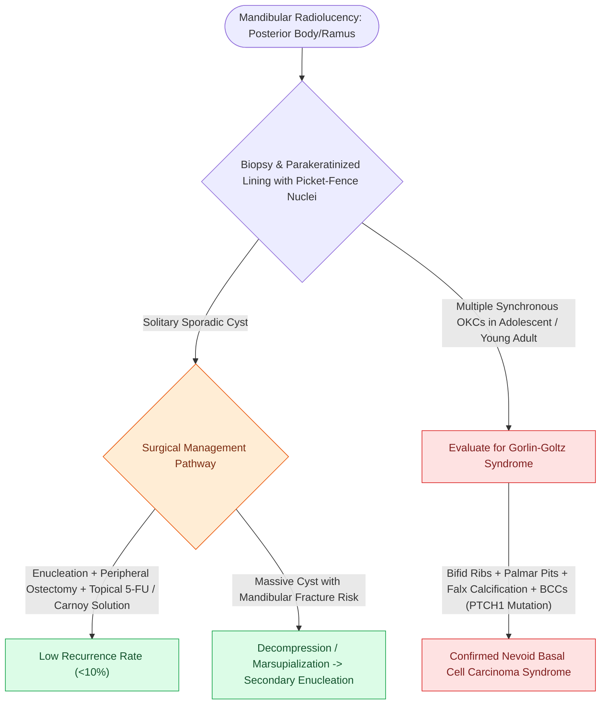

# Odontogenic keratocysts arise from PTCH1 mutations in Gorlin syndrome and exhibit high recurrence after simple enucleation

## Active Recall

> [!question]- What pathognomonic histological features define an odontogenic keratocyst (OKC)?
> *Answer / Clinical Rationale*: - (1) A uniform **thin, friable, 6–8 cell-layer-thick parakeratinized stratified squamous epithelium** lacking rete ridges. - (2) A prominent, palisaded basal cell layer with hyperchromatic, elongated nuclei resembling **"picket fences"** or **"tombstones"**. - (3) A corrugated or **wavy parakeratin surface layer** sloughing into a lumen filled with cheesy, creamy keratin debris. - (4) Frequent **daughter/satellite microcysts** within the fibrous connective tissue capsule, predisposing to recurrence if enucleated incompletely.

> [!question]- What clinical syndrome is characterized by multiple synchronous or metachronous odontogenic keratocysts, and what is its genetic driver?
> *Answer / Clinical Rationale*: **Nevoid Basal Cell Carcinoma Syndrome (NBCCS / Gorlin-Goltz Syndrome)**, an autosomal dominant disorder caused by germline mutations in the **$PTCH1$ (Patched-1)** tumor suppressor gene on chromosome **9q22.3**, leading to constitutive activation of the **Sonic Hedgehog ($SHH$)** signaling pathway. Clinical features include multiple OKCs (presenting in adolescence), multiple cutaneous basal cell carcinomas (BCCs), bifid ribs, palmar/plantar pits, calcification of the falx cerebri, and medulloblastoma.

> [!question]- What multimodal surgical techniques reduce the high recurrence rate of OKCs?
> *Answer / Clinical Rationale*: Simple enucleation carries a recurrence rate of $30\text{–}60\%$ due to epithelial friability and satellite daughter cysts. Recommended modalities include: **Enucleation combined with chemical cauterization via modified Carnoy's solution (without chloroform)** or 5-fluorouracil (5-FU) topical application, **peripheral bony ostectomy (rotary burring)** to remove 1–2 mm of cavity bone, or **decompression / marsupialization** for very large mandibular lesions to allow bone remodeling prior to delayed definitive enucleation.

## Core Clinical & Mechanistic Principles

**Odontogenic Keratocysts (OKCs)** (formerly classified as Keratocystic Odontogenic Tumors / KCOTs) arise from remnants of the dental lamina and exhibit aggressive growth along the medullary cavity with minimal buccolingual bony expansion:

### Surgical Nuance & Adjuvant Protocols
- **Carnoy's Solution**: Chemical neurolytic / fixative agent applied to the bony cavity for 3–5 minutes after enucleation to destroy microscopic daughter cysts. Must be carefully shielded from the inferior alveolar nerve to prevent permanent neurosensory deficits.
- **Topical 5-Fluorouracil (5-FU)**: Modern non-toxic alternative to Carnoy's solution that targets the high mitotic rate of residual odontogenic basal stem cells (see [[Ameloblastoma exhibits multilocular soap-bubble radiolucency and requires segmental resection with one-centimeter bony margins|Ameloblastoma vs OKC Differential]]).

## Connected Concepts & Graph Traversal
- **Ameloblastoma Contrast**: [[Ameloblastoma exhibits multilocular soap-bubble radiolucency and requires segmental resection with one-centimeter bony margins|Ameloblastoma vs OKC Differential]]
- **Mandibular Resection**: [[Marginal mandibulectomy preserves basilar bone height when tumor abuts but does not invade marrow|Marginal vs Segmental Mandibulectomy]]
- **Mandibular Reconstructive Principles**: [[The fibula osteocutaneous free flap provides up to twenty-five centimeters of vascularized bone for mandible reconstruction|Fibula Free Flap Mandibular Reconstruction]]
- **Fibro-Osseous Differential**: [[Craniofacial fibrous dysplasia and cherubism manifest as benign fibro-osseous jaw lesions managed with surgical contouring|Fibrous Dysplasia & Cherubism Differential]]
- **Regional Anesthesia for Enucleation**: [[Dental local anesthesia relies on anatomic landmarks to block the inferior alveolar, greater palatine, and superior alveolar nerves|Dental Nerve Block Landmarks]]
- **Cystic Ameloblastic Variant**: [[Unicystic ameloblastoma luminal and intraluminal variants permit conservative enucleation while the mural subtype mandates formal segmental resection|Unicystic Ameloblastoma]]
