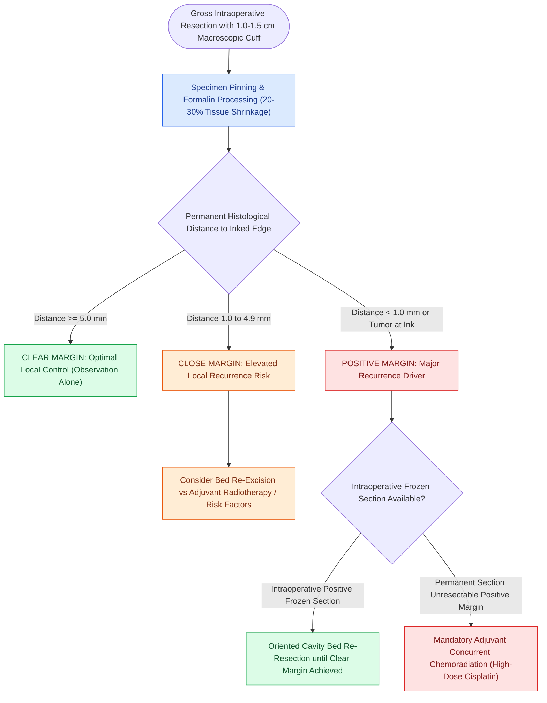

# Oncologic clear margins require at least five millimeters of histological normal tissue

## Active Recall

> [!question]- What is the microscopic cutoff for a 'clear' surgical margin in head and neck squamous cell carcinoma?
> *Answer / Clinical Rationale*: **$\ge 5.0\text{ mm}$** of normal, tumor-free tissue on permanent histological section.

> [!question]- Why is a 1.0–1.5 cm gross margin taken intraoperatively to achieve a 5-mm clear pathological margin?
> *Answer / Clinical Rationale*: To account for **$20\text{–}30\%$ tissue shrinkage** that occurs during specimen resection, pinning, and formalin fixation.

## Core Clinical & Mechanistic Principles
Histological surgical margin status is one of the strongest independent predictors of local recurrence and overall survival in head and neck squamous cell carcinoma:
- **Standard Pathological Definitions**:
  - **Clear Margin**: $\ge 5.0\text{ mm}$ of histological tumor-free tissue on permanent microscopic section.
  - **Close Margin**: $1.0\text{ to }4.9\text{ mm}$ of tumor-free tissue from the inked surgical border.
  - **Positive Margin**: $<1.0\text{ mm}$ or microscopic tumor extending directly to the inked surgical margin.
- **The Intraoperative Shrinkage Factor**: Formalin fixation and tissue processing cause mucosal and muscular contraction of $20\text{–}30\%$. Therefore, obtaining a **$1.0\text{–}1.5\text{ cm}$ gross surgical margin** intraoperatively is required to achieve a $\ge 5\text{-mm}$ clear histological margin on permanent sections.

### Surgical Technique & Critical Safety Checks
- **Frozen Section Mapping**:
  - *Specimen-Driven vs. Defect-Driven*: Specimen-driven frozen margins (sampling directly from the resected specimen) provide more accurate topological orientation than random defect-bed biopsies.
  - Positive frozen margins require immediate intraoperative re-resection of the corresponding surgical bed until clear margins are achieved (see [[AJCC 8th edition incorporates depth of invasion into oral cavity T-staging|Oral Cavity Staging & DOI]]).

## Connected Concepts & Graph Traversal
- **Oral Depth of Invasion**: [[AJCC 8th edition incorporates depth of invasion into oral cavity T-staging|Oral Cavity Staging & DOI]]
- **Oral Tongue Resection**: [[Oral tongue carcinoma spreads along intrinsic lingual musculature to bilateral cervical lymphatics|Oral Tongue Glossectomy Margins]]
- **High-Risk Adjuvant Therapy**: [[Extranodal extension in cervical lymph nodes upstages nodal disease and dictates adjuvant chemoradiotherapy|Adjuvant CRT for Positive Margins & ENE]]
- **Transcervical Exposure**: [[Transcervical pull-through resection mobilizes oral tongue tumors without dividing the mandible|Pull-Through Corridors & Margins]]
- **Transoral Anterior Resection**: [[Transoral resection provides oncologic access for early-stage anterior oral cavity neoplasms|Transoral Resection Craft]]
- **Lip-Split Mandibulotomy**: [[Lip-split paramedian mandibulotomy provides wide exposure for posterior oral cavity and oropharyngeal tumors|Mandibulotomy Exposure for Deep Margins]]
