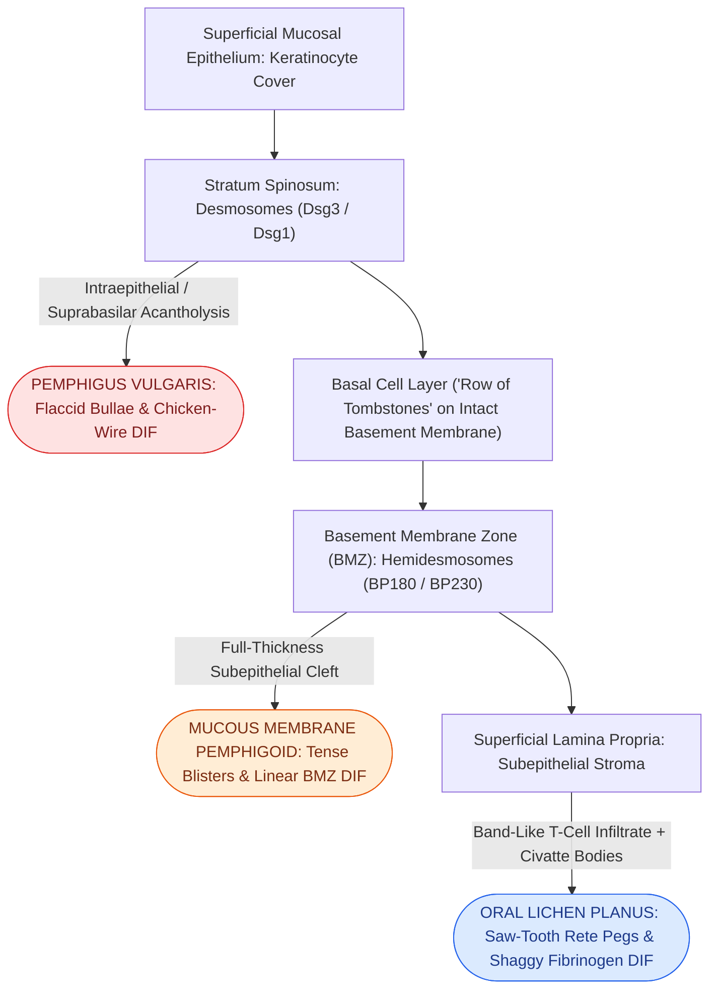
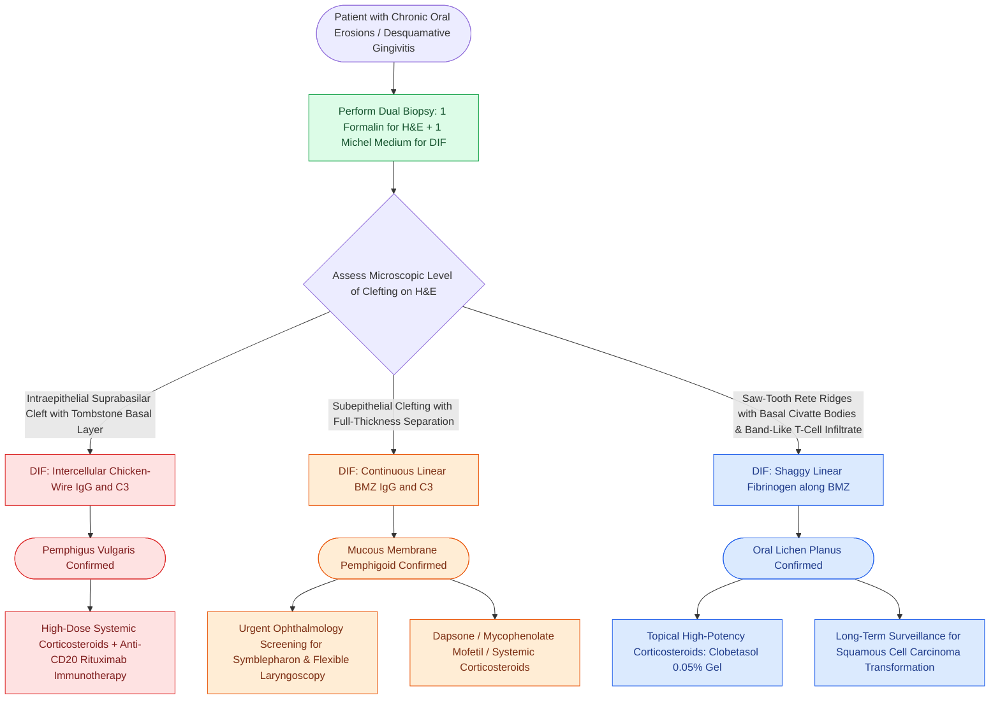

# Oral pemphigus vulgaris, mucous membrane pemphigoid, and lichen planus are distinguished by suprabasilar versus subepithelial clefting and direct immunofluorescence patterns

## Active Recall

> [!question]- What is the specific molecular target autoantigen and pathognomonic direct immunofluorescence (DIF) pattern in oral pemphigus vulgaris?
> *Answer / Clinical Rationale*: **Desmoglein 3 (Dsg3)**, a calcium-dependent desmosomal transmembrane cadherin glycoprotein (with or without Desmoglein 1). Autoantibody binding disrupts desmosomal adhesion between keratinocytes, leading to intraepithelial acantholysis. On DIF of perilesional mucosa, IgG and C3 deposit in the intercellular spaces between squamous epithelial cells, producing a classic **"chicken-wire" or "fishnet" pattern** throughout the spinous layer.

> [!question]- How does the level of histologic epithelial split differentiate pemphigus vulgaris from mucous membrane pemphigoid (MMP)?
> *Answer / Clinical Rationale*: Pemphigus vulgaris produces an **intraepithelial, suprabasilar cleft** immediately above the basal cell layer, leaving an intact single layer of basal cells attached to the basement membrane resembling a **"row of tombstones"** with rounded, detached, floating **Tzanck cells** in the blister fluid. In contrast, mucous membrane pemphigoid produces a **subepithelial cleft** with clean separation of the entire full-thickness epithelial sheet from the underlying lamina propria, as autoantibodies target hemidesmosomal basement membrane zone proteins (**BP180 / BP230 / laminin-332**).

> [!question]- What histopathologic triad and direct immunofluorescence hallmark define oral lichen planus (OLP)?
> *Answer / Clinical Rationale*: Histopathologically: (1) **hyperkeratosis / parakeratosis** with pointed, irregular rete ridges creating a **"saw-tooth" rete peg pattern**; (2) **liquefactive degeneration of the basal cell layer** with apoptotic basal keratinocytes forming colloid or **Civatte bodies**; and (3) a dense, sharply demarcated **band-like T-lymphocytic infiltrate** directly abutting the dermal-epidermal junction. On DIF, OLP displays **shaggy, fibrillar deposition of fibrinogen** along the basement membrane zone, typically in the absence of continuous linear IgG or C3.

## Core Clinical & Mechanistic Principles

Autoimmune vesiculobullous and lichenoid mucocutaneous disorders frequently present with chronic desquamative gingivitis, painful oral erosions, and persistent mucosal ulceration *(Cummings p.213–221)*. Because oral lesions routinely precede cutaneous manifestations by months to years, otolaryngologists are often the first clinicians to evaluate these patients. Precise differentiation between suprabasilar and subepithelial blistering is paramount, as pemphigus vulgaris carries lethal dehydration and sepsis risks, while mucous membrane pemphigoid threatens airway compromise and cicatricial ocular blindness *(Cummings p.215–216)*.

### Comparative Pathologic Mechanisms & Targets

#### 1. Pemphigus Vulgaris (PV)
- **Clinical Presentation**: Fragile, thin-roofed vesicles and bullae that rupture almost immediately under masticatory friction, leaving extensive, shallow, painful, ragged ulcerations on the buccal mucosa, palate, and gingiva.
- **Clinical Sign**: **Nikolsky sign is positive** (lateral tangential pressure on clinically normal perilesional mucosa causes epithelial detachment and bulla formation).
- **Histopathology**: Intraepithelial vesicle formation due to **suprabasilar acantholysis** (loss of intercellular cohesion between spinous keratinocytes). The basal cells remain adhered to the basement membrane, creating a classic "row of tombstones." Acantholytic keratinocytes round up and float free in vesicle fluid (**Tzanck cells**).
- **Direct Immunofluorescence (DIF)**: Perilesional punch biopsy shows diffuse **intercellular "chicken-wire" or "fishnet" IgG (predominantly IgG4) and C3** throughout the spinous layer.
- **Circulating Serology**: Anti-desmoglein 3 (and anti-Dsg1) antibodies measured by ELISA correlate with disease activity.

#### 2. Mucous Membrane Pemphigoid (MMP / Cicatricial Pemphigoid)
- **Clinical Presentation**: Tense, thick-roofed bullae that persist longer than pemphigus blisters because the entire epithelial roof is intact. Presents with severe desquamative gingivitis and scarring.
- **Critical Extraoral Risks**: Conjunctival involvement produces cicatricial symblepharon, ankyloblepharon, and blindness; laryngeal/subglottic involvement causes cicatricial mucosal webbing and life-threatening upper airway stenosis.
- **Histopathology**: **Subepithelial clefting** with complete separation of the full-thickness epithelium from the lamina propria. The basement membrane remains on the floor of the blister. Lamina propria displays mixed inflammatory infiltration (lymphocytes, plasma cells, eosinophils).
- **Direct Immunofluorescence (DIF)**: Continuous, smooth **linear deposition of IgG and C3 along the basement membrane zone (BMZ)**.
- **Target Antigens**: BP180 (type XVII collagen), BP230, and laminin-332 (anti-epiligrin pemphigoid, which carries an increased risk of underlying internal solid malignancy).

#### 3. Oral Lichen Planus (OLP)
- **Clinical Presentation**: Presents in two primary clinical forms:
  1. *Reticular Form*: Asymptomatic interlacing white keratotic lines (**Wickham striae**) on the bilateral buccal mucosa.
  2. *Erosive / Erythematous Form*: Painful mucosal erythema, central ulceration, and peripheral white radiating striae, frequently involving the gingiva (desquamative gingivitis).
- **Histopathology**: Cell-mediated CD8+ T-cell autoimmune reaction against basal keratinocytes. Key features:
  - Hyperorthokeratosis or parakeratosis.
  - "Saw-tooth" pointed rete ridges due to basilar atrophy.
  - Liquefactive degeneration and necrosis of the basal layer with rounded eosinophilic apoptotic bodies (**Civatte / colloid bodies**).
  - Dense, sharply demarcated **band-like subepithelial lymphocytic infiltrate** confined to the superficial lamina propria.
- **Direct Immunofluorescence (DIF)**: Strong, shaggy, continuous or fibrillar **deposition of fibrinogen along the basement membrane zone**; negative for continuous linear IgG, IgA, or C3.

### Diagnostic Comparison Matrix

| Feature | Pemphigus Vulgaris | Mucous Membrane Pemphigoid | Oral Lichen Planus |
| :--- | :--- | :--- | :--- |
| **Primary Autoantigen** | Desmoglein 3 (Dsg3) & Desmoglein 1 (Dsg1) | BP180 (type XVII collagen), BP230, Laminin-332 | Basal keratinocyte antigens (T-cell mediated) |
| **Histologic Split Level** | **Suprabasilar intraepithelial** | **Subepithelial** (full-thickness roof) | Subepithelial basal vacuolization |
| **Basal Cell Layer** | "Row of tombstones" on floor | Intact on blister roof | Liquefaction degeneration & Civatte bodies |
| **Acantholysis / Cells** | **Prominent Tzanck cells** | Absent (no acantholysis) | Absent (dense T-cell band) |
| **DIF Pattern** | **Intercellular "chicken-wire" IgG & C3** | **Continuous linear BMZ IgG & C3** | **Shaggy BMZ fibrinogen** |
| **Nikolsky Sign** | Positively elicited | Can be positive | Strictly negative |
| **Systemic Morbidity** | Lethal fluid loss, sepsis, cutaneous sloughing | Cicatricial ocular blindness, airway stenosis | Premalignant risk (1-2% oral SCC transformation) |

### Biopsy Technique & Diagnostic Pitfalls

1. **Dual-Biopsy Protocol**: When assessing suspected vesiculobullous disease, two separate specimens are required:
   - *Lesional Biopsy (H&E)*: Must include the edge of an intact blister with adjacent normal tissue. Taking a biopsy entirely from the center of an ulcer will only show non-specific granulation tissue and necrotic slough.
   - *Perilesional Biopsy (DIF)*: Must be harvested from clinically normal-appearing mucosa 5 to 10 mm away from an active blister (where autoantibodies are bound but the epithelium has not yet sheared off). DIF specimens must be placed immediately in **Michel transport medium** or saline, never in formalin (which denatures immunoglobulin fluorophores).
2. **Systemic Management and Immune Modulation**: Autoimmune mucosal inflammation is mediated by systemic antibody production and [[Complement activation cascades, MHC antigen presentation, and leukocyte adhesion molecules orchestrate mucosal innate and adaptive immunity|complement activation cascades]]. Pemphigus vulgaris is treated with pulsed systemic corticosteroids bridged to anti-CD20 monoclonal antibody therapy (rituximab). Mucous membrane pemphigoid requires urgent multidisciplinary ophthalmology evaluation to prevent blindness. Oral lichen planus is treated symptomatically with topical clobetasol gel in custom dental trays, with long-term mucosal surveillance to monitor for malignant squamous degeneration.

## Connected Concepts & Graph Traversal
- **🔗 Immune Hypersensitivity Classifications (Sinus)**: [[The Gell and Coombs classification delineates four distinct immunologic hypersensitivity mechanisms underlying otolaryngic disease|Gell and Coombs Hypersensitivity]]
- **🔗 Laryngeal Autoimmune Infiltration (Laryngology)**: [[Systemic autoimmune diseases manifest in the larynx with subglottic stenosis, rheumatoid bamboo nodes, and granulomatous infiltration|Laryngeal Autoimmune Manifestations]]
- **Oral Mucosal Surgical Biopsy**: [[Transoral resection provides oncologic access for early-stage anterior oral cavity neoplasms|Transoral Mucosal Resection]]
- **Malignant Transformation Depth Staging**: [[AJCC 8th edition incorporates depth of invasion into oral cavity T-staging|Oral Cavity Depth of Invasion]]
- **Intrinsic Muscle Invasion Differential**: [[Oral tongue carcinoma spreads along intrinsic lingual musculature to bilateral cervical lymphatics|Oral Tongue Infiltration]]
- **Oral Ulcerative & Granulomatous Differential**: [[Specific granulomatous diseases of the head and neck are diagnosed by pathognomonic histology and serological markers|Granulomatous Mucosal Differential]]
