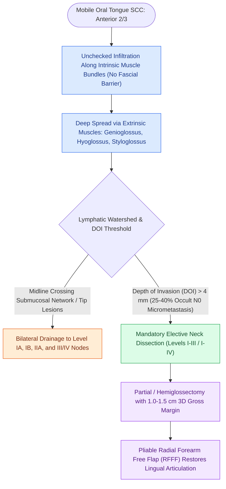

# Oral tongue carcinoma spreads along intrinsic lingual musculature to bilateral cervical lymphatics

## Active Recall

> [!question]- Why does oral tongue carcinoma have a high propensity for bilateral cervical lymph node metastasis?
> *Answer / Clinical Rationale*: Because the tongue contains a **rich midline-crossing submucosal lymphatic network**.

> [!question]- What reconstructive flap is the gold standard for restoring speech and swallowing after a hemiglossectomy?
> *Answer / Clinical Rationale*: The **Radial Forearm Free Flap (RFFF)**, due to its thin, pliable skin paddle.

## Core Clinical & Mechanistic Principles
Squamous cell carcinoma of the **mobile oral tongue (anterior 2/3)** is the most common oral cavity malignancy, characterized by aggressive infiltration and early occult regional metastasis:
- **Muscular Architecture & Tumor Propagation**:
  - The tongue lacks anatomical fascial barriers; tumor infiltrates freely along the vertical, transverse, superior longitudinal, and inferior longitudinal intrinsic muscle bundles.
  - Deep extension reaches the **extrinsic tongue muscles** (genioglossus, hyoglossus, styloglossus), which facilitate rapid spread to the tongue base and floor of mouth.
- **Lymphatic Drainage Dynamics**:
  - Rich capillary lymphatic network with cross-midline anastomoses.
  - Tip drains to Level IA and bilateral Level III/IV nodes.
  - Lateral borders drain to Levels IB, IIA, and III.
  - [[Elective neck dissection is indicated for oral cavity squamous cell carcinoma with depth of invasion exceeding four millimeters|Occult nodal metastasis]] occurs in **$25\text{–}40\%$** of clinically N0 necks when $\text{DOI} > 4\text{ mm}$.

### Surgical Technique & Critical Safety Checks
- **Surgical Resection (Partial Glossectomy)**: Resection must incorporate a $1.0\text{–}1.5\text{ cm}$ gross 3D margin around the palpable induration.
- **Reconstruction**: Hemiglossectomy defects require a thin, pliable **Radial Forearm Free Flap (RFFF)** to restore tongue mobility for intelligible speech and swallowing.

## Connected Concepts & Graph Traversal
- **Depth of Invasion & T-Staging**: [[AJCC 8th edition incorporates depth of invasion into oral cavity T-staging|Oral Cavity Staging & DOI]]
- **Elective Lymphadenectomy**: [[Elective neck dissection is indicated for oral cavity squamous cell carcinoma with depth of invasion exceeding four millimeters|Elective Neck Dissection Indications]]
- **Thin Pliable Reconstructive Donor**: [[The radial forearm free flap provides thin, pliable fasciocutaneous tissue for oral and pharyngeal defects|Radial Forearm Free Flap]]
- **Oncologic Resection Margins**: [[Oncologic clear margins require at least five millimeters of histological normal tissue|Five-Millimeter Clear Margins]]
- **Transcervical Pull-Through**: [[Transcervical pull-through resection mobilizes oral tongue tumors without dividing the mandible|Transcervical Pull-Through Corridor]]
- **Floor of Mouth Extension**: [[Floor of mouth carcinoma requires sublingual gland excision and Wharton duct relocation|Floor of Mouth Infiltration]]
- **Nodal Staging Alternative**: [[Sentinel lymph node biopsy accurately stages the clinically negative neck in early oral squamous cell carcinoma while reducing shoulder morbidity|Sentinel Lymph Node Biopsy (Oral SCC)]]
