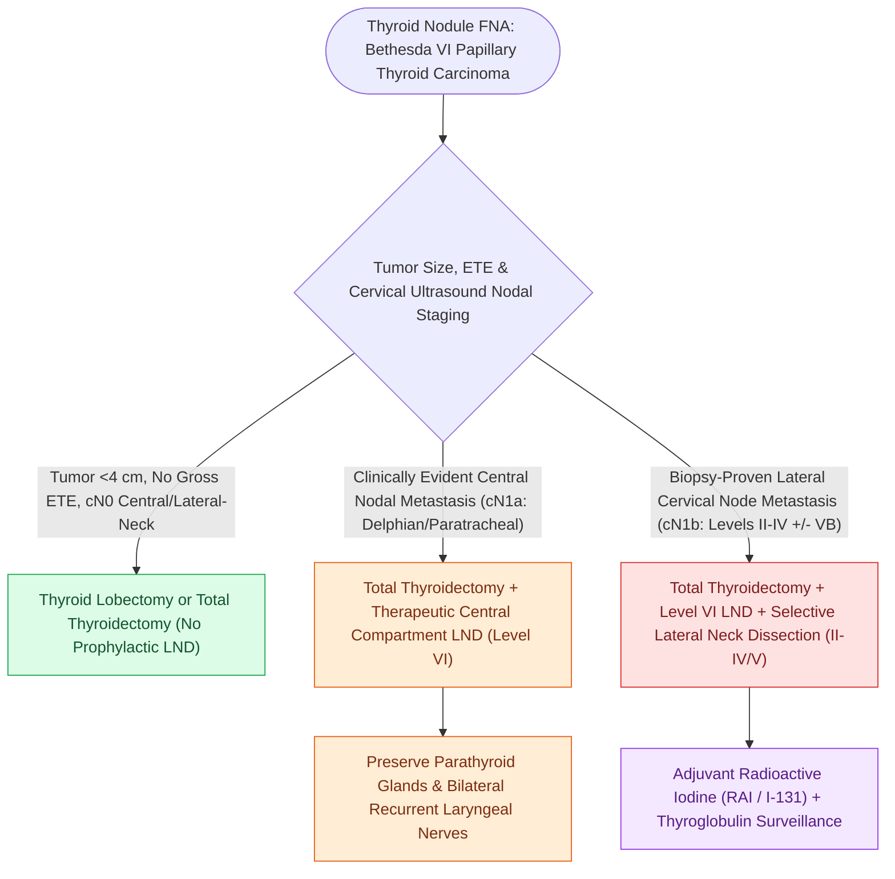

# Papillary thyroid carcinoma spreads via cervical lymphatics to central and lateral neck compartments

## Active Recall

> [!question]- What are the diagnostic microscopic nuclear features of papillary thyroid carcinoma?
> *Answer / Clinical Rationale*: **'Orphan Annie eye' optically clear nuclei**, **nuclear overlapping**, **longitudinal grooves**, and **intranuclear pseudoinclusions**.

> [!question]- What lymph node compartment is the first-echelon drainage basin for papillary thyroid carcinoma?
> *Answer / Clinical Rationale*: **Level VI (the central compartment)**, including the pretracheal, paratracheal, and Delphian lymph nodes.

## Core Clinical & Mechanistic Principles
**Papillary Thyroid Carcinoma (PTC)** is the most common endocrine malignancy ($>85\%$ of all thyroid cancers):
- **Pathological Hallmarks**: Nuclear enlargement, overlapping nuclei, "Orphan Annie eye" optically clear nuclei, nuclear pseudoinclusions, longitudinal nuclear grooves, and psammoma bodies.
- **Lymphatic Metastatic Patterns**:
  - Exhibits a high rate of regional lymph node metastasis ($40\text{–}60\%$ occult nodal spread).
  - **First-Echelon Drainage**: **Level VI (Central Compartment)** paratracheal and prelaryngeal (Delphian) lymph nodes.
  - **Second-Echelon Drainage**: **Levels III and IV (Lateral Neck)**, followed by Levels II and VB. "Skip metastases" directly to lateral neck without central node involvement occur in $\approx 10\%$ (especially upper pole tumors).
- **Surgical Paradigm (ATA Guidelines)**:
  - Total thyroidectomy or thyroid lobectomy for tumors $1\text{–}4\text{ cm}$ without extrathyroidal extension.
  - **Therapeutic central compartment neck dissection** for clinically evident central nodal disease ($cN1a$).
  - **Therapeutic lateral neck dissection (Levels II–V)** for biopsy-proven lateral cervical metastasis ($cN1b$).

### Surgical Technique & Critical Safety Checks
- **Radioiodine (RAI / I-131) Adjuvant Therapy**: Administered following total thyroidectomy for high-risk features (gross ETE, $N1b$ disease, extensive $[[Extranodal extension in cervical lymph nodes upstages nodal disease and dictates adjuvant chemoradiotherapy|ENE]]^+$, or elevated post-op stimulated thyroglobulin).

## Connected Concepts & Graph Traversal
- **Central Compartment Dissection**: [[Central compartment neck dissection clears level VI nodes between the carotid sheaths and suprasternal notch|Level VI Central Neck Dissection]]
- **Molecular Prognostication**: [[BRAF V600E and TERT promoter mutations drive aggressive papillary thyroid carcinoma behavior|BRAF V600E and TERT Mutations]]
- **RLN Localization in Simon's Triangle**: [[The recurrent laryngeal nerve is identified within Simon's triangle and followed through Berry's ligament|Recurrent Laryngeal Nerve Craft]]
- **Post-Thyroidectomy Hypocalcemia**: [[Post-thyroidectomy hypocalcemia is managed with oral calcium, calcitriol, and intravenous calcium gluconate|Post-Thyroidectomy Hypocalcemia]]
- **Lateral Cervical Levels**: [[Cervical lymph node levels I through VII define regional metastatic drainage basins|Cervical Lymph Node Levels]]
- **EBSLN Preservation Craft**: [[The superior thyroid artery branches are divided flush on the thyroid capsule to protect the EBSLN|EBSLN Preservation Technique]]
- **Extent-of-Surgery Risk Stratification**: [[Differentiated thyroid carcinoma prognostic scoring systems AMES, AGES, and MACIS stratify low and high risk disease to guide the extent of thyroidectomy|AMES, AGES & MACIS Scoring]]
