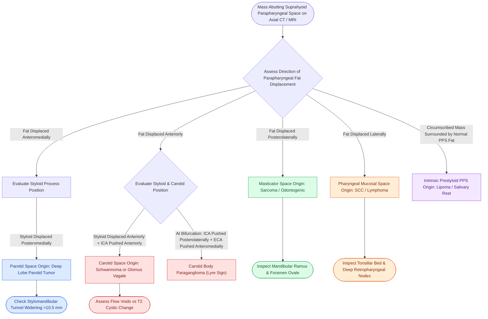

# Parapharyngeal space fat and styloid process displacement vectors localize deep neck masses and differentiate parotid, neurogenic, and mucosal lesions

## Active Recall

> [!question]- How does the direction of parapharyngeal space (PPS) fat displacement on axial CT or MRI pinpoint the anatomical space of origin for a suprahyoid neck mass?
> *Answer / Clinical Rationale*: The parapharyngeal space fat pad is compliant and surrounded by rigid muscular and bony boundaries, making its displacement direction pathognomonic: (1) **Anteromedial fat displacement** indicates a mass arising in the *parotid space* (deep lobe parotid neoplasm); (2) **Anterior fat displacement** indicates a mass arising in the *carotid (poststyloid) space* (schwannoma, neurofibroma, vagal paraganglioma); (3) **Posterolateral fat displacement** indicates a mass arising in the *masticator space* (sarcoma, odontogenic abscess, V3 schwannoma); (4) **Lateral fat displacement** indicates a mass arising in the *pharyngeal mucosal space* (tonsillar carcinoma, lymphoma); and (5) **Medial displacement or circumferential fat thinning** indicates an *intrinsic prestyloid PPS lesion* (lipoma, salivary choristoma).

> [!question]- What is the diagnostic significance of styloid process displacement when differentiating a deep lobe parotid tumor from a carotid space neurogenic tumor?
> *Answer / Clinical Rationale*: The **styloid process** and its attached musculature (styloglossus, stylopharyngeus, stylohyoid) define the boundary between the parotid and carotid spaces. A **deep lobe parotid tumor** originates lateral/anterior to the stylomandibular tunnel, pushing the PPS fat *anteromedially* and displacing the styloid process **posteromedially**. In contrast, a **carotid space mass** (e.g., vagal schwannoma or paraganglioma) arises posterior to the styloid diaphragm, displacing the styloid process **anteriorly or anterolaterally** while pushing the PPS fat anteriorly.

> [!question]- How do carotid body paragangliomas and vagal paragangliomas (glomus vagale) differ in their displacement of the internal carotid artery (ICA) and internal jugular vein (IJV)?
> *Answer / Clinical Rationale*: While both are hypervascular carotid space tumors demonstrating "salt-and-pepper" MRI appearance, their vascular displacement vectors diverge: (1) **Carotid body tumor (chemodectoma)** arises at the carotid bifurcation, producing classic **splaying of the ICA and ECA** (Lyre sign), displacing the ICA posteromedially and the ECA anterolaterally; (2) **Vagal paraganglioma (glomus vagale)** arises along CN X within the poststyloid carotid space above the bifurcation, displacing both the **ICA and ECA anteriorly/anteromedially**, while compressing or displacing the **IJV posterolaterally**.

## Core Clinical & Mechanistic Principles

The parapharyngeal space (PPS) represents the central crossroad of the suprahyoid neck. Shaped like an inverted pyramid with its base at the sphenoid and temporal skull base and its apex at the greater cornu of the hyoid bone, its normal content is predominantly homogeneous fat *(Cummings p.276, 284)*. 

Because fat possesses negative Hounsfield units on CT ($-50$ to $-120\text{ HU}$) and high signal intensity on T1-weighted MRI, displacement of the PPS fat pad provides the definitive radiographic clue to localize lesions originating in bordering fascial compartments:

### Parapharyngeal Space Displacement Vector Differential Matrix

| Space of Origin | Typical Neoplasms / Lesions | PPS Fat Displacement Vector | Styloid Process Displacement Vector | Major Vessel Displacement (ICA / IJV) | Key Confirmatory Cross-Sectional Features |
| :--- | :--- | :--- | :--- | :--- | :--- |
| **Parotid Space (Deep Lobe)** | Pleomorphic adenoma, mucoepidermoid carcinoma, adenoid cystic carcinoma | **Anteromedial** | **Posteromedial** | ICA displaced posteromedially | Widening of stylomandibular tunnel ($>10.5\text{ mm}$ between styloid process and mandibular ramus); tumor fat-plane separation from deep parotid absent |
| **Carotid Space (Poststyloid PPS)** | Schwannoma (CN X or sympathetic), vagal paraganglioma, neurofibroma | **Anterior / Anteromedial** | **Anterior / Anterolateral** | ICA displaced anteriorly; IJV displaced posteriorly | Flow voids and "salt-and-pepper" appearance on T1+Gd (paraganglioma); target sign or cystic degeneration on T2 (schwannoma) |
| **Masticator Space** | Rhabdomyosarcoma, osteosarcoma, odontogenic phlegmon, V3 schwannoma | **Posterolateral / Posterior** | **Posterior / Posterolateral** | Vessels unaffected or pushed posteriorly | Mandibular ramus cortical erosion, pterygoid/masseter muscle enlargement, widening of foramen ovale on CT |
| **Pharyngeal Mucosal Space** | Tonsillar SCC, diffuse large B-cell lymphoma, peritonsillar abscess | **Lateral / Posterolateral** | **No displacement** | Carotid sheath vessels displaced posterolaterally | Asymmetric tonsillar mucosal enhancement, ulceration, central necrotic cavitation, level II lymphadenopathy |
| **Intrinsic Prestyloid PPS** | Lipoma, ectopic mixed tumor (minor salivary), choristoma | **Medial / Centrifugal** (surrounded by fat ring) | **No displacement or slight posterior** | ICA maintains normal poststyloid position | Circumscribed mass with preserved circumferential fat rind; absence of connection to deep lobe of parotid gland |
| **Carotid Bifurcation** | Carotid body tumor (glomus caroticum) | **Minimal (infrahyoid/level II)** | **None (below styloid)** | **Splaying of ICA and ECA** (Lyre sign) | Hypervascular mass cradled within the carotid bifurcation; intense early arterial enhancement on CTA |

### Critical Radiologic Pitfalls

1. **The Retromandibular Deep Lobe Pseudo-Parapharyngeal Mass**:
   - Pleomorphic adenomas arising from the deep lobe of the parotid gland can herniate through the stylomandibular tunnel into the parapharyngeal space.
   - *Diagnostic Rule*: If there is no distinct fat plane separating the tumor from the deep lobe of the parotid gland on axial T1 MRI, the lesion is of parotid origin, even if the bulk of the mass resides within the anatomical prestyloid PPS.

2. **Differentiating Vagal Schwannoma from Sympathetic Chain Schwannoma**:
   - *Vagal Schwannoma*: Displaces the internal carotid artery **medially** and the internal jugular vein **laterally** (separating the artery and vein within the carotid sheath).
   - *Cervical Sympathetic Chain Schwannoma*: Displaces **both the ICA and the IJV anteriorly** together as a unit without separating them, because the sympathetic chain lies embedded in the posterior wall of the carotid sheath rather than between the vessels.

Comprehensive anatomical and therapeutic integration links these principles directly to [[Retromolar trigone carcinoma invades the pterygomandibular raphe and masticator space|Masticator Space Invasion]].

## Connected Concepts & Graph Traversal
- **Anatomical Hub**: [[The parapharyngeal space is an inverted pyramid connecting peritonsillar, masticator, parotid, and retropharyngeal spaces|Parapharyngeal Space Hub]]
- **Parotid Neoplasm Pathology**: [[Pleomorphic adenoma requires superficial parotidectomy with a cuff of normal tissue to prevent pseudopod recurrence|Parotid Pleomorphic Adenoma]]
- **Carotid Bifurcation Splaying**: [[Carotid body paragangliomas splay the bifurcation and are graded by the Shamblin classification|Carotid Body Paraganglioma]]
- **Vagal Paraganglioma Features**: [[Vagal paragangliomas present as lateral neck masses with Fontaine sign and anteromedial carotid displacement without bifurcation splaying|Vagal Paraganglioma]]
- **Surgical Danger Plane**: [[TORS radical tonsillectomy requires careful identification of the internal carotid artery posterolaterally|TORS Parapharyngeal ICA Safeguard]]
