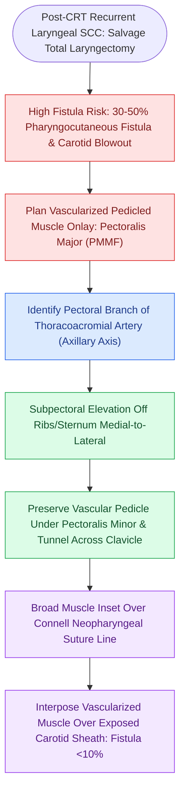

# Pectoralis major muscle flap reinforcement prevents pharyngocutaneous fistula in salvage laryngectomy

## Active Recall

> [!question]- What is the dominant vascular pedicle supplying the Pectoralis Major muscle flap?
> *Answer / Clinical Rationale*: The **pectoral branch of the thoracoacromial artery**.

> [!question]- Why is vascularized muscle flap reinforcement routinely performed during salvage laryngectomy?
> *Answer / Clinical Rationale*: To introduce non-irradiated, vascularized tissue over the neopharynx, reducing the high ($30\text{–}50\%$) rate of **pharyngocutaneous fistula** and protecting the carotid artery.

## Core Clinical & Mechanistic Principles
In **salvage [[Total laryngectomy achieves en bloc laryngeal resection with permanent end-stoma|total laryngectomy]]** (performed after failed radiotherapy or chemoradiotherapy), tissue hypovascularity and fibrosis increase the risk of [[Pharyngocutaneous fistula is managed with wound care, nutritional support, and surgical flap closure|pharyngocutaneous fistula]] to **$30\text{–}50\%$**:
- **The Reinforcement Flap Principle**: Transposing non-irradiated, highly vascularized muscle over the suture line provides robust angiogenic support, fills dead space around the neopharynx, covers the carotid sheath, and reduces fistula rates to $<10\text{–}15\%$.
- **Pectoralis Major Myocutaneous / Muscle-Only Flap (PMMF)**:
  - **Dominant Vascular Pedicle**: **Pectoral branch of the thoracoacromial artery** (derived from the 2nd part of the axillary artery), accompanied by venae comitantes.
  - **Secondary Supply**: Lateral thoracic artery.
  - **Motor Innervation**: Lateral and medial pectoral nerves.
- **Harvest Craft**:
  1. Incise skin along the lateral border of the pectoralis major muscle.
  2. Elevate muscle off the chest wall in the subpectoral avascular plane from inferior/medial to superior/lateral.
  3. Identify the thoracoacromial pedicle on the deep surface of the muscle medial to the pectoralis minor.
  4. Tunnel muscle over or under the clavicle into the neck.
  5. Suture muscle flat over the neopharyngeal repair and carotid artery.

### Surgical Technique & Critical Safety Checks
- **Other Vascularized Flap Options**: Submental island flap, Supraclavicular artery island flap (SCAIF), or Anterolateral Thigh (ALT) free flap.

## Connected Concepts & Graph Traversal
- **Neopharyngeal Suture Craft**: [[Primary pharyngeal closure after total laryngectomy utilizes an inverting Connell technique|Connell Neopharyngeal Closure]]
- **Fistula Rescue Protocols**: [[Pharyngocutaneous fistula is managed with wound care, nutritional support, and surgical flap closure|Pharyngocutaneous Fistula Rescue]]
- **Carotid Blowout Prevention**: [[Carotid blowout syndrome is classified into threatened, impending, and acute hemorrhage|Carotid Blowout Staging]]
- **Salvage Total Laryngectomy**: [[Total laryngectomy achieves en bloc laryngeal resection with permanent end-stoma|Total Laryngectomy Standards]]
- **Piriform & Hypopharyngeal Resection**: [[Hypopharyngeal piriform sinus carcinoma requires partial or total laryngopharyngectomy|Piriform Sinus Laryngopharyngectomy]]
- **Regional Pedicled Alternatives**: [[The latissimus dorsi myocutaneous free flap covers massive soft tissue and skull base defects|Latissimus Dorsi & Bulk Reconstruction]]
