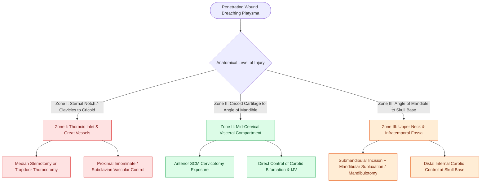

# Penetrating neck trauma anatomical zones I, II, and III dictate surgical exposure corridors

## Active Recall

> [!question]- What are the precise anatomical boundaries defining Monson's Zones I, II, and III in penetrating neck trauma?
> *Answer / Clinical Rationale*: **Zone I**: From the clavicles / sternal notch to the cricoid cartilage; **Zone II**: From the cricoid cartilage to the angle of the mandible; **Zone III**: From the angle of the mandible to the skull base.

> [!question]- What surgical exposure corridor is required for proximal vascular control of Zone I injuries?
> *Answer / Clinical Rationale*: **Median sternotomy** (for right-sided great vessels and innominate artery) or **high anterolateral left thoracotomy / "trapdoor" thoracotomy** (for left subclavian and proximal common carotid control), because Zone I structures are shielded behind the bony thoracic inlet and clavicles.

> [!question]- Why is surgical exposure in Zone III particularly challenging, and what maneuver facilitates distal internal carotid artery access at the skull base?
> *Answer / Clinical Rationale*: Zone III is tightly bounded by the ramus of the mandible, mastoid tip, and tympanic plate; distal ICA exposure requires **anterior subluxation of the mandible**, division of the posterior belly of the digastric muscle, or vertical **mandibulotomy / styloidectomy**.

## Core Clinical & Mechanistic Principles
In penetrating neck trauma, anatomical stratification into **Monson's three distinct zones** historically dictated exploration algorithms and remains the critical framework for planning surgical access corridors when operative intervention is mandated by hemodynamic instability or hard vascular signs (paired with modern [[The no-zone approach to penetrating neck trauma triages stable patients with CTA based on hard and soft signs|no-zone CTA triage]] in stable patients):

- **Zone I (Thoracic Inlet & Base of Neck)**:
  - *Boundaries*: Clavicles and sternal notch to the inferior border of the **cricoid cartilage**.
  - *Critical Structures*: Great vessels (innominate, proximal common carotid, subclavian, and vertebral arteries), internal jugular and subclavian veins, trachea, cervical esophagus, thoracic duct, lung apices, brachial plexus, and recurrent laryngeal nerves.
  - *Surgical Access*: Standard cervical incisions provide inadequate proximal vascular control. Mandatory surgical exposure requires a **median sternotomy** (for right-sided great vessels and the innominate trunk) or a **trapdoor incision (partial median sternotomy + high left anterolateral thoracotomy + supraclavicular extension)** for proximal left subclavian artery control.
- **Zone II (Mid-Cervical Visceral Compartment)**:
  - *Boundaries*: Cricoid cartilage to the **angle of the mandible**.
  - *Critical Structures*: Common carotid bifurcation, internal and external carotid arteries, internal jugular vein, larynx, hypopharynx, cervical esophagus, and cranial nerves $\text{X}$, $\text{XI}$, and $\text{XII}$.
  - *Surgical Access*: The most surgically accessible zone. Rapid, comprehensive exposure is achieved via a generous **anterior sternocleidomastoid (SCM) cervicotomy** along the anterior border of the SCM muscle to achieve [[Carotid blowout syndrome management includes throat packing, endovascular embolization, and carotid stenting|proximal and distal vascular control]].
- **Zone III (Upper Neck & Lateral Skull Base)**:
  - *Boundaries*: Angle of the mandible to the **skull base**.
  - *Critical Structures*: Distal internal carotid artery, internal jugular vein, vertebral artery, and cranial nerves $\text{IX}$, $\text{X}$, $\text{XI}$, and $\text{XII}$.
  - *Surgical Access*: Heavily shielded by the parotid gland and mandibular ramus. Requires an extended submandibular incision, division of the posterior belly of the digastric muscle, styloidectomy, and **anterior mandibular subluxation** or vertical midline mandibulotomy to expose the distal ICA at the carotid canal.

### Critical Surgical Safeties & Craft Nuance
- **Platysma Penetration Standard**: Any penetrating wound breaching the **platysma muscle** is defined as penetrating neck trauma and mandates formal evaluation, as superficial exploration in the trauma bay risks dislodging a tamponaded clot and triggering uncontrollable hemorrhage into [[The danger space permits unrestricted infection spread from skull base to posterior mediastinum|deep fascial and danger spaces]].
- **Proximal and Distal Control**: Always secure vascular control proximal and distal to the injury zone before opening a tense, contained hematoma.

## Connected Concepts & Graph Traversal
- **Triage & Non-Operative Protocol**: [[The no-zone approach to penetrating neck trauma triages stable patients with CTA based on hard and soft signs|No-Zone CTA Trauma Algorithm]]
- **Carotid Bifurcation Anatomy**: [[Carotid body paragangliomas splay the bifurcation and are graded by the Shamblin classification|Carotid Bifurcation & Shamblin]]
- **Emergency Airway Protocol**: [[Awake fiberoptic intubation is the preferred airway technique for angioedema with impending obstruction|Emergency Trauma Airway]]
- **Vascular Blowout Rescue**: [[Carotid blowout syndrome management includes throat packing, endovascular embolization, and carotid stenting|Carotid Blowout Rescue]]
- **Deep Fascial Spread**: [[The danger space permits unrestricted infection spread from skull base to posterior mediastinum|Cervical Fascial Planes]]
