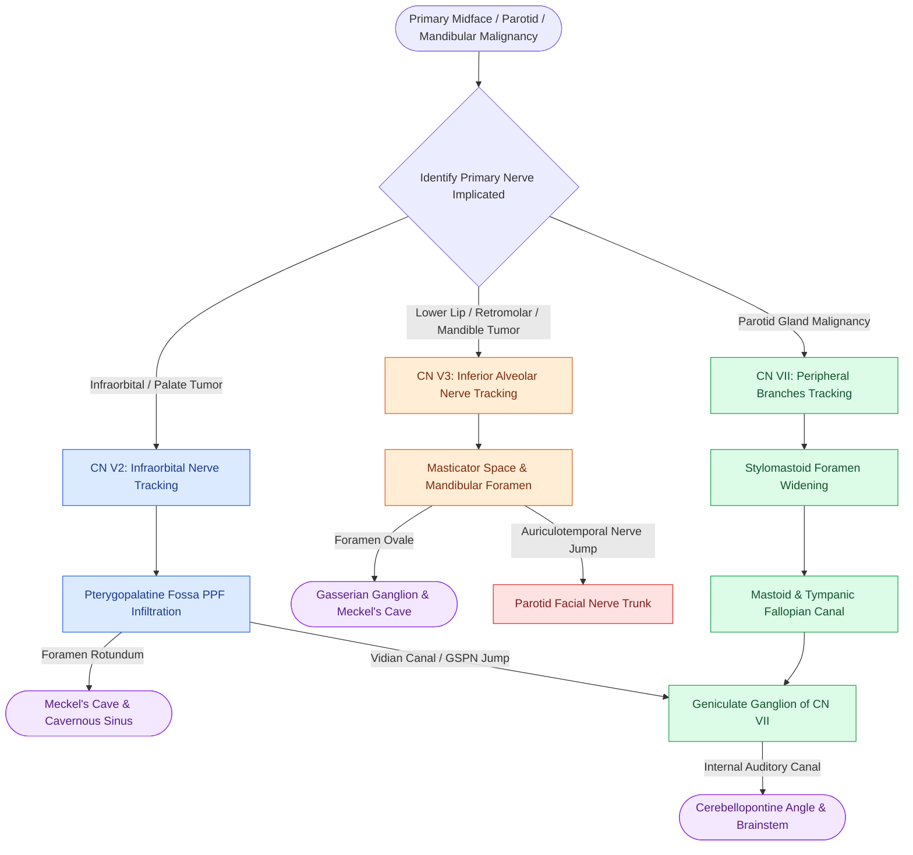

# Perineural tumor spread along cranial nerves V2, V3, and VII follows retrograde skull base pathways through the pterygopalatine fossa, foramen ovale, and stylomastoid foramen

## Active Recall

> [!question]- What is the exact retrograde anatomical pathway of perineural tumor spread (PNS) along the maxillary nerve (CN V2) from the cheek into the middle cranial fossa?
> *Answer / Clinical Rationale*: PNS along **CN V2** begins in the peripheral infraorbital nerve (from midface cutaneous SCC, basal cell carcinoma, or maxillary sinus adenoid cystic carcinoma) -> traverses the **infraorbital canal and groove** in the orbital floor -> enters the **pterygopalatine fossa (PPF)** via the inferior orbital fissure -> tracks through the **foramen rotundum** -> reaches the **Meckel's cave** and **cavernous sinus** in the middle cranial fossa. Obliteration of the normal fat pad in the pterygopalatine fossa on axial T1 MRI is the hallmark early imaging sign.

> [!question]- How do tumor cells exploit communicating branches to jump bidirectionally between the facial nerve (CN VII) and the trigeminal divisions (CN V2 and CN V3)?
> *Answer / Clinical Rationale*: Tumor cells exploit two critical neural anastomotic bridges: (1) **V2 to VII bridge (Vidian / Greater Petrosal Nerve pathway)**: Tumor in the pterygopalatine fossa (V2) travels retrogradely along the *Vidian nerve* (nerve of the pterygoid canal) to the *greater superficial petrosal nerve (GSPN)*, which leads directly to the **geniculate ganglion of the facial nerve (CN VII)**; (2) **V3 to VII bridge (Auriculotemporal Nerve pathway)**: Tumor tracking along the mandibular nerve (V3) in the infratemporal fossa/masticator space travels via the *auriculotemporal nerve*, which wraps around the middle meningeal artery and communicates directly with the **main trunk or temporofacial division of the facial nerve** within the parotid gland.

> [!question]- What are the primary and secondary radiologic signs of perineural tumor spread on contrast-enhanced CT and fat-suppressed T1-weighted MRI?
> *Answer / Clinical Rationale*: **Primary signs** include: (1) Asymmetric thickening and nodular enhancement of the nerve trunk on post-gadolinium fat-suppressed T1 MRI; (2) Replacement/obliteration of normal fat planes in neural exit foramina (pterygopalatine fossa, foramen ovale, stylomastoid foramen); and (3) Smooth widening, scalloping, or cortical erosion of the bony neural canals/foramina on high-resolution bone-window CT. **Secondary signs** represent target organ denervation: (1) *CN V3 denervation*: Acute/subacute edematous T2 hyperintensity followed by chronic atrophy and fatty infiltration of the masticator muscles (masseter, temporalis, medial and lateral pterygoids, mylohyoid, anterior belly of digastric); (2) *CN VII denervation*: Atrophy and volume loss of the mimetic facial muscles.

## Core Clinical & Mechanistic Principles

Perineural tumor spread (PNS) is the continuous or discontinuous ("skip lesions") extension of malignant cells along the perineural sheath, endoneurium, or epineurium of cranial nerves. It is characteristically driven by neurotropic malignancies: **adenoid cystic carcinoma (ACC)** (highest propensity), **cutaneous squamous cell carcinoma (cSCC)**, **desmoplastic melanoma**, **polymorphous adenocarcinoma**, and **mucoepidermoid carcinoma** *(Cummings p.265, 276–277)*.

PNS follows low-resistance planes along established cranial nerve corridors, frequently defying conventional lymphatic and vascular drainage boundaries to enter the intracranial compartment:

### Cranial Nerve Perineural Spread Pathways Matrix

| Nerve Division | Peripheral Triggers & Entry Foci | Skull Base Foramina & Fissures | Intracranial Basin Reached | Secondary Muscle Denervation Targets |
| :--- | :--- | :--- | :--- | :--- |
| **Maxillary (CN V2)** | Midface cutaneous SCC/melanoma, maxillary sinus ACC, palate minor salivary tumors | Infraorbital foramen -> Inferior orbital fissure -> **Pterygopalatine Fossa (PPF)** -> **Foramen Rotundum** | Meckel's cave, lateral wall of cavernous sinus, middle cranial fossa | None (purely sensory division) |
| **Mandibular (CN V3)** | Lower lip cSCC, retromolar trigone SCC, alveolar ridge SCC, adenoid cystic carcinoma | Mental foramen -> Mandibular canal -> Mandibular foramen -> Masticator space -> **Foramen Ovale** | Meckel's cave, gasserian ganglion, brainstem trigeminal root entry zone | **Masticator muscles**: Masseter, temporalis, medial pterygoid, lateral pterygoid, mylohyoid, anterior digastric |
| **Facial (CN VII)** | Parotid gland malignancies (ACC, mucoepidermoid, cSCC metastasis), ear canal cancer | Peripheral pes anserinus -> **Stylomastoid Foramen** -> Mastoid / Tympanic Fallopian canal -> **Geniculate Ganglion** | Internal auditory canal (IAC), cerebellopontine angle (CPA), brainstem facial nucleus | **Mimetic muscles**: Orbicularis oculi, orbicularis oris, buccinator, platysma, frontalis |
| **V2 ⇄ VII Cross-Talk** | Palatal or paranasal ACC invading the PPF | **Vidian Canal (Pterygoid Canal)** -> Foramen lacerum -> Greater superficial petrosal nerve | Geniculate ganglion and descending mastoid segment of CN VII | Mimetic muscles (if retrograde down VII) or trigeminal sensory deficits |
| **V3 ⇄ VII Cross-Talk** | Parotid malignancies spreading deeply; infratemporal fossa tumors | **Auriculotemporal Nerve** running between parotid bed and mandibular neck | Masticator space -> Foramen ovale -> Meckel's cave | Dual denervation of masticator and mimetic muscle groups |

### High-Yield Cross-Sectional Imaging Protocol & Findings

1. **Obliteration of Fat Cushions (The Earliest Finding)**:
   - On axial and coronal noncontrast T1 MRI, the normal pterygopalatine fossa, foramen ovale, and stylomastoid foramen are filled with hyperintense fat. 
   - *Earliest Sign*: Replacement of high T1 fat signal by intermediate-signal tumor tissue in the PPF or around the foramen ovale, even before bony foramen expansion is visible on CT.

2. **Bone Window CT vs Contrast-Enhanced Fat-Suppressed MRI**:
   - High-resolution noncontrast bone CT demonstrates **expansion, scalloping, and cortical demineralization** of neural apertures (foramen rotundum $>3\text{ mm}$, foramen ovale asymmetry $>1.5\text{ mm}$, widening of vidian canal).
   - Post-gadolinium fat-suppressed T1 MRI is the most sensitive sequence, demonstrating **thickened, nodular, enhancing nerve cables** tracking through skull base apertures.

3. **Muscle Denervation Staging**:
   - *Acute/Subacute Phase (Weeks to Months)*: Target muscles exhibit high signal on T2-weighted MRI and STIR sequences due to neurogenic edema, with subtle contrast enhancement, without muscle volume loss.
   - *Chronic Phase (Months to Years)*: Target muscles exhibit profound **volume loss (atrophy) and high T1 signal intensity** reflecting complete fatty replacement. Recognizing unilateral masticator atrophy on neck CT should immediately prompt an active search for an occult V3 tumor at the skull base.

Comprehensive anatomical and therapeutic integration links these principles directly to [[Trigeminal neuralgia causes paroxysmal lancinating facial pain treated with carbamazepine and microvascular decompression|Trigeminal Nerve Pathways]].

## Connected Concepts & Graph Traversal
- **Histopathologic Prototype**: [[Adenoid cystic carcinoma exhibits prominent perineural invasion and late distant hematogenous metastasis|Adenoid Cystic Carcinoma PNS]]
- **Surgical Sacrifice Criteria**: [[Total parotidectomy with facial nerve sacrifice is indicated for direct malignant nerve invasion|Facial Nerve Malignant Sacrifice]]
- **Surgical Nerve Localization**: [[Superficial parotidectomy dissects the facial nerve branches to resect the lateral salivary lobe|Facial Nerve Trunk Surgical Landmarks]]
- **Tragal Pointer & Stylomastoid Landmark**: [[The facial nerve main trunk is localized using the tragal pointer, tympanomastoid suture, and digastric ridge|Facial Nerve Localization]]
- **🔗 Intratemporal Canal Architecture (Otology)**: [[The labyrinthine segment is the narrowest portion of the Fallopian canal and most vulnerable to edema|Fallopian Canal Architecture]]
