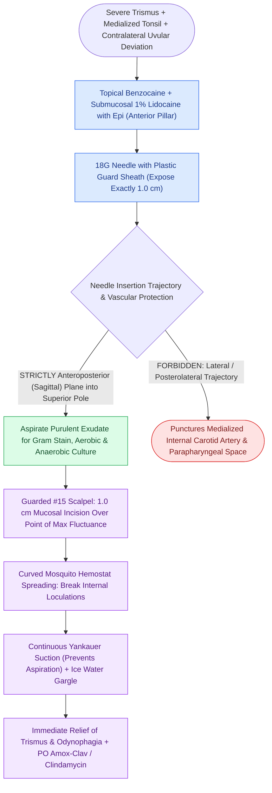

# Peritonsillar abscess needle aspiration and incision and drainage require superior pole local anesthetic and landmark-guided needle guard protection

## Active Recall

> [!question]- Why must the aspiration needle be strictly directed in an anteroposterior orientation rather than directed laterally during PTA drainage?
> *Answer / Clinical Rationale*: Directing the needle laterally or posterolaterally aims directly toward the post-styloid parapharyngeal space and carotid sheath, risking catastrophic arterial puncture of the **internal carotid artery** or internal jugular vein. An anteroposterior trajectory enters the tonsillar fossa safely within the muscular boundaries of the superior constrictor.

> [!question]- What anatomical structure is Weber's gland, and what role does it play in PTA pathogenesis?
> *Answer / Clinical Rationale*: Weber's glands are minor salivary glands embedded in the supratonsillar space superior to the palatine tonsil capsule. Obstruction of Weber's duct leading to suppurative micro-abscess formation is the primary trigger for the development of superior pole peritonsillar abscesses.

## Core Clinical & Mechanistic Principles
A [[Pediatric acute bacterial tonsillitis is differentiated from viral pharyngitis using modified Centor criteria|peritonsillar abscess (PTA)]], or "quinsy," is a localized collection of purulence in the potential space between the fibrous capsule of the palatine tonsil and the superior pharyngeal constrictor muscle. Most commonly originating from suppurative infection of the superior pole **Weber's salivary glands**, purulent expansion displaces the tonsil medially and inferiorly, pushes the uvula contralaterally, and provokes intense spasm of the adjacent internal pterygoid muscle, causing severe [[The parapharyngeal space is an inverted pyramid connecting peritonsillar, masticator, parotid, and retropharyngeal spaces|trismus]] and a muffled "hot potato" voice.

Safe bedside procedural evacuation—via needle aspiration or formal incision and drainage (I&D)—requires strict adherence to anatomical boundaries to avoid puncturing the **internal carotid artery (ICA)**, which normally courses $2.0\text{ to }2.5\text{ cm}$ posterolateral to the tonsillar capsule but may lie as close as $1.0\text{ cm}$ in cases of congenital tortuosity or vascular medialization.

### Key Consultation Supplies
- Coaxial surgical headlight
- Tongue depressor or Wieder tongue retractor
- Rigid Yankauer suction tip and functional wall suction
- Topical 14% benzocaine spray or 4% lidocaine
- 1% lidocaine with 1:100,000 epinephrine
- 27-gauge needle (for submucosal infiltration) and 3 mL syringe
- 18-gauge needle with cut plastic guard sheath ($1.0\text{ cm}$ exposed) and 10–12 mL syringe
- #15 or #11 scalpel blade (taped leaving $0.5\text{ cm}$ exposed)
- Curved Kelly or curved mosquito hemostat forceps
- Sterile culture swab transport tube (aerobic and anaerobic)
- Ice water cup for post-procedure gargles

> [!example]- **Operative Note Template: Bedside needle aspiration and incision and drainage of peritonsillar abscess**
> **PROCEDURE**: Bedside needle aspiration and incision and drainage of peritonsillar abscess
> **PRE-PROCEDURAL DIAGNOSIS**: Acute peritonsillar abscess of the [right/left] palatine tonsil
> **POST-PROCEDURAL DIAGNOSIS**: Acute peritonsillar abscess of the [right/left] palatine tonsil status-post needle aspiration and incision and drainage
> **SURGEON**: [Surgeon Name, MD]
> **ASSISTANT**: [Resident/Fellow Name, MD]
>
> **PROCEDURE IN DETAIL**:
> Informed consent was obtained. The patient was seated upright in the examination chair. Illumination was provided by a coaxial headlight. Topical benzocaine spray was applied to the oropharynx, followed by submucosal infiltration of 2.0 mL of 1% lidocaine with 1:100,000 epinephrine into the anterior tonsillar pillar.
>
> Using an 18-gauge needle with a modified plastic guard sheath exposing exactly 1.0 cm of needle length, the superior pole of the tonsillar pillar was entered in a strictly sagittal / anteroposterior plane. A total of [e.g., 4 mL] of thick, foul-smelling purulent fluid was aspirated and sent for aerobic and anaerobic cultures.
>
> To provide dependent drainage, a 1.0 cm mucosal incision was made along the anterior pillar overlying the cavity using a guarded #15 scalpel blade. A curved mosquito forceps was inserted into the cavity and spread in multiple directions to break up internal loculations. Rigid Yankauer suction was utilized immediately to evacuate remaining pus with continuous airway protection. Hemostasis was verified, and the patient was instructed to gargle with ice water. The patient tolerated the procedure well and reported immediate relief of trismus and odynophagia.

## References
1. Christian, J.M., Felts, C.B., Beckman, N.A., et al. (2020). Deep Neck and Odontogenic Infections. In Flint, P.W., et al. (Eds.), *Cummings Otolaryngology Head and Neck Surgery* 7e (pp. 141-154). Philadelphia, PA: Elsevier.
2. Jeyakumar, A., Miller, S., Mitchell, R.B. (2013). Adenotonsillar Disease in Children. In Johnson, J.J., Rosen, C.A. (Eds.), *Bailey’s Head and Neck Surgery-Otolaryngology* 5e (pp. 1430-1444). Baltimore, MD: Lippincott Williams & Wilkins.
3. Galioto, N.J. (2017). Peritonsillar Abscess. *Am Fam Physician*, 95(8):501-506.

## Connected Concepts & Graph Traversal
- **Physiological Basis**: [[The parapharyngeal space is an inverted pyramid connecting peritonsillar, masticator, parotid, and retropharyngeal spaces|Parapharyngeal Space Boundaries]]
- **Differential Pathology**: [[Pediatric acute bacterial tonsillitis is differentiated from viral pharyngitis using modified Centor criteria|Pediatric Acute Tonsillitis]]
- **Non-Operative Counterpart**: [[Peritonsillar phlegmon is managed with intravenous ampicillin-sulbactam and corticosteroids without operative incisional drainage|Peritonsillar Phlegmon Medical Management]]
- **Operative Rescue**: [[Quinsy tonsillectomy provides immediate abscess drainage and definitive tonsillar extirpation for refractory peritonsillar infection|Quinsy Tonsillectomy]]
- **Life-Threatening Vascular Safety**: [[Carotid blowout syndrome management includes throat packing, endovascular embolization, and carotid stenting|Carotid Blowout Syndrome]]
