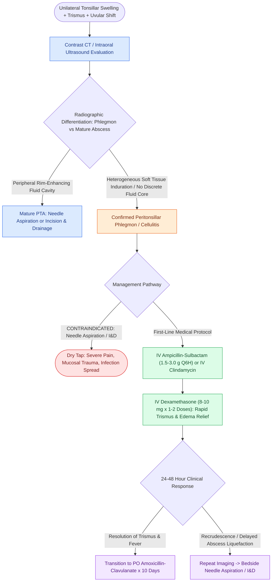

# Peritonsillar phlegmon is managed with intravenous ampicillin-sulbactam and corticosteroids without operative incisional drainage

## Active Recall

> [!question]- Why is attempted surgical incision and drainage contraindicated in early peritonsillar phlegmon?
> *Answer / Clinical Rationale*: In a phlegmon, the peritonsillar space contains diffuse, inflamed, non-liquefied fibrovascular tissue without a coalescent fluid pocket. Surgical incision results in a "dry tap," causing intense patient pain, mucosal bleeding, and potential tracking of infection into adjacent fascial planes without providing any drainage benefit.

> [!question]- What radiographic features on contrast-enhanced neck CT distinguish peritonsillar phlegmon from peritonsillar abscess?
> *Answer / Clinical Rationale*: Peritonsillar phlegmon demonstrates ill-defined soft-tissue enlargement, fat stranding, and heterogeneous mucosal enhancement without a discrete low-attenuation fluid cavity. In contrast, an abscess exhibits a well-defined central hypodense fluid core surrounded by a distinct, hyperemic rim of peripheral contrast enhancement.

## Core Clinical & Mechanistic Principles
Peritonsillar cellulitis, or **peritonsillar phlegmon**, represents an early, non-suppurative inflammatory induration of the peritonsillar space before coalescence into a drainable, encapsulated fluid collection. Clinically, patients present identically to those with [[Peritonsillar abscess needle aspiration and incision and drainage require superior pole local anesthetic and landmark-guided needle guard protection|peritonsillar abscess (PTA)]] with unilateral sore throat, odynophagia, [[The parapharyngeal space is an inverted pyramid connecting peritonsillar, masticator, parotid, and retropharyngeal spaces|trismus]], ipsilateral tonsillar hypertrophy, and palatal fullness. However, palpation reveals a firm, non-fluctuant inflammatory mass without central softening.

Contrast-enhanced CT of the neck or intraoral ultrasound differentiates phlegmon (diffuse, non-enhancing or heterogeneous soft-tissue induration without rim enhancement) from a true mature abscess (hypodense fluid center with peripheral rim enhancement). Attempted needle aspiration or incisional drainage of a phlegmon yields only blood and inflammatory seroma (a "dry tap"), causing unnecessary procedural pain, bleeding, and mucosal trauma without clinical benefit. First-line management consists of targeted intravenous antimicrobial coverage and high-dose corticosteroids.

### Medical Protocol & Surveillance Criteria
1. **Targeted Intravenous Antimicrobial Coverage**:
   - **Ampicillin-sulbactam ($1.5\text{ to }3.0\text{ g}$ IV q6h)**: First-line coverage against polymicrobial flora, including *Streptococcus pyogenes* (Group A Strep), *Streptococcus anginosus* group, *Staphylococcus aureus*, and oral anaerobes (*Fusobacterium necrophorum*, *Prevotella*).
   - In severe penicillin allergy: **Clindamycin ($600\text{ to }900\text{ mg}$ IV q8h)** or **Moxifloxacin ($400\text{ mg}$ IV daily)** plus vancomycin if MRSA is suspected.
2. **Corticosteroid Anti-Inflammatory Therapy**:
   - **Dexamethasone ($8\text{ to }10\text{ mg}$ IV single dose or daily $\times 1\text{--}2$ doses)**: Dramatically reduces palatal and pharyngeal edema, relieves trismus within 4 to 8 hours, and accelerates return of oral swallowing.
3. **Clinical Monitoring & Progression Thresholds**:
   - Monitor for resolution of fever, pain, and trismus over 24–48 hours. Lack of clinical improvement warrants repeat cross-sectional imaging to rule out interval maturation into a drainable abscess or descending parapharyngeal space extension.

## References
1. Christian, J.M., Felts, C.B., Beckman, N.A., et al. (2020). Deep Neck and Odontogenic Infections. In Flint, P.W., et al. (Eds.), *Cummings Otolaryngology Head and Neck Surgery* 7e (pp. 141-154). Philadelphia, PA: Elsevier.
2. Jeyakumar, A., Miller, S., Mitchell, R.B. (2013). Adenotonsillar Disease in Children. In Johnson, J.J., Rosen, C.A. (Eds.), *Bailey’s Head and Neck Surgery-Otolaryngology* 5e (pp. 1430-1444). Baltimore, MD: Lippincott Williams & Wilkins.
3. Galioto, N.J. (2017). Peritonsillar Abscess. *Am Fam Physician*, 95(8):501-506.

## Connected Concepts & Graph Traversal
- **Physiological Basis**: [[Pediatric acute bacterial tonsillitis is differentiated from viral pharyngitis using modified Centor criteria|Pediatric Acute Bacterial Tonsillitis]]
- **Procedural Counterpart**: [[Peritonsillar abscess needle aspiration and incision and drainage require superior pole local anesthetic and landmark-guided needle guard protection|PTA Needle Aspiration & I&D]]
- **Refractory Operative Rescue**: [[Quinsy tonsillectomy provides immediate abscess drainage and definitive tonsillar extirpation for refractory peritonsillar infection|Quinsy Tonsillectomy]]
- **Deep Space Infection**: [[The parapharyngeal space is an inverted pyramid connecting peritonsillar, masticator, parotid, and retropharyngeal spaces|Parapharyngeal Space Spread]]
- **Antibiotic Regimens**: [[Empiric antimicrobial therapy for deep neck space infections targets polymicrobial oral flora and MRSA|Deep Neck Space Antibiotics]]
