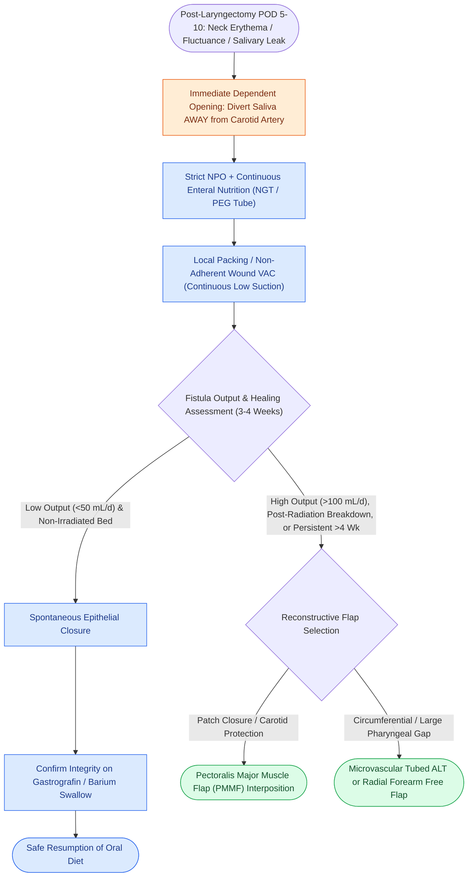

# Pharyngocutaneous fistula is managed with wound care, nutritional support, and surgical flap closure

## Active Recall

> [!question]- What is the most catastrophic risk associated with a persistent pharyngocutaneous fistula?
> *Answer / Clinical Rationale*: **Carotid blowout syndrome**, caused by salivary enzyme digestion and infection of the exposed carotid arterial wall.

> [!question]- What is the first-line management protocol for a low-volume postoperative pharyngocutaneous fistula?
> *Answer / Clinical Rationale*: **Strict NPO status**, enteral tube feeding, **dependent drainage away from the carotid artery**, and local compressive wound care.

## Core Clinical & Mechanistic Principles
**Pharyngocutaneous Fistula (PCF)** is the most common major complication following [[Total laryngectomy achieves en bloc laryngeal resection with permanent end-stoma|total laryngectomy]], occurring when saliva leaks through the neopharyngeal suture line into the neck tissues:
- **Clinical Presentation**: Spiking fevers, erythema, edema, and fluctuance in the lower neck around POD 5–10, followed by drainage of saliva and mucus through the skin incision or drain site.
- **Catastrophic Risk**: Salivary bathing of the carotid artery leads to adventitial digestion, pseudoaneurysm, and **acute carotid blowout**.
- **Stepwise Management Protocol**:
  1. **Immediate Divergence & Suction**: Open dependent skin to direct saliva away from the carotid artery; place continuous suction drain.
  2. **NPO & Nutrition**: Stop oral intake immediately; maintain enteral nutrition via Dobhoff nasogastric tube or PEG; optimize albumin/prealbumin.
  3. **Wound Care & Compression**: Local wound packing, negative pressure wound therapy (wound VAC with non-adherent contact layer away from vessels).
  4. **Surgical Reconstruction**: Fistulas that fail to close within 3–4 weeks or large irradiated defects require surgical debridement and vascularized tissue coverage (**Pectoralis Major, ALT, or [[The radial forearm free flap provides thin, pliable fasciocutaneous tissue for oral and pharyngeal defects|RFFF]] flap**).

### Surgical Technique & Critical Safety Checks
- **Timing of Oral Intake Resumption**: Perform a Modified Barium Swallow (MBS) / gastrografin swallow study at 10–14 days postoperatively before initiating oral feeds in irradiated patients.

## Connected Concepts & Graph Traversal
- **Pectoralis Flap Reinforcement**: [[Pectoralis major muscle flap reinforcement prevents pharyngocutaneous fistula in salvage laryngectomy|Pectoralis Major Myocutaneous Flap]]
- **Carotid Blowout Emergency**: [[Carotid blowout syndrome is classified into threatened, impending, and acute hemorrhage|Carotid Blowout Classification & Staging]]
- **Inverting Neopharyngeal Suture**: [[Primary pharyngeal closure after total laryngectomy utilizes an inverting Connell technique|Connell Neopharyngeal Closure]]
- **Total Laryngectomy Standards**: [[Total laryngectomy achieves en bloc laryngeal resection with permanent end-stoma|Total Laryngectomy Principles]]
- **Circumferential Pharyngeal Reconstruction**: [[Circumferential laryngopharyngectomy requires tubed microvascular or visceral flap reconstruction|Circumferential Pharyngectomy Reconstruction]]
- **Thin Pliable Free Flap Donor**: [[The radial forearm free flap provides thin, pliable fasciocutaneous tissue for oral and pharyngeal defects|Radial Forearm Free Flap]]
- **Vascularized Coverage for Recurrence**: [[Stomal recurrence after total laryngectomy is staged by the Sisson classification and requires mediastinal resection with vascularized tissue coverage|Stomal Recurrence (Sisson Classification)]]
